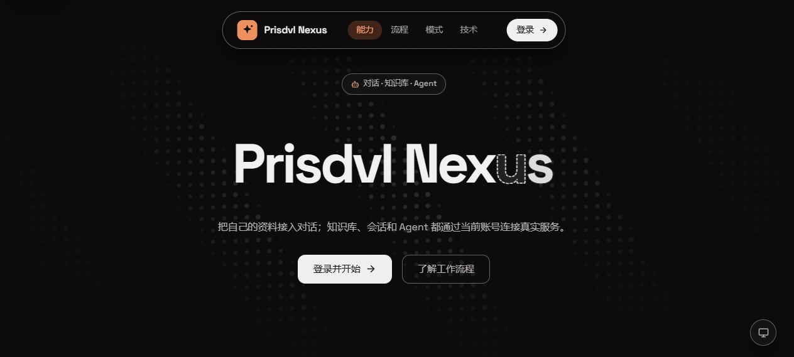
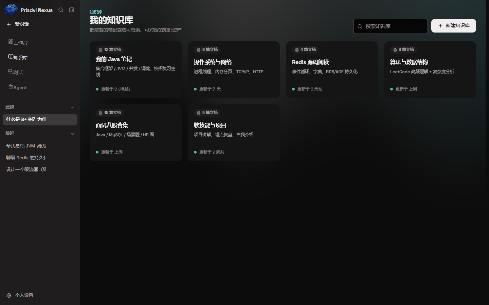
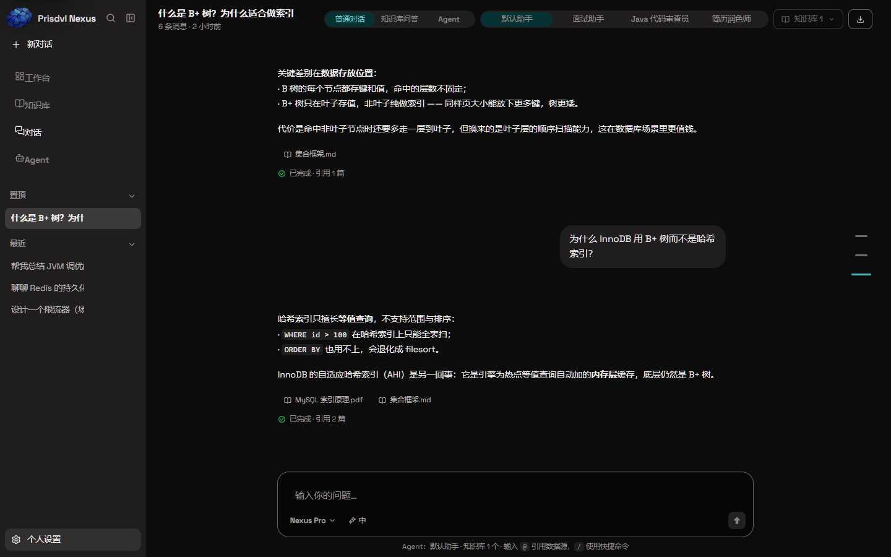
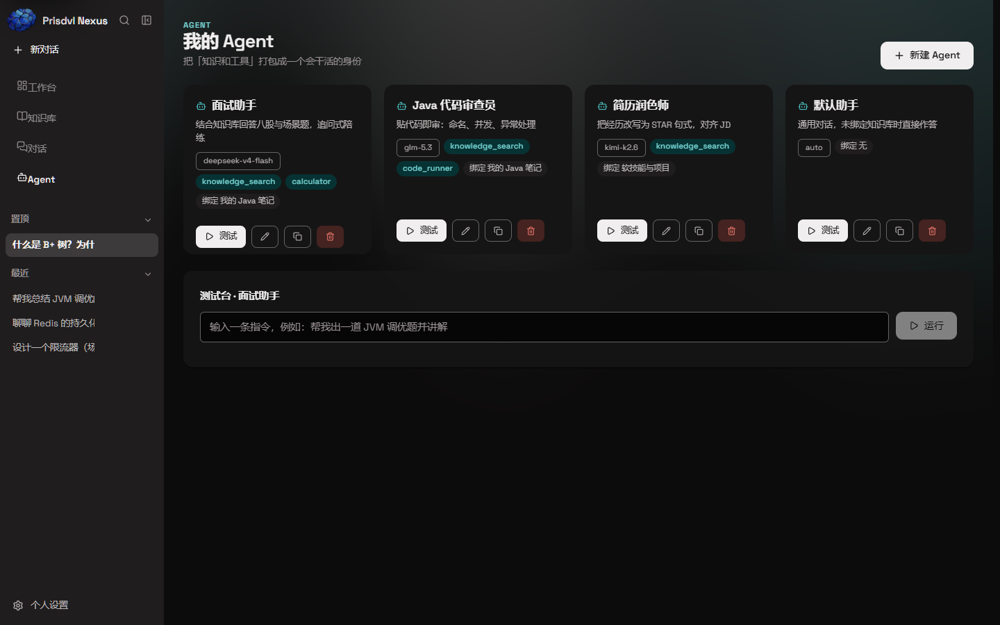

# Prisdvl Nexus

**A Self-Hosted, Multi-User AI Knowledge Base & Agent Platform**
多用户自托管 AI 知识库与 Agent 平台 —— 文档导入、混合检索、带引用的 RAG，以及可配置、权限受控的 Agent。

[](.github/workflows/ci.yml)


Prisdvl Nexus 是一个可以**完整跑起来**的多用户知识平台：每个用户拥有独立工作区与知识库，导入自己的文档后，
系统完成解析 → 结构化切片 → Embedding → **Elasticsearch BM25 + pgvector 混合检索（RRF 融合）** →
带引用的 RAG 回答；再通过基于 **Spring AI Tool Calling** 的可配置 Agent，把检索、问答等能力以工具形式暴露给模型，
工具调用过程实时可见、随消息落库，并通过进程内 **MCP（JSON-RPC）** 端点开放给外部客户端。

> 形态：模块化单体（4 个 Maven 模块）+ React 19 单页应用；一条 `docker compose up -d` 起 7 个服务得到完整系统。

---

## 1. Screenshots / 界面预览

> 以下为 **2026-10-14 用当前 React 19 代码实截**的界面（1440×900，内置 mock 数据，
> `VITE_USE_MOCK=true` 的 dev server；非真实模型/真实用户数据）。历史界面（Vue 版）见
> [docs/archive/screenshots/current/](docs/archive/screenshots/current/)（仅作演进记录）。









---

## 2. Why / 核心价值

| 问题 | Prisdvl Nexus 的能力 |
| --- | --- |
| 通用大模型不知道团队/个人文档里写了什么 | **RAG**：导入 MD / TXT / PDF / DOCX / ZIP / Obsidian Vault，结构化切分 + 向量 + BM25 混合检索 + LLM 重排 |
| 模型编造文档里不存在的内容 | **检索前置 + 强制引用**；RAG 路径零命中时**不调用模型**，直接返回固定文案 |
| 文档多、重复导入慢且贵 | **SHA-256 增量同步**：未变更跳过、变更重建 |
| 多个知识库要一起查 | **多库并行检索**：虚拟线程扇出 → 按输入顺序装配 → 跨库 RRF → 全局重排；单库失败被点名且不拖垮其它库 |
| 希望模型"动手做事"而不只是答题 | **Tool Calling + Agent**：配置化 Agent、工具白名单、用户级启停、执行轨迹落库、流式可随时停止；并经 **MCP** 对外开放 |

三个值得展开的技术取舍（不是 PPT，是有测试钉住的实现）：

1. **混合检索怎么融** —— ES 的 BM25 名次与 pgvector 余弦相似度不可比，用 **RRF（Reciprocal Rank Fusion，k=60）**融合名次而非加权求和，融合后再做一次 LLM 重排。
2. **多库检索怎么做** —— 虚拟线程扇出 + **按输入顺序（非完成顺序）装配** + 逐库失败隔离；检索事件要推 SSE 帧，任务内绝不并发写监听器。
3. **零命中为什么不调模型** —— 产品语义而非性能问题：没检索到还让模型自由发挥就是幻觉的开始。该规则**只对 RAG 路径成立**；Agent 模式下检索是工具，零命中变成一条工具观测。详见 [docs/rag.md](docs/rag.md)。

---

## 3. Quick Start / 快速开始

### 方式一：Docker Compose（推荐，得到完整系统）

前置：JDK 21（宿主机打 jar）、Docker Desktop；两个模型 API Key（对话网关 + 阿里云百炼嵌入）。

```bash
# 1) 宿主机打出 fat jar（后端镜像只运行、不构建）
mvn -B package -DskipTests

# 2) 配置必填变量（共 3 个，缺任一个 compose 都会拒绝启动）
cd deploy
cp .env.example .env
#   编辑 .env：JWT_SECRET、AI_CHAT_API_KEY、AI_EMBEDDING_API_KEY

# 3) 构建并起整栈（7 个服务）
docker compose build
docker compose up -d
docker compose ps                 # 等到全部 (healthy)
```

打开 http://localhost:8088 ，注册账号（**用户名 / 密码 / 邮箱**均为必填；默认 console 邮件通道下验证码在 backend 日志里）。

第一次让知识可检索需要走完：**新建知识库 → 导入文档 → 向量化 → 建索引**，然后即可在对话页发起带引用的问答。

- 嵌入模型：云端 **阿里云百炼 `text-embedding-v4`（1024 维）**，在 [百炼控制台](https://bailian.console.aliyun.com/) 开通并把 API-KEY 填入 `AI_EMBEDDING_API_KEY`。**不需要本地拉取任何模型**（早期版本的 Ollama 方案已移除）。
- 对话模型：任意 OpenAI 兼容网关，默认 `AI_CHAT_BASE_URL` / `AI_CHAT_MODEL` 可换成 DeepSeek 官方等。
- 完整环境变量、端口、持久化、故障排查见 [docs/deployment.md](docs/deployment.md)。

### 方式二：本地开发

```bash
# 后端（仓库根目录，JDK 21 + Maven 3.9+）
mvn -B clean package -DskipTests
java -jar nexus-app/target/nexus-app-0.0.1-SNAPSHOT.jar --spring.profiles.active=standalone
#   standalone = H2 内存库 + 检索降级为 SQL 关键词匹配，零外部依赖，重启清空

# 前端（另开终端；Node 20+）
cd frontend
npm ci
npm run dev        # http://localhost:5175 ，/api 由 Vite 代理到本机后端 8080
```

需要真实 MySQL/pgvector/ES 的开发形态：`cd deploy && docker compose up -d mysql postgres redis elasticsearch rabbitmq`，
后端用 `--spring.profiles.active=local` 启动。详见 [docs/deployment.md](docs/deployment.md) §1。

---

## 4. Architecture / 系统架构

```
浏览器 ──http://localhost:8088──► [frontend] nginx（SPA + /api、/mcp 反代；SSE 不缓冲）
                                         │ 容器网络
                                         ▼
                    nexus-app（Spring Boot 4.1 / JDK 21）
                    auth · user · knowledge · chat · agent · tool · mcp
                                         │
              nexus-ai（ChatClient / ToolCallingManager / Agent Runtime /
                       Retriever 策略族 / Embedding / Rerank）
                                         │
              nexus-knowledge（解析 / 切片 / 向量库 / ES 索引 /
                              检索 / 引用 / 多库扇出）
                                         │
                    nexus-common（Result / ErrorCode / 异常 / 工具）

基础设施：MySQL 8.4（业务库）· PostgreSQL 18 + pgvector（向量）· Elasticsearch 9.4 + IK（BM25）
          Redis 8（限流/配额/会话）· RabbitMQ 4（异步导入 + DLQ）
```

模块依赖严格线性、编译期强制：`nexus-app → nexus-knowledge → nexus-ai → nexus-common`，无环。
MCP 端点留在 nexus-app 进程内复用鉴权与 Spring 上下文，**不存在独立的 nexus-mcp-server 模块**。
为什么是模块化单体而不是微服务，见 [docs/architecture.md](docs/architecture.md)。

### 核心链路

- **知识导入**：Parser 分派（MD/TXT 直读、PDF 走 PDFBox、DOCX 走 POI、ZIP/Vault 安全解包）→ 标题感知切片 → Embedding 写 pgvector（HNSW，`vector(1024)`）；RabbitMQ 异步导入带 DLX/DLQ，`nexus.import.mode=sync` 可回退。
- **混合检索**：ES BM25（IK 分词、字段加权）与 pgvector 向量各取名次 → RRF 融合 → LLM 重排（5s 超时降级）；元数据过滤下推到 ES `filter` / SQL `WHERE`。
- **多库检索**：单库在调用线程直跑，多库才虚拟线程扇出；扇出总超时 `nexus.retrieval.fanout-timeout`（默认 10s）；部分失败返回部分结果并显式点名，全部失败抛原异常。
- **Agent**：`AgentDefinition`（配置）/ `AgentRuntime`（一次执行）/ `AgentService`（持久化门面）三分；工具循环由 Spring AI `ToolCallingManager` 驱动，不是手写 while。
- **工具权限**：用户启用集合 ∩ Agent 白名单双层裁剪；`READ` 直接执行，`WRITE`/`DANGEROUS` 必须人工确认（`once`/`always`/`deny`，`always` 落库且可撤销）；权限存 `ai_tool_registry`，执行前读库判定；MCP 的 `tools/list`、`tools/call` 走同一启停判定，停用工具不可见也不可调（JSON-RPC `-32003` / 业务码 `5004`）。
- **人工审批闭环**：`POST /api/agent/runs` 起运行 → `WAITING_APPROVAL` 挂起（`UPDATE … WHERE status=?` 原子转换）→ SSE `approval_required` → `POST /api/agent/runs/{runId}/approval` 恢复**同一次**调用；拒绝作为 observation 回灌模型（不是失败），工具调用与运行轨迹全量落库且入参脱敏。
- **流式（SSE）**：检索事件先于第一个字到达；支持随时停止；取消注册表仅在内存（多实例/重启失效，属已知限制）。

---

## 5. Capabilities / 能力清单

> 状态：✅ 已实现且有测试 · ◐ 部分实现（边界见 §8）

| 域 | 能力 | 状态 |
| --- | --- | --- |
| 知识导入 | MD / TXT / PDF（PDFBox 3）/ DOCX（POI 5）/ ZIP / Obsidian Vault；SHA-256 增量同步；RabbitMQ 异步导入 + DLQ；ZIP Slip / Zip Bomb 防护 | ✅ |
| 切片与索引 | 标题感知切分、Token 计数、切片的向量/索引双状态可查；ES 索引按知识库隔离 | ✅ |
| 检索 | pgvector HNSW 向量、ES+IK 关键词、RRF 混合、LLM 重排（超时降级）、元数据过滤下推 | ✅ |
| RAG | 同步 + SSE 流式问答、`[n]` 引用解析、引用随消息落库、多知识库并行检索与失败点名 | ✅ |
| Agent | 配置化（落库 `agent` 表）、工具白名单、温度、回答策略（`KB_PREFERRED` / `KB_ONLY`）、多知识库绑定、Tool Trace 落库、流式 + 停止；**运行状态机 + 工具人工审批（`READ`/`WRITE`/`DANGEROUS` + `once`/`always`/`deny` + 授权撤销 + 调用审计）** | ✅ |
| MCP | 进程内 `POST /mcp`（initialize / ping / tools/list / tools/call），JWT 鉴权，遵守用户工具启停 | ✅ |
| 工作流 | 可编排 DAG：8 种节点（START / KNOWLEDGE_RETRIEVAL / LLM / AGENT / IF_ELSE / TEMPLATE / **HUMAN_APPROVAL** / END）、草稿与发布两套版本（每次保存生成版本快照）、元信息更新（`PUT /api/workflows/{id}`，局部更新且**不产生新版本**）、**预置模板**（`GET /api/workflows/presets` 列出 3 个 + `POST .../presets/{code}` 实例化为草稿）、静态图校验（唯一 START、无环、START 可达、变量引用受限）、`debug` 跑草稿 / `runs` 跑已发布、**人工审批**（运行挂在 `HUMAN_APPROVAL` 上 → `WAITING_APPROVAL` → `POST .../approval` 同意则续跑、拒绝则失败）、**从失败节点续跑**（`POST .../retry`，已成功节点输出回灌）、**运行历史 `GET /api/workflow-runs?workflowId=`（倒序分页，失败运行也能找回）**、节点轨迹落库（成功与失败都留痕）；**前端设计器已接真实 API**（列表 / 模板新建 / 画布增删节点与连线 / 逐类型配置 / 保存 / 校验 / 发布 / 运行 / 轨迹 / 运行历史 / 审批） | ✅ 后端 25 用例全绿；前端 `npm run build` 通过；**8 种节点全部有真机证据**：浏览器 E2E **41/41**（START / TEMPLATE / LLM / HUMAN_APPROVAL）+ 真实基础设施上的 API 闭环（`KNOWLEDGE_RETRIEVAL` 命中 3 条并排序正确、`AGENT` 真实模型 2496 ms、`IF_ELSE` 双分支各跑一次且对侧 SKIPPED）（见 §8） |
| 用户与安全 | 注册（邮箱必填）/ 登录 / JWT（HS256）/ BCrypt / RBAC；**Refresh Token 轮转 + 服务端 logout（设备会话）**；邮箱验证 / 重置密码；令牌版本吊销、登录冻结、限流、每日配额 | ✅ |
| 可观测 | 自建计数器 + Micrometer（`/actuator/metrics`）；无 Prometheus / 时间序列 | ◐ |
| 部署 | 7 服务 docker compose、nginx 唯一对外入口、健康检查、数据卷持久化 | ✅ |
| 前端 | React 19 + Vite + TS：落地页 / 登录注册 / 知识库与文档 / 对话（RAG + Agent）/ Agent 管理 / **工作流设计器** / 账号设置；主题与引导 | ✅ |

---

## 6. Tech Stack & Modules / 技术栈与模块

| 层 | 选型（以 `pom.xml` / `frontend/package.json` 为准） |
| --- | --- |
| 语言 / 构建 | Java 21、Maven 3.9+（4 模块 reactor） |
| 框架 | Spring Boot 4.1.1、Spring AI 2.0.1（BOM） |
| 业务库 | MySQL 8.4 + MyBatis-Plus 3.5.17 + Flyway（迁移 V1–V23，无 V11；V22 = 工具授权与 Agent 运行，V23 = 工作流定义与运行） |
| 向量库 | PostgreSQL 18 + pgvector 0.8.6（HNSW，`vector(1024)`） |
| 关键词检索 | Elasticsearch 9.4.5 + analysis-ik 9.4.5 |
| 缓存 / 队列 | Redis 8.10、RabbitMQ 4.3 |
| 模型 | 对话：OpenAI 兼容网关（可换）；嵌入：阿里云百炼 `text-embedding-v4`（1024 维） |
| 文档解析 | PDFBox 3.0.7、Apache POI 5.5.1 |
| 前端 | React 19.3、Vite 8.3、TypeScript 6、React Router 8（目录 `frontend/`） |
| 部署 | Docker / docker compose、nginx 1.29 |

```
prisdvl-nexus/
├── nexus-common/        通用 Result/ErrorCode/异常/工具（无 Web 依赖）
├── nexus-ai/            模型接入、ToolCallingManager、Agent Runtime、检索策略、Embedding
├── nexus-knowledge/     解析/切片/向量库/ES/检索/引用/多库扇出
├── nexus-app/           唯一可运行模块：全部 Controller 与装配（auth…mcp）
├── frontend/            React 19 前端（src/pages、src/components、src/lib…）
│   ├── scripts/         qa-*.mjs 等 QA/截图脚本（复用系统 Edge，不下载浏览器）
│   ├── nginx.conf       生产入口（SPA fallback、/api 与 /mcp 反代、SSE 不缓冲）
│   └── Dockerfile       node:22-alpine 构建 → nginx:1.29-alpine 运行
├── deploy/              docker-compose.yml（7 服务）、.env.example、backend/ES Dockerfile
├── scripts/             smoke.ps1、cleanup-test-data.ps1、seed-demo.mjs、demo-vault.zip
└── docs/                架构 / RAG / Agent / 安全 / 部署 / 数据库 / API / 决策（archive/ 为历史记录）
```

---

## 7. Security / 安全边界

已实现（机制与证据见 [docs/security.md](docs/security.md)）：

- JWT HS256，claims 含 `sub/username/roles/ver/jti/iss/iat/exp`；限定 HS256 防算法混淆；校验 `iss` 与令牌版本。
- BCrypt 密码哈希；`token_version` 改密即吊销全部已签发 access token。
- **Refresh Token 轮转 + 设备会话**（`sys_user_session`，迁移 V21）：`POST /api/auth/refresh` 轮换、`POST /api/auth/logout` 撤销当前设备会话；access JWT 本身仍靠 exp/版本号失效。
- 登录失败冻结（按用户名，fail-open）、固定窗口限流（`Retry-After`，fail-open）、每日请求 + token 双配额（fail-closed）。
- 用户隔离把 `user_id` 写进 SQL；越权返回 404/业务码而非 403；上传防 ZIP Slip（整批中止）与 Zip Bomb（三层解压后上限）。
- compose 对 `JWT_SECRET` / `AI_CHAT_API_KEY` / `AI_EMBEDDING_API_KEY` 用 `${VAR:?…}` fail-closed；只有 nginx 端口对全网开放，其余端口绑 `127.0.0.1`。

**明确未实现 / 已知边界**（不要误以为有）：

- Token 存 `localStorage`，存在 XSS 暴露面；无 HttpOnly Cookie 方案。
- 无 TLS 终结、无安全响应头（CSP/HSTS 等）、无 OAuth2/OIDC、无 CSRF token（纯 Token API）、无字段级加密 / KMS。
- Redis 不可用时限流/冻结降级为进程内实现（fail-open），多实例下限流不一致；`allkeys-lru` 也可能淘汰计数键。
- 停用账号不会立即吊销已签发 access token（软删除会立即失效，两者不同）。
- ES 在开发编排中关闭安全模块、仅绑回环；compose 是**单机**部署，未验证多机/高可用。

---

## 8. Testing / 测试与验证

**本仓库当前一次实测**（命令、环境、日期如下；不以历史数字充当本次结果）：

| 口径 | 结果 |
| --- | --- |
| 后端 `mvn -B test`（默认，无 LIVE 开关） | **883** 个用例：**0** 失败 / **0** 错误 / **35** 跳过，BUILD SUCCESS（2026-10-20 全仓实测，**分档跑与全量跑结论一致**：common 19 / ai 82 / knowledge 174 / app 608；上一轮 2026-10-17/18 为 833 例 / 33 跳过、app 564——app 较其上轮 541 +23，其中 +11 恢复提交新增的 workflow 测试、+3 运行历史、+2 元信息更新、+5 人工审批与失败续跑、+1 预置模板、+1 变量校验回归） |
| 前端 `npm run build`（`tsc --noEmit && vite build`） | exit 0（2026-10-17；仅有既存的 chunk 体积警告） |
| 后端 **LIVE 套件**（需 Docker；部分套件自起容器，部分连真实模型） | **33 例全部实测通过**（2026-10-18，与默认套件分开跑）：<br>· 只需 Docker **24 例**：`RedisEmailCodeStoreLiveTest` 9 / `MySqlJsonRoundTripTest` 2 / `LiveVectorStoreTest` 4（真实 pgvector + HNSW 排序）/ `LiveChunkIndexTest` 9（真实 ES，直接调 `_analyze` 验证 IK 分词）<br>· 需真实模型 Key **9 例**：`LiveModelCallTest` 2 / `ChatStreamLiveTest` 3（真实 SSE 流式）/ `MultiTurnMemoryTest` 1 / `AgentLoopTest` 1（真实工具循环，15.5 s）/ `LiveEmbeddingTest` 2（百炼 `text-embedding-v4`，1024 维、中文语义排序正确，12.8 s）<br>**默认套件的跳过清单现已增至 35 例**（2026-10-20 实测：只需 Docker **25** + 需模型 Key **10**）——`LiveChunkIndexTest` 现为 10 例（原 9），另增 `EmbeddingByokLiveTest` 1 例（`BYOK_LIVE_EMBEDDING_KEY`）；**这两例未做 LIVE 复跑**（2026-10-20 未连 Docker），上表仍是 2026-10-18 那次 33 例的实测结论 |
| 工作流端到端（**真实基础设施**，`local` profile） | 2026-10-18：compose 起 MySQL / Redis / pgvector / ES / RabbitMQ → 建知识库 → 上传 md（3 个切片）→ 建索引（`indexed=3/3`，562 ms）→ 工作流 `START → KNOWLEDGE_RETRIEVAL(bm25) → TEMPLATE → END` → `validate` **valid=true** → `publish` 200 → `run` **SUCCEEDED**，检索**命中 3 条**且排序正确（「缓存穿透」得分 2.329 排第一，「缓存雪崩 / 缓存击穿」各 0.401，中文经 IK 分词）。这条链路此前从未跑通过，本轮顺带修掉一个真 bug（见下）。<br>同日另一条：`AGENT` 节点 **建 Agent → 发布 → 工作流 `START → AGENT → TEMPLATE → END` → `run` SUCCEEDED**，agent 节点耗时 **2496 ms**（真实模型调用）、`usedTools=true`，回答 174 字并自带「以下内容不是来自你的笔记」的来源声明。<br>再一条（standalone 即可，无需 Docker）：`IF_ELSE` 分支路由 `START → IF_ELSE → true/false 两个 TEMPLATE → END`，`flag=yes` 时 `branch=True, yes=SUCCEEDED, no=SKIPPED`；`flag=no` 时反之——**运行时的分支选择（activeEdges）被真正验证**。至此 **8 种节点全部有真机证据** |
| 工作流端到端（真浏览器 + 真后端） | `npm run verify:workflow` → **ALL OK 41/41**（2026-10-18；`--spring.profiles.active=standalone` + `npm run dev`，未启 Docker、未设 LIVE 变量、未连外部模型；退出码契约 0/1/2 与 `EXIT_CODE` 日志同时生效）。覆盖：创建/种子图、节点增删与连线（面板 8 类含 `HUMAN_APPROVAL`）、保存、校验、发布、运行、节点轨迹、运行历史（空态/累积/点行切换/浏览器内翻页）、失败运行（502+4006 落库与轨迹）、**人工审批（跑到闸门挂起成「待审批」→ 点「同意并继续」→ 运行继续至成功）**、**失败续跑（对失败运行点「重试运行」→ 新建一条 `RETRY` 运行，同样 502/4006）**。浏览器这一轮覆盖 START / TEMPLATE / LLM / HUMAN_APPROVAL；`KNOWLEDGE_RETRIEVAL` 与 `AGENT` 由上一条（真实基础设施）覆盖 |
| compose 配置校验 | `docker compose config --quiet` 通过（缺 3 个必填变量时拒绝启动，2026-10-14 复验） |
| 前端其他 QA | 除 `verify-workflow.mjs` 外的 `verify:*` / `qa-*.mjs`：**NOT VERIFIED**（截图见 §1） |

默认 `mvn test` 跳过的用例是需要真实基础设施 / 真实模型的 **LIVE 测试**（Testcontainers 自起 ES/PG 的检索类、
连真实模型的嵌入/对话类），由环境变量门控（如 `AI_SEARCH_LIVE=true`、`AI_VECTOR_LIVE=true`、
`AI_EMBEDDING_LIVE=true`、或非空的 `AI_CHAT_API_KEY`）。**只要 shell 里设了 `AI_CHAT_API_KEY`（哪怕是占位值），对应 LIVE 套件就会执行**；无有效密钥时会失败——这不是默认 CI 口径。GitHub Actions 故意不注入任何模型密钥。

那 35 个跳过项里已有 **33 例**落地（2026-10-18 那次 LIVE 复跑全部通过）：**24 例**只依赖 Docker（Redis / MySQL / pgvector / ES+IK，各自用 Testcontainers 起容器），
**9 例**用 `deploy/.env` 的真实 Key 跑通（`LiveModelCallTest` 2 / `ChatStreamLiveTest` 3 /
`MultiTurnMemoryTest` 1 / `AgentLoopTest` 1 / `LiveEmbeddingTest` 2）。2026-10-20 默认套件实测跳过 **35** 例，
即 **25 例**只需 Docker + **10 例**需模型 Key；比 33 多出的 2 例是 `LiveChunkIndexTest` 新增的 1 例
与 `EmbeddingByokLiveTest` 1 例（`BYOK_LIVE_EMBEDDING_KEY`），**尚未做 LIVE 复跑**。
跑 LIVE 套件要单独指定 `-Dtest=...`，否则会把默认 608 例一起再跑一遍。

> **`ollama:bge-m3` 只是已弃用的历史方案**：生产/local 早已是百炼 `text-embedding-v4`（1024 维），
> 只有 test profile 还钉着旧的 ollama 角色。现已把 test profile 也改成
> `bailian:text-embedding-v4`（假 Key 兜底，构建不发请求；真实调用由 `LiveEmbeddingTest` 用真 Key 守卫），
> `KnowledgeBaseFlowTest` 的「建库即冻结」断言也同步改为 bailian。代码里的 `OLLAMA` 协议支持仍然保留
> （`AiModelRegistry` / `EmbeddingClientFactory`），只是不再是默认选型、也不再被测试依赖——
> 想换回本地模型只改 yaml 即可。`LiveEmbeddingTest` 2 例因此转绿（12.8 s，1024 维、中文语义排序正确）。

> ⚠️ **别用 `-Dsurefire.failIfNoSpecifiedTests=false` 兜底**：它会把「`-Dtest` 没匹配到任何类」
> 变成静默的 BUILD SUCCESS。第一次我用 `-Dtest=A+B+C`（`+` 不是 surefire 的分隔符）跑出过
> 「零个测试却 EXIT=0」，改用逗号分隔并去掉该开关后才是真实结果。

> 2026-10-18 跑 LIVE 时发现一处**测试漂移**并已修：`MySqlJsonRoundTripTest`、`ChatStreamLiveTest`、
> `AgentLoopTest` 的注册请求只发 `username + password`，而注册接口自 `cb5ae96` 起强制要求 `email`，
> 所以这些用例以前即使开了 flag 也必然 400。三处都已补上 email，断言与其含义未改。
>
> **验证程度不同，不能一概而论**：`MySqlJsonRoundTripTest` 有 Docker 环境，修完 2/2 真的过了；
> 另两个门控在 `AI_CHAT_API_KEY`，没有真 Key 就只能确认「失败点已从注册 400 后移到模型层」——
> `AgentLoopTest` 现在注册与登录都通过，卡在 `POST /api/agent/ask` 的 **503（模型不可达）**；
> `ChatStreamLiveTest` 三个用例都过了 `newSession`，卡在 SSE 事件断言（meta 需在 delta 之前、不应出现 error 事件）。
> **要跑绿仍需要真实对话 Key**，所以这两套件本次不能标注为通过。

> **2026-10-18 端到端跑工作流检索时挖出的真 bug（已修）**：`WorkflowGraphValidator.validateVariables`
> 要求变量写成 `nodes.output.<节点id>`，而运行时的 `WorkflowVariableResolver` 按 `nodes.<节点id>.output.<路径>` 解析
> —— 两者正好相反。后果是：**任何引用上游节点输出的图都无法发布**（`validate` 报「变量只能引用 input 或节点 output」，
> `publish` 随之 500），刚加的三个预置模板里的 `{{ nodes.retrieval.output.documents }}` 也全部命中此坑。
> 修法是让校验器与解析器对齐（`parts.length >= 4` 且 `parts[2] == "output"`，upstream 取 `parts[1]`）。
> 原有测试 `rejectsUnknownVariableNode` 之所以「通过」，是因为报错信息回显了原始引用串、
> `hasMessageContaining("missing")` 被巧合满足——现已改为断言「上游节点不存在」，并新增
> `acceptsValidUpstreamVariable`（修复前必抛异常）作为真正的回归用例。

```bash
# 与 CI 一致：先确保未导出 AI_CHAT_API_KEY / *_LIVE
mvn -B test                    # 默认：单元 + MockMvc/集成，LIVE 用例自动跳过
cd frontend && npm run build   # 前端类型检查 + 生产构建（tsc --noEmit && vite build）
```

> 证据分级：UNIT / INTEGRATION / E2E（真浏览器）/ LIVE（真 ES/pgvector/模型）/ REAL ENVIRONMENT（整栈）。
> 没真跑过的一律标 **NOT VERIFIED**。历史各轮验收数字保留在 [docs/deployment.md](docs/deployment.md) §8（带日期，勿与当前口径混用）。

---

## 9. Known Limitations & Roadmap / 已知限制与路线图

当前仍欠的事（完整清单与优先级见 [docs/roadmap.md](docs/roadmap.md)）：

1. **检索事件命中列表未持久化** —— 「检索到 N 个片段」卡片刷新后消失（引用列表已落库，两者不同）。
2. **安全加固** —— TLS 终结、安全响应头、Token 从 localStorage 迁移等（access JWT 仍短 TTL，refresh 已可服务端吊销）。
3. **CI 覆盖面** —— 已有最小 GitHub Actions（后端默认 `mvn test` + 前端 `npm run build` + `compose config`）；**LIVE / 真浏览器 E2E 尚未进流水线**。
4. **前端首包体积** —— `elk`（约 1.46 MB / gzip 456 KB）与主 chunk（约 1.18 MB / gzip 392 KB，2026-10-14 `npm run build`）偏大，来自 mermaid/elk 与 markdown 渲染链。
5. **取消注册表与审批等待注册表仅内存**（进程重启后 `WAITING_APPROVAL` 的运行被标为 `FAILED`，而不是被恢复）、**观测无时间序列、无物理外键、单机部署** 等工程边界。
6. **审批的两条未做边界**：`GET /api/tool-invocations`（审计数据已落库，查询接口未开）与 `POST /api/agent/runs` 自身的流式形态（`approval_required` 事件走 `/api/chat/stream` 的工具拦截点）。
7. **工作流运行是同步的；失败留痕已补齐** —— `POST /api/workflows/{id}/debug` 与 `/{id}/runs` 在一次 HTTP 内跑完整张图（`WorkflowRuntimeService:63`），所以前端没有「停止」入口（取消了也没有意义）。**原先失败运行完全不留痕**：`run()` 上的 `@Transactional` 会把已落库的运行与节点轨迹随 `BusinessException` 一起回滚（实测：失败后按 workflowId 查运行列表 `total=0`）——所以只加查询接口并不能让失败轨迹可读。现已一并修：`run()` 改为 `@Transactional(noRollbackFor = BusinessException.class)`，并新增 `GET /api/workflow-runs?workflowId=`（倒序分页）运行历史，失败运行可找回 `runId` 再读节点轨迹（回归测试 `WorkflowResourceTest.listsFailedRunSoTraceIsReadable`）。

---

## 10. Documentation / 文档索引

| 文档 | 内容 |
| --- | --- |
| [docs/deployment.md](docs/deployment.md) | 三种运行方式、compose 编排、环境变量、持久化、健康检查、故障排查（§8 为带日期的历史真机验收） |
| [docs/architecture.md](docs/architecture.md) | 分层规则、模块化单体理由、数据流 |
| [docs/rag.md](docs/rag.md) | 导入、混合检索、多库扇出、元数据过滤、零命中行为、引用 |
| [docs/agent.md](docs/agent.md) | Agent 职责、执行链路、工具白名单、温度与回答策略、流式与停止 |
| [docs/security.md](docs/security.md) | JWT / Refresh / BCrypt / 限流 / 配额 / 隔离 / 上传防护与已知边界 |
| [docs/database.md](docs/database.md) | ER 图、核心表、索引、Redis/ES 结构 |
| [docs/api.md](docs/api.md) | 统一返回、错误码、REST 与 SSE 协议（含"规划中未实现"标注） |
| [docs/roadmap.md](docs/roadmap.md) | 当前未完成待办 + Phase 0–11 历史规划（编号体系说明见文首） |
| [docs/decisions.md](docs/decisions.md) | 架构决策记录（ADR）与分阶段实测记录 |
| [docs/archive/](docs/archive/) | 旧 Vue 版前端、历史报告与截图 —— **历史记录，不是当前操作说明** |

---

## 开发约定

1. 分层不可跨越：`Controller → Service → Domain/Mapper`；Controller 不碰数据库、不直接调 LLM。
2. 每个核心模块必须有测试；测试数字只用实测值，没跑过的写 NOT VERIFIED。
3. 文档与代码同一次提交；不为"看起来高级"引入无实际价值的组件。
4. 答案必须区分来源：知识库内容 / 检索到的外部资料 / 模型自身知识 / 模型推测。
