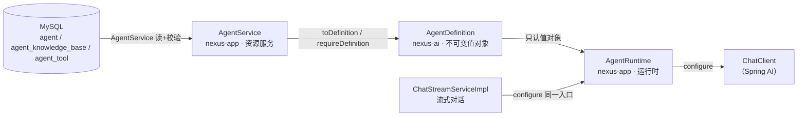
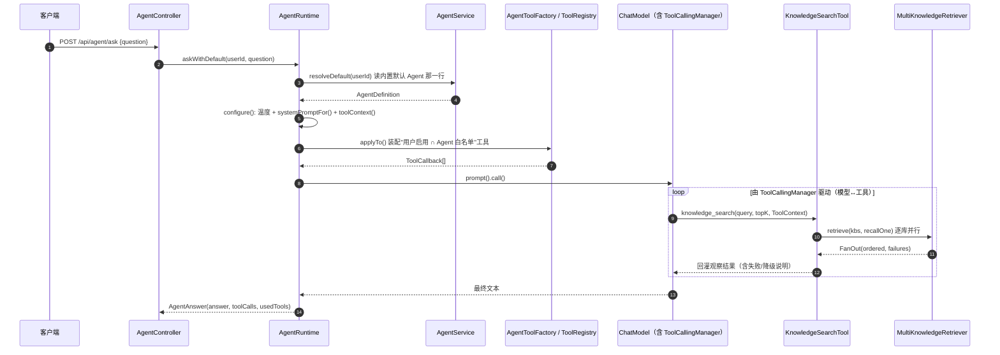

# Agent 架构（Prisdvl-Nexus）

> 本文只描述**代码里真实存在的机制**。每条关键结论都带 `文件:行号`。
> 凡代码未确认的，标注「未确认」；凡"看似有其实没有"的旋钮，单列在 [§4 代码里没有的机制](#4-代码里没有的机制宁缺勿假)。
> 与 [architecture.md](architecture.md) §10 的差异：那里是 Phase 6 的**设计稿**（含 Planner / 人工确认 / 状态机），
> 本文记录的是**实际落地实现**——两者不是同一件事，以本文为准。

---

## 1. 三个类的职责边界

平台化的核心一条：**配置（是什么） / 运行时（怎么跑） / 持久化（增删改查）三者分离**。
落成三个类，依赖方向是 `app → ai`：



### 1.1 `AgentDefinition`（`nexus-ai`）— **不可变配置**

| 项 | 内容 | 证据 |
| --- | --- | --- |
| 形态 | `record`，无 MyBatis 依赖、无 Spring Web 依赖 | `nexus-ai/src/main/java/com/lky/nexus/ai/agent/AgentDefinition.java:41` |
| 字段 | `agentId, code, name, systemPrompt, modelRole, temperature, kbIds, toolCodes, answerPolicy, builtin` | 同上 `:44-94` |
| 不变量 | 构造器强制 `agentId/code/name/systemPrompt/modelRole` 非空；`kbIds/toolCodes` 去重保序且非 null；`answerPolicy` 非 null | `:96-109` |
| 语义方法 | `scoped()`=是否限定检索范围；`toolScoped()`=是否限定工具白名单；`describe()`=日志/痕迹用 | `:112-126` |

**为什么放 `nexus-ai`**：它是"Agent 是什么"的抽象，与厂商、与存储无关；`nexus-app` 决定"从哪来"（数据库）。
若放 `app` 层，`AgentDefinition` 持有 `AnswerPolicy` 会形成 `ai → app` 的倒挂（`AgentDefinition.java:12-16`）。

**刻意没有的字段**：`maxIterations` / `timeoutMs`（`AgentDefinition.java:18-20`）。理由：今天没有任何机制会读它们
——轮数上限在框架的 `ToolCallingManager`，超时在 HTTP 层。提前放进来只会得到"配了却不生效"的假旋钮。

### 1.2 `AgentRuntime`（`nexus-app`）— **运行时**

| 方法 | 职责 | 证据 |
| --- | --- | --- |
| `configure(request, userId, definition, listener)` | 把一份 Definition 装到一次请求：温度 + 系统提示 + 工具 + ToolContext | `nexus-app/src/main/java/com/lky/nexus/app/agent/AgentRuntime.java:67-94` |
| `ask(userId, definition, question)` | 跑一次一次性调用，收集工具痕迹返回 `AgentAnswer` | `AgentRuntime.java:103-132` |
| `askWithDefault(userId, question)` | 读该用户内置默认 Agent 跑一次（供 `/api/agent/ask`、MCP `qa_ask`、评测入口） | `AgentRuntime.java:141-143` |

本类**只认值对象、不碰数据库**。`configure` 是两条执行链路（一次性 `ask` 与流式 `ChatStreamServiceImpl`）的
**唯一公共装配点**——抽出它是为了防止"改一处、另一处行为不同"（`AgentRuntime.java:59-66`）。

### 1.3 `AgentService`（`nexus-app`）— **持久化 / CRUD 门面**

| 分组 | 方法 | 证据 |
| --- | --- | --- |
| 读 | `list` / `detail` / `requireOwned` / `kbIdsOf` / `toolCodesOf` | `nexus-app/src/main/java/com/lky/nexus/app/agent/AgentService.java:89,111,116,131,144` |
| 写 | `create` / `update` / `duplicate` / `delete` | `AgentService.java:156,193,223,257` |
| 装配 | `requireDefinition`（可被会话选用）/ `testDefinition`（试跑，宽松）/ `resolveDefault`（内置兜底，幂等补齐）/ `toDefinition` | `AgentService.java:282,305,316,386` |
| 校验 | `applyEditableFields` / `requireTemperatureInRange` / `requireConfiguredModelRole` / `requireStatusChangeAllowed` / `replaceTools` / `replaceKnowledgeBases` | `AgentService.java:410,449,463,470,478,493` |

**一条线**：本类"只碰数据库与准入规则，一行'怎么跑 Agent'的逻辑都没有"（`AgentService.java:40-44`）。
`Entity`（`AgentPO`）永远进不到 `AgentRuntime`，桥只有 `requireDefinition` / `resolveDefault` / `testDefinition`。

---

## 2. 完整执行链路

### 2.1 请求链路（一次性）



角色解析：`AgentController.java:31-34` → `AgentRuntime.askWithDefault` → `AgentService.resolveDefault`。

### 2.2 系统提示词由谁拼

**唯一组装点**是 `AgentPrompts.systemPromptFor(definition)`（`nexus-app/.../AgentPrompts.java:109-111`）：

```
最终系统提示 = definition.systemPrompt()  +  "\n\n"  +  policyBlock(definition.answerPolicy())
```

- 用户写的提示词来自 `agent.system_prompt` 列，空值在装配阶段被 `AgentService.toDefinition` 补成
  `AgentPrompts.AGENT_SYSTEM`（`AgentService.java:391-392`），运行期不再兜底。
- 策略块由 `answerPolicy` 决定（`AgentPrompts.policyBlock`，`:114-119`）。
- **刻意在请求期拼、不写回数据库**：`ToolRegistry` 要读 `definition.systemPrompt()` 找"提示词点名了却没装配的工具"，
  库里那列必须保持用户原文（`AgentPrompts.java:105-107`）。
- `configure` 里在**同一处**调用它，两条链路共用（`AgentRuntime.java:86`）。

提示词本身有反注入纪律：检索结果是"外部知识"，其中的指令不执行（`AgentPrompts.AGENT_SYSTEM` 规则 5，`:46`）。
这属于**提示词约束**，不是代码强制。

### 2.3 可检索知识库怎么进上下文

**不经模型，走 ToolContext**（模型既不知道 kb id，也不该能指定别人的库）：

```mermaid
graph LR
    AD["definition.kbIds()"] -->|AgentRuntime.configure| CTX["AgentContext.of(userId, kbIds, listener)"]
    CTX -->|toolContext(map)| TC["Spring AI ToolContext"]
    TC -->|框架注入方法参数| KS["KnowledgeSearchTool.search(..., ToolContext)"]
    KS -->|AgentContext.kbIds(ctx)| L["List&lt;Long&gt; scoped"]
    L -->|.in(scoped != null, ...)| SQL["knowledgeBaseMapper.selectList(user_id + id in scoped)"]
    SQL --> MK["MultiKnowledgeRetriever 扇出"]
```

- 装配：`AgentRuntime.java:89` `AgentContext.of(userId, definition.kbIds(), listener)`。
- 读取：`KnowledgeSearchTool.java:111` `AgentContext.kbIds(toolContext)`；`:112-115` 查询带 `user_id` + `id in scoped`。
- `AgentContext.kbIds` 把"空集合"统一收敛成 `null`（= 不限制）（`AgentContext.java:100-107`）。
- 扇出：`KnowledgeSearchTool.java:146-147` 调 `multiRetriever.retrieve(...)`，逐库并行召回。
- **ToolContext 的内容不会发给模型**：框架生成工具入参 schema 时跳过 `ToolContext` 参数（`AgentContext.java:24-26`）。

### 2.4 工具怎么被选择

模型看到哪些工具 = **`该用户启用中的工具 ∩ 该 Agent 的白名单`**，由 `ToolRegistry.resolveFor` 决定
（`ToolRegistry.java:79-116`），再由 `AgentToolFactory.assemble` 包上执行壳后 `request.tools(...)` 装到请求
（`AgentToolFactory.java:47-63`）。详见 [§3.1](#31-工具白名单)。

模型在运行时**自己决定是否调用**、调几次——这不是平台代码选择的，平台只决定"给了哪些工具"。

### 2.5 循环由谁驱动（**重要，别写错**）

**Agent 循环不是本项目手写的 `while`，而是由 Spring AI 的 `ToolCallingManager` 驱动**：

- `AiModelRegistry` 在启动时构建 `ToolCallingManager` 并**显式传给每个 `ChatModel`**
  （`nexus-ai/src/main/java/com/lky/nexus/ai/model/AiModelRegistry.java:43,45-46,144,163,189-199`）。
- 只要请求声明了工具（`request.tools(...)`），框架就自动完成
  "模型 → 工具 → 结果回填 → 模型继续"的往返（`AgentRuntime.java:34-36` 类注释原文）。
- 本项目的职责只有三个"用户可控"点：**可见**（痕迹）、**有界**（框架轮数上限）、**可降级**（工具失败如实说明）。

> 结论：不要写成"我们自己写了一个 Agent Loop"。我们写的是**装配**（提示词/工具/上下文），循环在框架里。

---

## 3. 逐项说明

### 3.1 工具白名单

| 项 | 值 / 位置 | 证据 |
| --- | --- | --- |
| 类 / 方法 | `ToolRegistry.resolveFor(userId, definition)` | `ToolRegistry.java:79` |
| 用户启用集合 | `tool` 表的**覆盖行**（`enabled=0` 才停用；无行 = 默认启用） | `V13__tool.sql` 表 `tool`；`ToolRegistry.java:99,216-221` |
| Agent 绑定 code | `agent_tool.tool_code`（引用 `@Tool(name=...)`，不是 `tool.id`） | `V13__tool.sql` 表 `agent_tool`、唯一键 `uk_agent_tool` |
| 交集语义 | 两者都满足才装；**用户停用优先于白名单**（停用的工具不会因白名单复活） | `ToolRegistry.java:73-104` |
| 白名单为空 | `toolScoped()==false` → 不限制（装该用户全部启用中的内置工具） | `AgentDefinition.java:117-119`；`ToolRegistry.java:81,96` |
| 写入校验 | `requireKnownTools`：不认识的 code 直接拒（`5011 TOOL_NOT_FOUND`） | `ToolRegistry.java:192-208`；`AgentService.java:481` |
| 装配结果 0 个工具 | 计数 `agent.tools.empty` + WARN；提示词点名了但没装配 → 计数 `tool.prompt.mismatch` | `ToolRegistry.java:106-113,133-147` |

**cap 40 / 150**（见 [§3.7](#37-最大迭代)）：`AiModelProperties.ToolLimits` 默认
`maxCallsPerToolDefault=40`、`maxTotalToolCalls=150`（`nexus-ai/.../config/AiModelProperties.java:93-99`），
映射到 `application.yml:238-240`。

**已知缺口（如实说明）**：MCP 直连的 `tools/call` **绕过**用户的启用/停用开关。
启停生效的地方是 Agent 装配；`/mcp` 的直调路径不做"停用即拒"（`McpEndpoint.java:46-51`，类注释里明写
"不做半个，只在 tools/list 里藏起来而 call 仍然能调是更坏的谎"）。
MCP 的 `tools/list` 也确实**不按 enabled 过滤**——它从 `ToolCatalog.all()` 列出全部（`McpEndpoint.java:145-156`）。

### 3.2 Agent 状态

| 取值 | 含义 | 证据 |
| --- | --- | --- |
| `DRAFT` | 默认；可改可试跑，**不能被会话选用** | `AgentStatus.java:20`；`V12__agent.sql` `DEFAULT 'DRAFT'` |
| `PUBLISHED` | 可被会话选用 | `AgentStatus.java:21` |
| `DISABLED` | 保留配置、停止服务；已被它服务的会话再提问**明确报错**，不悄悄换回默认 | `AgentStatus.java:22-23` |

- 状态只有这三个；**没有 `DELETED` 状态**——`delete` 是物理删除行 + 清理绑定
  （`AgentService.delete` `:257-270`）。
- `AgentStatus.DEFAULT = DRAFT`（`:31`）；`parse` 宽松：null/空 → 默认，非法 → `1001`（`:33-44`）。
- **"草稿不能选用"在哪强制**：`AgentService.requireDefinition`
  （`:282-294`）——归属（404/5006）→ `DRAFT` 抛 `5008 AGENT_NOT_PUBLISHED` → `DISABLED` 抛 `5009 AGENT_DISABLED`。
  会话侧统一走 `ConversationAgentResolver.resolve`（`chat/service/ConversationAgentResolver.java`），
  流式与非流式都读它，避免"流式报 5008、非流式照跑"。
- **试跑放宽**：`testDefinition` 只校验归属、**不校验状态**（DRAFT/DISABLED 都能跑，`AgentService.java:296-307`）。
- **内置保护**：`builtin=true` 不可删（`5010`，`:259-262`）、不可停用/退回草稿
  （`requireStatusChangeAllowed` `:470-476`）。
- **状态流转**：`UPDATE` 接口通过局部更新 `{"status": "..."}` 触发（`AgentResourceController.java:68-72`），
  没有单独的 `/status` 接口。代码里**没有**一个显式的"合法流转表"（例如禁止 PUBLISHED → DRAFT）——
  `requireStatusChangeAllowed` 只拦内置行。除内置行外任意两态互转都被允许（**未确认**存在其它限制）。

### 3.3 temperature

| 项 | 内容 | 证据 |
| --- | --- | --- |
| 字段 | `agent.temperature DECIMAL(3,2) NULL` | `V16__agent_temperature.sql` |
| 值对象字段 | `AgentDefinition.temperature`（`Double`，可 null） | `AgentDefinition.java:70` |
| 传到哪里 | `AgentRuntime.configure`：`request.options(ChatOptions.builder().temperature(...))` | `AgentRuntime.java:79-81` |
| 范围校验 | **有**：`requireTemperatureInRange`，`0–2` 闭区间，越界抛 `1001` | `AgentService.java:449-455` |
| 写入点 | `applyEditableFields`（create/update 共用） | `AgentService.java:433-439` |

- `null` = 跟随全局 `ai.defaults.temperature`（默认 0.7，`application.yml:227-228`）；`null` 与 `0` **不同义**
  （`0` = 显式贪心）（`AgentDefinition.java:58-69`；`V16` 文件头）。
- 用**请求级 options** 而非重建 `ChatModel`：`ChatClient` 合并语义是"模型默认选项逐字段被请求级非空值覆盖"，
  所以只写 temperature，`model/baseUrl/apiKey` 一个都不会丢（`AgentRuntime.java:72-78`）。
- **生效边界（诚实）**：只有走 `AgentRuntime.configure` 的调用才吃这个值；PLAIN / RAG 会话与
  `/api/knowledge/**/ask` 不走 `configure`，仍用全局默认（`V16__agent_temperature.sql` 文件头）。

### 3.4 kbIds

| 项 | 内容 | 证据 |
| --- | --- | --- |
| 绑定表 | `agent_knowledge_base(agent_id, kb_id)`，唯一键 `uk_agent_kb` | `V12__agent.sql` |
| 读 | `AgentService.kbIdsOf(agentId)`（按绑定 id 升序） | `AgentService.java:131-136` |
| 写 | `replaceKnowledgeBases`（先删后插；每个 kb 先 `requireOwned`） | `AgentService.java:493-509` |
| 进 Definition | `toDefinition` 调 `kbIdsOf` | `AgentService.java:399` |
| 进检索 | `AgentContext.of(userId, kbIds, listener)` → ToolContext → `AgentContext.kbIds` | `AgentRuntime.java:89`；`AgentContext.java:61-71,101-107` |
| 更新语义 | `null` = 不改；空列表 = 解绑（回到"不限制"） | `AgentService.java:207-210` |

**"空绑定 = 不限制"体现在哪**：

1. `AgentDefinition.scoped()` 返回 `false`（`AgentDefinition.java:112-114`）；
2. `AgentContext.of` 只在 `kbIds` 非空时才写入 `KB_IDS`（`AgentContext.java:64-66`）；
3. `KnowledgeSearchTool` 读到 `scoped == null` 时，查询**不带** `in` 条件 → 该用户全部知识库
   （`KnowledgeSearchTool.java:111-115`）。
   `AgentContext` 类注释明确：老行为就是不限制，因此老链路无需改动（`AgentContext.java:95-99`）。

### 3.5 modelRole

| 项 | 内容 | 证据 |
| --- | --- | --- |
| 字段名 | `agent.model_role VARCHAR(64) NULL`；值对象 `definition.modelRole()` | `V12__agent.sql`；`AgentDefinition.java:56` |
| 取值 | `ai.roles` 里的 key，如 `chat.agent`（常量 `AiModelProperties.Role.CHAT_AGENT`） | `AgentDefinition.java:55`；`AiModelProperties.java:55` |
| 解析 | `ChatClientFactory.get(role)` → `ai.roles[role]` → `AiModelRegistry.requireChatModel(ref)` | `ChatClientFactory.java:68-84`；`AgentRuntime.java:109` |
| 解析不到 | 抛 `4006 MODEL_ROLE_NOT_CONFIGURED`：①角色未在 `ai.roles` 配置（`ChatClientFactory.java:79-81`）②角色指向模型未注册（`AiModelRegistry.java:80-82`） | 同左 |
| 写入校验 | `requireConfiguredModelRole`：不在 `configuredRoles()` 里就拒（`4006`），避免存下坏角色到提问才报错 | `AgentService.java:463-468` |
| 空值兜底 | 装配阶段补 `CHAT_AGENT` | `AgentService.java:393-394` |

### 3.6 answerPolicy

| 项 | 内容 | 证据 |
| --- | --- | --- |
| 字段 | `agent.answer_policy VARCHAR(16) NOT NULL DEFAULT 'KB_PREFERRED'` | `V14__agent_answer_policy.sql` |
| 取值 | `KB_PREFERRED`（默认）/ `KB_ONLY` | `AnswerPolicy.java:31-37` |
| 默认 | `AnswerPolicy.DEFAULT = KB_PREFERRED` | `AnswerPolicy.java:47` |
| `parse` 宽松语义 | `null`/空 → `DEFAULT`；大小写不敏感；非法 → `1001` | `AnswerPolicy.java:55-65` |
| 拼接 | `AgentPrompts.systemPromptFor` 追加 `policyBlock` | `AgentPrompts.java:109-119` |
| 策略文本 | `POLICY_KB_PREFERRED`（`:79-87`）/ `POLICY_KB_ONLY`（`:90-96`） | 同左 |

> **这只是提示词层约束，不是代码强制。**
> 平台**不做**任何"回答是否引用了资料"的代码校验：`KB_ONLY` 仅仅往系统提示里追加一段文本，
> 没有逻辑会拦截或改写模型的回答。`KB_PREFERRED` 的末句是"让位条款"——用户自定义提示更严则以用户为准
> （`AgentPrompts.java:71-77`），我们无法解析用户中文提示，只能如此声明。
>
> 代码强制的那半条是**归属**：`AGENT_SYSTEM` 规则 3 禁止把模型自身知识说成用户笔记内容（`:44`）——
> 同样也只是提示词，不是代码。

`AnswerPolicy.parse` 是 `nexus-ai` 里**第一个带 parse 的枚举**（`AnswerPolicy.java:25-29`），
因为 `agent.answer_policy` 存的就是它的名字。

### 3.7 最大迭代

**代码里没有显式的"最大迭代"旋钮。**

- `AgentDefinition` 刻意不含 `maxIterations` / `timeoutMs`（`AgentDefinition.java:18-20`）。
- `V12__agent.sql` 文件头明确**不建** `max_iterations` / `timeout_ms` / `memory_config` 三列，
  理由："今天没有任何一处会读它们……先建列只会得到'配置了但不生效'的假旋钮"。
- 循环终止条件**由框架与工具上限决定**：`ToolCallingManager` 的
  `maxCallsPerTool=40`（单工具一次生成内）/ `maxTotalToolCalls=150`（一次生成合计），
  超限行为固定 `THROW`（`AiModelRegistry.java:189-199`；默认值 `AiModelProperties.java:95-99`）。
- 超限抛 `ToolCallLimitExceededException` → `FailureClassifier` 翻译成
  **`5002 AGENT_MAX_ITERATIONS_EXCEEDED`**，不可重试（`FailureClassifier.java:82-86,115-123`）。

> 所以：有"工具调用次数上限"这个**框架级**的硬边界（可配，40/150），
> **没有**"Agent 最多循环 N 轮"这种按 Agent 配置的旋钮。不要编一个数字。

### 3.8 Tool Trace（工具痕迹）

| 项 | 内容 | 证据 |
| --- | --- | --- |
| 收集（一次性） | `AgentContext.collector(trace)` 把记录收进调用私有 `List`（天然并发安全） | `AgentRuntime.java:106,110`；`AgentContext.java:130-142` |
| 记录结构 | `AgentContext.ToolCallRecord(tool, input, resultSummary)` | `AgentContext.java:150` |
| 记录时机 | 工具**自报**（`knowledge_search`）或执行壳**兜底**（`calculator` 等不自报的） | `ToolCatalog.java:90-100`；`ExecutingToolCallback.java:86-122` |
| 谁写记录 | `AgentContext.call`（开始）/ `AgentContext.record`（结束） | `AgentContext.java:114-127` |
| 返回 | `AgentAnswer(answer, toolCalls, usedTools)` | `AgentAnswer.java` |
| 落库 | 流式路径把 `MessageToolCall` 列表写进 **`chat_message.metadata` 的 `toolCalls` 字段（JSON）** | `ChatStreamServiceImpl.java:495-512`；`ChatMessageServiceImpl.java:54,179-180,262-267` |
| 刷新后可见 | 是——`MessageToolCall` 随消息持久化，不只在内存 | `MessageToolCall.java` 类注释；`ChatStreamServiceImpl.java:511` |

**消息上的 Agent 出处**：

- `V17__chat_message_agent_id.sql` 给 `chat_message` 加 `agent_id BIGINT NULL` + 索引 `idx_msg_user_agent(user_id, agent_id, id)`。
- 两列同名不同义（**别删其中一个**）：`chat_conversation.agent_id` 是**活指针**（会话当前用哪个，可改）；
  `chat_message.agent_id` 是**历史事实**（这条回答当时实际用哪个，插入即定）（`V17` 文件头）。
- **只记助手消息**，用户消息恒 `NULL`（`V17` 文件头）。
- 落的是**解析后**的真实 id：会话没选时写内置默认那一行的 id，而不是 `null`
  （`ChatStreamServiceImpl.java:170`；`ChatMessageService.java:19-27`；`ChatMessageServiceImpl.java:110`）。

### 3.9 流式执行（SSE）

**SSE 帧类型**（`nexus-app` 的 `chat/stream` 包，前后端契约）：

| 事件名 | 常量 | 状态 | 证据 |
| --- | --- | --- | --- |
| `meta` | `SseEventNames.META` | 已实现 | `SseEventNames.java:17` |
| `delta` | `DELTA` | 已实现 | `:20` |
| `usage` | `USAGE` | 已实现 | `:23` |
| `done` | `DONE` | 已实现 | `:26` |
| `error` | `ERROR` | 已实现 | `:29` |
| `retrieval` | `RETRIEVAL` | 已实现（RAG） | `:33` |
| `tool_call` | `TOOL_CALL` | 已实现（Agent） | `:39` |
| `tool_result` | `TOOL_RESULT` | 已实现（Agent） | `:40` |
| `citation` | `CITATION` | **预留**（当前引用随 `done` 返回） | `:36` |
| `approval_required` | `APPROVAL_REQUIRED` | **预留**（人工确认未落地） | `:41` |

**`ChatStreamServiceImpl.StreamSession`** 是一次流式会话的可变状态与终止逻辑内部类
（`ChatStreamServiceImpl.java:308`）。它同时实现 `AgentContext.ToolCallListener`：

- `onCall` → 发 `tool_call` 帧；`onResult` → 收进 `toolCalls` 列表并发 `tool_result` 帧（`:393-407`）。
- 工具痕迹 `toolCalls` 声明为 `Collections.synchronizedList`，落库时再 `synchronized` 拷一份（`:328,495-498`）。

**为什么工具/检索事件必须由调用线程按序回放（不能并发写监听器）**：

- 多库检索的工作线程**不得**碰共享可变状态。`KnowledgeSearchTool.recallOne` 明确不调 `AgentContext.record`、
  不自增计数，把要留痕的内容装进返回值（`KnowledgeSearchTool.java:215-224`）；
  收集完后由**调用线程**按输入顺序串行回放（`KnowledgeSearchTool.java:151-179`）。
  理由：`onResult` 最终推到 `SseEmitter`，而 `SseEmitter.send` **不是线程安全的**；顺序也必须是确定的
  （`MultiKnowledgeRetriever.java:91-97`；`KnowledgeSearchTool.java:152-154`）。
- `MultiKnowledgeRetriever` 用 `invokeAll(tasks, timeout)` 保证"返回时全部已完成/取消、且返回列表与任务同序"
  （`MultiKnowledgeRetriever.java:51-57,216-228`）；单库**不开线程**、异常原样抛（`:110-118`）。

### 3.10 stop / dispose

| 项 | 内容 | 证据 |
| --- | --- | --- |
| 接口 | `POST /api/chat/stream/{requestId}/stop`，幂等（流已结束返回 `cancelled=false`，非错误） | `ChatStreamController.java:40-45` |
| 服务 | `ChatStreamServiceImpl.stop` → `cancellationRegistry.cancel(requestId, userId)` | `ChatStreamServiceImpl.java:280-283` |
| 注册表 | `InMemoryStreamCancellationRegistry`（`ConcurrentHashMap<String, Entry>`） | `InMemoryStreamCancellationRegistry.java:28` |
| 越权保护 | 只有发起者能停自己的流（比对 `userId`），否则拒绝并 WARN | `:44-51` |
| 检测点 | `onChunk` 每帧检查 `isCancelled`，命中即 `stopAndFinalize()` | `ChatStreamServiceImpl.java:413-416` |
| 落库 | `stopAndFinalize` → `dispose()` 上游 + 落 `STOPPED` + 发 `done{finishReason:"stopped"}` | `ChatStreamServiceImpl.java:466-477` |

**诚实边界**：取消注册表**只在内存里**——类注释原话"单实例部署下这样就够了；多实例需要换 Redis 实现"
（`InMemoryStreamCancellationRegistry.java:16-19`）。因此**多实例部署或进程重启后，`stop` 不生效**
（注册表清空、`cancel` 返回 false）。登记时顺手清理超过 10 分钟的悬挂条目（`:26,65-68`）。

**`dispose` 释放什么**：释放的是 `StreamSession.subscription` 这个 Reactor `Disposable`
——**真的断开上游订阅，停止 token 消耗**，而不只是关掉 SSE 连接
（`ChatStreamServiceImpl.java:67-68,466-477,568-573`）。
四类终止路径（正常结束 / 用户停止 / 异常 / 客户端断开）用 `AtomicBoolean finalized` 保证只执行一次
（`:69-70,325,379-388,426-434,451-464,467-488`）。客户端断开由 `send` 抛异常触发 `abandon()`（`:548-557,479-488`）。

### 3.11 错误处理

| 场景 | 表现 | 恢复语义 | 证据 |
| --- | --- | --- | --- |
| 模型未注册 / 角色未配置 | `4006 MODEL_ROLE_NOT_CONFIGURED` | 不可重试，改配置 | `AiModelRegistry.java:80-82`；`ChatClientFactory.java:79-81`；`ErrorCode.java:72` |
| 模型密钥被拒 | `4007 MODEL_AUTH_FAILED`（HTTP 502） | **不可重试**，文案明确"重试无法恢复" | `FailureClassifier.java:92-94,158-167`；`ErrorCode.java:76` |
| 模型超时 | `4002 MODEL_TIMEOUT`（HTTP 504） | 可重试 | `FailureClassifier.java:95-97,176-186` |
| 工具循环撞上限 | `5002 AGENT_MAX_ITERATIONS_EXCEEDED` | 不可重试，"把问题拆小" | `FailureClassifier.java:83-86,115-123` |
| 工具执行异常 | **不外抛**：执行壳把失败变成一句观察结果回灌给模型，`Outcome.failed=true` | 模型可换方式或如实告知 | `ExecutingToolCallback.java:109-122` |
| 检索部分库失败 | 隔离失败库，其余库照常贡献；计数 `retrieval.kb.failed`；失败写进回给模型的观察结果 | 回答照常，但如实说明范围不完整 | `MultiKnowledgeRetriever.java:183-191`；`KnowledgeSearchTool.java:146-179` |
| 检索**全部**库失败 | **抛出原始异常**（不返回"0 条"）；全是超时则抛 `4005` 并点名 | 不掩盖为"知识库里没有" | `MultiKnowledgeRetriever.java:180-182,260-283` |
| 无依据（RAG 空结果） | 不调用模型，返回 `RagAnswerService.EMPTY_ANSWER` | 明确"资料中没有" | `ChatStreamServiceImpl.java:194-202` |
| 无依据（有库没搜成） | 不调用模型，返回 `RETRIEVAL_FAILED_ANSWER`（与上句**必须不同**：那是故障不是查证结果） | 明确是基础设施问题 | `RagAnswerService.java:21-33`；`ChatStreamServiceImpl.java:198-200` |
| Agent 无依据 | **无代码层错误码**：是否/如何作答由 `answerPolicy` 提示词约束模型 | 见 [§3.6](#36-answerpolicy) | `AgentPrompts.java:109-119` |

- 分类判定**只写在一处** `FailureClassifier.classify`（`:82-99`），并沿 cause 链上溯（`:188-201`）。
- 流式路径不能再抛异常（SSE 已打开），把 `Failure` 填进 `error` 帧；落库的 `error_msg` 存"给用户看的那句"，
  不存原始异常文本（防错误信息外泄）（`ChatStreamServiceImpl.java:436-464`）。
- 非流式路径用 `FailureClassifier.toBusinessException` 转业务异常（`FailureClassifier.java:105-108`；
  `AgentRuntime.java:117-127`）。

---

## 4. 代码里没有的机制（宁缺勿假）

| 被问到的机制 | 结论 | 依据 |
| --- | --- | --- |
| 显式"最大迭代"旋钮 | **不存在**。循环终止由框架 `ToolCallingManager`（40/150，超限抛）决定 | `AgentDefinition.java:18-20`；`V12__agent.sql` 文件头；`AiModelRegistry.java:189-199` |
| `timeoutMs` / `memory_config` 列 | **不存在**（同上，刻意不建） | `V12__agent.sql` 文件头 |
| Agent 级超时 | **不存在**；超时在 HTTP/客户端层 | `AgentDefinition.java:18-20` |
| 自研 Agent Loop / Planner / 人工确认 | **不存在**。循环由框架驱动；`approval_required` 事件是预留名 | `AgentRuntime.java:34-36`；`SseEventNames.java:41` |
| `agent_tool.enabled` 列 | **不存在**（"在不在白名单里"已表达用不用） | `V13__tool.sql` 文件头 |
| Agent 状态删除态 / 状态流转表 | **不存在**。删除是物理删除；无显式合法流转表 | `AgentService.java:257-270,470-476` |
| 多实例 stop | **不支持**（注册表仅在内存） | `InMemoryStreamCancellationRegistry.java:16-19` |

「未确认」项：除内置行外是否存在其它状态流转限制——代码未找到强制点。
