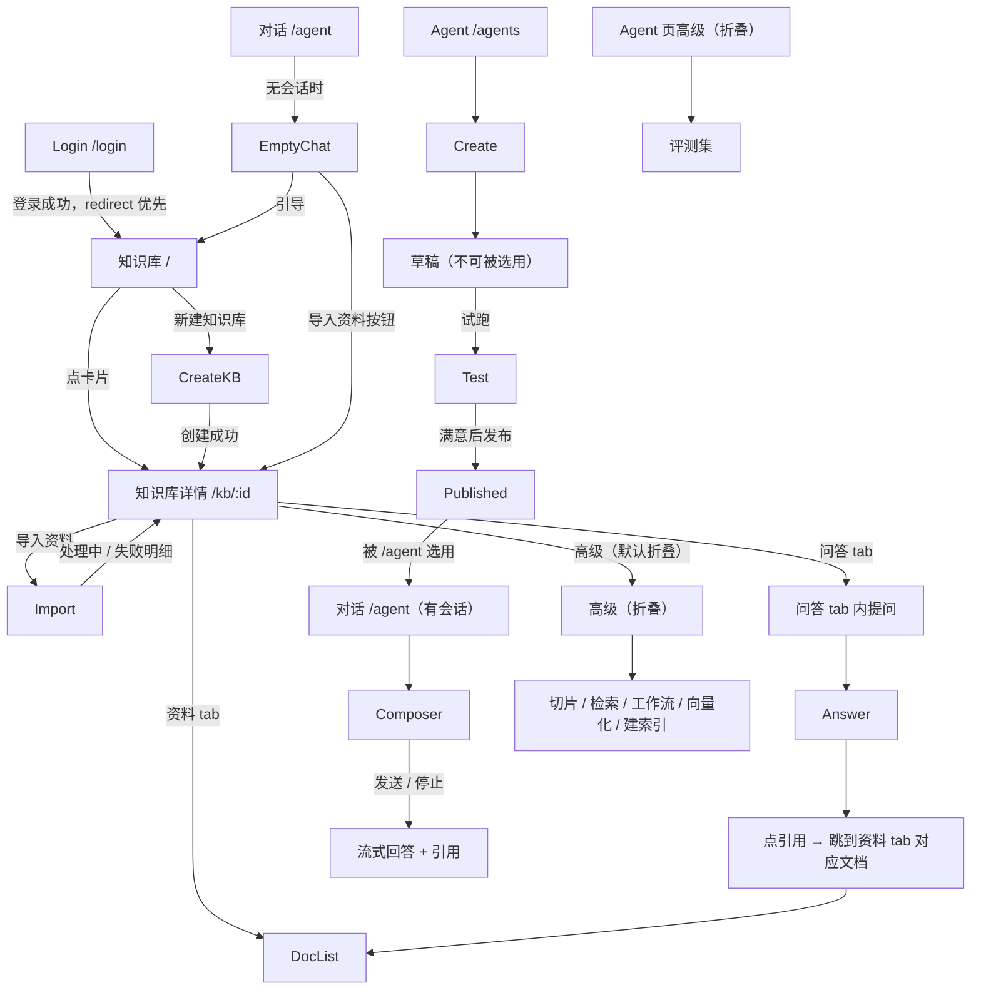
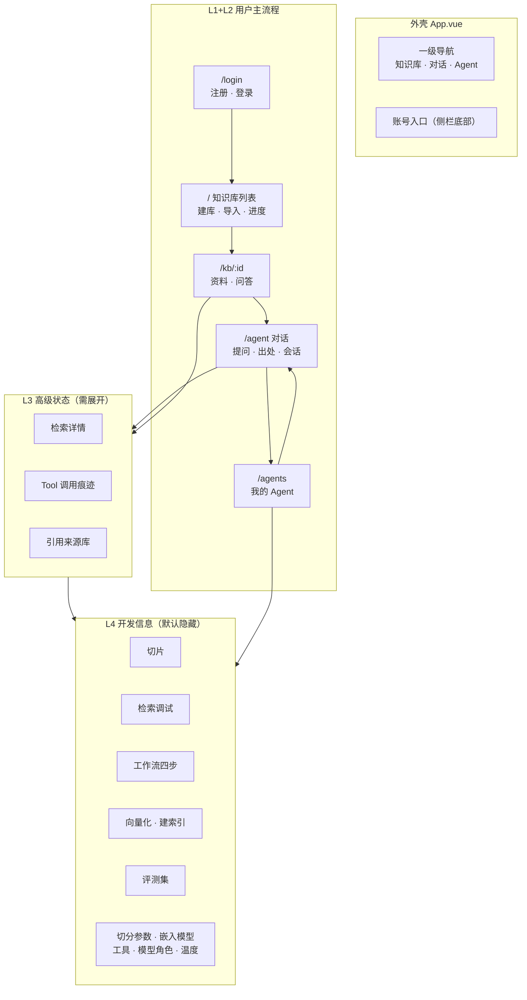

# 前端信息架构设计（Phase B）
> 状态：**历史（Vue 3 时代 Phase B 信息架构）**。

> ⚠️ **历史文档（Vue 时代，已归档）**：本文描述的是**已被取代的 Vue 3 前端**（原 `web/`，
> 现归档在 `docs/archive/web-vue/`）。当前产品前端是 React 19 工程 `frontend/`：
> 设计令牌 `frontend/src/styles/tokens.css`、通用组件 `frontend/src/components/`、
> 动效积木 `frontend/src/bits/`、页面 `frontend/src/pages/`、后端契约层 `frontend/src/lib/api.ts`。
> 本文里的 `web/src/...` 路径、Element Plus 选择器、`AgentView` / `KnowledgeBaseDetailView` 等
> 组件名**只对归档副本有效**，不能当作当前实现的规范。

> 阶段：**纯设计**。本文件不修改任何 Vue / TS / CSS / API / 后端 / Store / 组件 / E2E，不安装任何包。
> 事实基础：`docs/archive/reports/frontend-architecture-audit.md`（Phase A）、`web/src/router/index.ts`、
> `web/src/App.vue`、四个视图的实测结构。本文件里每一条"现状"都有出处，推断与实测分开标注。
> 上游：Phase A 审计 → Phase 0（data-testid + E2E 稳定）→ **Phase B（本文件）**。

---

## 1. 产品定位

**一句话**：把用户自己的资料变成一个可以提问、并给出**可核对出处**的知识空间。

它不是聊天机器人，也不是笔记编辑器。它的独特之处只有一条：**回答必须能指回用户自己导入的那份资料**。
因此产品的全部设计围绕一件事——让"资料 → 提问 → 出处"这条链路短且清楚。

三条由此推出的定位约束：

| 约束 | 含义 |
| --- | --- |
| 资料是前提 | 一切功能都以"用户有资料"为前提；没资料时，系统该教他怎么进来，而不是演示自己 |
| 出处是核心 | 引用不是锦上添花，是产品可信度的唯一来源，必须和回答同屏、不可折叠进二级 |
| 机制不外露 | RRF / BM25 / Rerank / 向量化是**系统怎么工作**，不是**用户在做什么**。默认不出现 |

---

## 2. 核心用户任务

任务书给的流程是主序，我把它标注上"当前是否已具备"，避免把设计写成许愿：

| # | 任务 | 当前状态（实测） |
| --- | --- | --- |
| 1 | 注册 | ✅ 已具备（缺密码强度提示） |
| 2 | 登录 | ✅ 已具备 |
| 3 | 找到"我的资料在哪" | ⚠️ 登录后直接落到知识库列表，**可用但不明确**（无首页、无引导语） |
| 4 | 创建知识库 | ✅ 已具备 |
| 5 | 导入资料（PDF/DOCX/MD/TXT/ZIP） | ✅ 已具备，**取消选择器不卡 loading**（UA-001 已修） |
| 6 | 等待处理 | ⚠️ 有进度显示，但**多文件只显示"当前文件"**（审计 §10） |
| 7 | 导入完成 → 能提问 | ✅ 已自动串接 workflow（UA-014） |
| 8 | 开始问答 | ✅ 已具备 |
| 9 | 查看引用 | ✅ 已具备，且**刷新后仍在**（UA-016 回归） |
| 10 | 管理会话 | ✅ 已具备（侧栏可折叠） |
| 11 | 创建 / 配置 Agent | ✅ 已具备 |
| 12 | 发布 Agent | ✅ 已具备（草稿 → 试跑 → 发布的状态机正确） |
| 13 | 选知识库 / 工具 | ✅ 已具备 |
| 14 | 找回历史对话 | ⚠️ 侧栏有列表但**无搜索**；会话多了以后找不到 |

**设计要解决的不是"缺功能"，是第 3、6、14 步的表达问题，以及把机制类信息挪出主流程。**

---

## 3. 用户角色

任务书要求区分普通用户与开发者。实测当前系统**只有一个角色模型**（`roles: string[]`），
但界面事实上存在两类使用者：

| 角色 | 用这个产品做什么 | 界面需求 |
| --- | --- | --- |
| **资料持有者**（普通用户） | 导资料、提问、看出处、管会话；偶尔配一个 Agent 换个说话方式 | 路径短、术语少、状态清楚 |
| **调校者**（高级用户） | 调切分策略、换嵌入模型、查检索为什么没命中、跑评测 | 这些能力**要有，但不能挡路** |

**关键判断**：这两类人**用同一个账号、同一份数据**，不是两个权限体系。所以不该做"两套界面"，
而该做**同一界面里的分层**：默认给 Level 1+2，需要时展开 Level 3+4。

这样设计的好处是：高级能力**不隐藏**（藏起来等于不存在），但**不打扰**。

---

## 4. 一级导航

### 4.1 三个方案的比较

| | 方案 A `Chat 知识库 Agent 设置` | 方案 B `首页 知识库 对话 Agent 设置` | **方案 C（本文件采纳）`知识库 对话 Agent`** |
| --- | --- | --- | --- |
| 页面数 | 4 项导航 | 5 项导航 | **3 项导航（= 现状）** |
| 新用户落点 | 落 Chat → 零资料时对面板 | 落首页 | **落知识库列表**（现状） |
| "设置"占一级位 | 占位，但它其实是一个模态框 | 占位，同上 | **不占**，留在侧栏底部账号入口 |
| 多出的页面 | — | 首页（且 `/` 已被知识库列表占用，要重排） | **无** |
| 与现状的差距 | 需把 `/` 改成 Chat | 需新增首页 + 重排 | **只改标签，不改结构** |

### 4.2 采纳方案 C，理由三条

1. **不加首页。** 任务书明确"不要为了增加首页而增加页面"。而且新用户的第一个动作
   客观上就是"有资料吗？没有就建一个并导入"——**知识库列表页正是那个答案**。
   造一个首页只会让同一个答案多一次点击。
2. **"设置"不该占一级导航。** 实测设置是侧栏底部的账号入口，点开是模态框（`ProfileDialog`）。
   它不是一个"有多个页面要去"的地方。一级导航位应该给**目的地**，不是**动作**。
3. **顺序按前置关系排，不按重要性排。** 提问的前提是有资料，所以 `知识库` 在 `对话` 之前。
   这与任务书 §二 给出的流程（创建知识库 → 导入资料 → 开始问答）同序。

### 4.3 一级导航定稿

| 顺序 | 标签 | 路由 | 图标 | 匹配路由 |
| --- | --- | --- | --- | --- |
| 1 | 知识库 | `/` | Collection | `knowledge-bases` / `knowledge-base-detail` |
| 2 | 对话 | `/agent` | ChatDotRound | `agent` |
| 3 | Agent | `/agents` | MagicStick | `agents` |

**唯一改动**：第 3 项标签由「Agent 管理」改为「Agent」。

理由：`/agent`（对话）和 `/agents`（管理）**现在都叫 Agent**。侧栏只有 68px 宽时
两个字与三个字的差别很关键，而且"管理"这个词对普通用户是后台词汇。
选中态仍会高亮，标题栏（`meta.title`）保留完整名称"Agent 管理"，
所以**没有任何信息丢失**，只是入口标签更短。

**不做**：不把"知识库"改成"我的资料"。实测页面上所有元素（创建/删除/导入/删除知识库）
都叫"知识库"，改入口不改内容只会造成分裂；这属于 Phase C 的术语统一范围。

---

## 5. 二级导航

一级只有 3 项，二级只出现在**详情态**与**管理态**：

### 5.1 知识库详情（`/kb/:id`）

| 现行 tab | 采纳设计 | 理由 |
| --- | --- | --- |
| 正文 | **资料** | 现状的"左文档列表 + 右正文"本来就是一件事（选一篇看一篇）。合并后 tab 名与内容一致 |
| 切片 | **高级 → 切片** | 切片是 RAG 的**中间产物**。用户问的是"我的资料答得准不准"，不是"切了几段" |
| 检索 | **高级 → 检索** | 现状是调试界面（融合/BM25/向量 + topK 单选 + RRF 科普 hint）。它回答的是"为什么没命中"，属诊断 |
| 问答 | **问答**（主 tab） | 这是用户任务本身。**从第 3 位提到第 2 位**，与"资料"并列 |

采纳后的主 tab：**资料 / 问答**
采纳后的高级区（默认折叠）：**切片 / 检索 / 知识工作流 / 向量化 / 建索引 / 重建索引**

**不加"概览" tab**：页头已有文档数、切片数、Token 估算三个指标，
再加一个概览页就是把同一批数字换个地方再放一次（审计已记录 `.metrics` 类名在两页重复）。

### 5.2 Agent 管理（`/agents`）

| 分区 | 内容 |
| --- | --- |
| 主区 | 我的 Agent（卡片列表） |
| 高级（默认折叠） | 评测集 |

页面内**不设 tab**：实测该页只有一个列表 + 4 个弹窗（新建/配置/试跑/评测），
加 tab 会造出"只有一个 tab 的 tab 栏"。

### 5.3 对话（`/agent`）

**无二级导航**。会话列表在左侧栏（现状已是），它不是"二级导航"，
它是一个**可折叠的会话抽屉**——折叠后主区全宽，这个交互现状已验证好用（UA-007）。

---

## 6. 页面职责

| 页面 | 路由 | 主要任务 | 次要任务 | **不应该出现** |
| --- | --- | --- | --- | --- |
| Login | `/login` | 注册 / 登录 | 改密码入口 | 任何技术信息、示例账号说明 |
| 知识库 | `/` | 看有哪些库、建库、导入资料、删库 | 看处理进度 | 嵌入模型维度、切分策略、Agent 内部实现 |
| 知识库详情 | `/kb/:id` | 管资料（看/删）、在库里提问、看出处 | 高级：切片/检索/工作流 | 检索算法科普、运行原理 |
| 对话 | `/agent` | 提问、看回答与出处、管会话 | 选 Agent / 选知识库 | 评测集、RRF/BM25、重排、系统原理 |
| Agent | `/agents` | 建/配/发/停/删 Agent，试跑 | 高级：评测 | AgentRuntime、ToolRegistry、SSE、复杂运行原理 |
| 账号设置 | 模态框 | 改昵称/邮箱/密码 | — | — |
| 高级工具 | 详情页与 Agent 页的高级区 | 切片/检索/工作流/评测 | — | **普通用户的导航里** |

**"Agent Chat"不是独立页面**：任务书表格里有它，但实测 `/agent` 就是它
（`/agent` 路由指向 `AgentView.vue`，页面内可换 Agent）。拆成两个页面会让"提问"这件事
多一次跳转。**本设计把它作为 `/agent` 的一种会话模式，而非独立页面。**

---

## 7. 页面跳转关系



**与任务书给定图的关键差异**（三处，都是有理由的）：

| 差异 | 任务书图 | 本设计 | 理由 |
| --- | --- | --- | --- |
| 无 Home | 有 `Home` 中枢 | **删掉 Home** | 不新增页面；`/` 本身就是工作空间入口 |
| Agent Chat | `AgentEditor --> AgentChat` | **删掉 AgentChat 节点** | 它就是 `/agent`，不是独立页面 |
| Evaluation | `Agents --> Evaluation` | **移入 Agent 页的高级折叠区** | 见 §11 |

**新增的一条边**：`EmptyChat --> KB`（零知识库时给"先去导入资料"的出路）。
理由：审计确认空态**已修掉伪造示例**（UA-003），但现在只告诉用户"还没有知识库"，
**没告诉他下一步去哪**。这条边就是那个下一步。

---

## 8. Chat 信息架构

Chat 是产品的核心页面，也是当前最重的视图（1691 行）。按任务书给定的五块划分：

### 8.1 Header（现状已具备 3 项，全部保留）

| 元素 | 现状 | 采纳设计 |
| --- | --- | --- |
| 当前 Agent | `el-tag` 显示 mode + `agent-select` | 保留 |
| 当前知识库 | `kb-select`（多选，最多 10） | 保留 |
| 会话名称 | `thread-title` | 保留 |
| 副标题（两种模式的长解释） | `thread-title .sub` | **移入 `?` 悬浮说明**。它在每次会话顶部常驻两行长文，是典型的 Level 4 |

### 8.2 Sidebar（只负责三件事）

| 元素 | 现状 | 采纳设计 |
| --- | --- | --- |
| 会话列表 | 已有 | 保留 |
| 新建会话 | 已有 | 保留 |
| 搜索会话 | **无** | **新增**（任务书明确要求）。侧栏顶部一个搜索框 |
| 展开 / 收起 | 已有折叠钮 | 保留 |
| 当日额度 | `rail-foot` 显示 `今日 x/y 次 · a/b tokens` | **保留在 Level 2**。它是账号级状态，与选哪个会话无关，放侧栏底部是对的 |

会话项内的重命名 / 删除：现状是 hover 显形的图标 + `aria-label`。**保留**
（已在 Phase 0 加上 testid，E2E 稳定）。

### 8.3 Messages

| 元素 | 采纳设计 | 层级 |
| --- | --- | --- |
| 用户消息 | 保留 | L1 |
| AI 回答 | 保留 | L1 |
| 引用（Citation） | 保留，**同屏不折叠** | L1（产品的核心信任来源） |
| 检索状态（"检索到 N 个片段"） | 保留，但**降为一行小字** | L2 |
| 「已重排」「预算截断 N 段」等标签 | **收进"检索详情"折叠** | L3 |
| Tool 调用痕迹 | 保留，**默认收起**，标题显示"检索完成" | L3 |
| 多库失败提示 | 保留（它是"这次少搜了谁"，用户必须知道） | L2 |
| provenance（由哪个 Agent 回答） | 保留，弱化为一行 | L3 |
| 示例问题 | 保留**但仅在有 ≥1 个知识库时出现** | L1 |
| 零知识库提示 | 保留 + **加"去导入资料"动作** | L1 |

**要点**：现状的检索卡片把 5 类信息（片段数、多库数、失败数、已重排、预算截断）
平铺成一行标签。设计目标是**默认只让用户看到"发生了什么"，需要时才问"为什么"**。

### 8.4 Composer

| 元素 | 现状 | 采纳设计 |
| --- | --- | --- |
| 输入框 | 已有 | 保留 |
| 发送 / 停止 | 已有（两个独立按钮） | 保留 |
| Agent 选择 | 已有 | 保留 |
| 知识库选择 | 已有 | 保留 |
| 模式选择（Agent / 知识库问答） | 已有 | 保留 |
| 当日额度 | 在 sidebar | **不在这里**（已明确归 Sidebar） |

**明确不做**：不在 Composer 附近放任何统计或技术信息。
任务书要求"不要把 Evaluation、系统原理、技术统计塞进 Chat"——现状基本做到了，
这一条是**保持**而非改变。

### 8.5 Chat 页不出现的东西（清单）

`评测集` `命中率` `RRF` `BM25` `Vector` `Rerank` `Retriever` `AgentRuntime`
`ToolRegistry` `SSE` `Metrics` `Context Token 预算` `chunkSize/chunkOverlap`

现状检查：Chat 页**没有**评测集与 RRF/BM25（✅ 已符合）；
**有**「重排」（已重排标签）、`chunkSize` 在知识库页而非 Chat 页、
工具痕迹含 `trace-input`/`trace-result`（技术感较强，L3 折叠后可接受）。

---

## 9. Knowledge 信息架构

### 9.1 概念正名

| 不是 | 是 |
| --- | --- |
| Obsidian Vault | Knowledge Base（用户的资料空间） |
| "上传 Vault" | "导入资料"（Vault 是来源之一） |

现状**已经改对了**（UA-004：列表页主入口已是「导入资料」，Vault 收进下拉，
文案也已是「导入资料包」）。本设计**保持现状**，只把详情页页头的「导入资料包」
在概念上明确为"整包同步"（现状有 `title` 提示，采纳为显式次级说明）。

### 9.2 页面结构

```
知识库列表 /
├── 页头：新建知识库
├── 空态：还没有知识库 → [新建知识库]（+ 引导：支持哪些格式）
└── 卡片
    ├── 名称 + 类型标签（Vault / 手工）
    ├── 指标：文档数 / 切片数 / Token
    ├── 处理进度（导入中 / 建立索引中）      ← L2
    └── 操作：浏览与检索 / 导入资料 / 更多导入方式 / 删除

知识库详情 /kb/:id
├── 页头
│   ├── 库名 + 切分参数（L4 → 折叠）
│   ├── 指标：文档 / 切片 / Token            ← L2
│   └── 操作：导入文件 / 导入资料包  +  [高级 ▾]
├── 最近导入结果                                ← L2（保留！见下）
├── 主区 tabs：资料 | 问答
│   ├── 资料：文档列表（过滤/选中/删除）+ 正文阅读
│   └── 问答：提问框 + 流式开关 + 回答 + 引用
└── 高级（默认折叠）
    ├── 切片列表
    ├── 检索（融合/BM25/向量 + topK + RRF 说明）
    ├── 知识工作流（统计→向量化→建索引）
    └── 向量化 / 建索引 / 重建索引
```

### 9.3 一条明确的设计判断：「最近导入结果」**不**属于高级信息

任务书说"不要出现 RRF / BM25 / 向量化 / Tool Trace"。但导入结果面板里那些
"失败：xxx.md — 解析失败：文件为空"**不是开发信息，是用户必须知道的状态**。

用户的原话会是："我导了 5 个文件，其中 2 个没进去，我要知道是哪两个、为什么。"

把它藏进高级区 = 用户看不到 = 他会以为导入成功了。**所以它留在 Level 2，位置不动。**
这是本设计与"把机制信息全藏起来"的一个刻意分歧点。

真正该藏的是页头那三个**手动**触发的工作流按钮——因为导入后系统已经自动串接了
（UA-014），用户不需要手动点它们（见 §17 的判据）。

---

## 10. Agent 信息架构

### 10.1 使用与管理必须分开

| | 使用 | 管理 |
| --- | --- | --- |
| 入口 | `/agent` 的 Agent 选择器 | `/agents` |
| 用户动作 | 选一个、提问 | 建 / 配 / 试跑 / 发布 / 停用 / 删 |
| 频率 | 每次提问可能都碰 | 偶尔 |

现状**已经分开**（`/agent` 选、`/agents` 管），这点保持。

### 10.2 卡片信息分层

| 卡片上的东西 | 现状 | 采纳层级 | 理由 |
| --- | --- | --- | --- |
| 名称 + 状态（草稿/已发布/已停用） | 有 | **L1** | 用户要知道自己有哪些、能不能用 |
| 检索范围（绑了哪些库） | 有 | **L1** | 这是**用户自己做的选择**，必须回显（现状做得对） |
| 回答策略（优先用笔记 / 只依据笔记） | 有 | **L1** | 它决定"没资料时它会不会瞎答"，是用户理解它的关键 |
| 可用工具 | 有 | **L3** → 折叠 | 普通用户不关心 Agent 挂了哪些工具 |
| 模型角色 | 有 | **L3** → 折叠 | 服务端默认值，多数用户从未设置过 |
| 采样温度 | 有 | **L3** → 折叠 | 高级调参 |
| 系统提示词全文 | 有 | **L3** → 折叠 | 长文本，破坏卡片节奏 |
| 「未绑定知识库 = 可检索全部」提示 | 有 | **L1** | 反直觉语义，必须写在界面上 |
| 内置项说明 | 有 | **L2** | 解释为什么它不能删 |

**结论：卡片从 7 个 `dt` 收到 3 个。** 其余 4 个在"配置"弹窗里已经都能改
（实测配置弹窗有提示词/策略/知识库/工具/温度五个字段），**列表页重复展示它们
不提供任何新信息**，只是把卡片撑高。

### 10.3 页脚机制说明

现状 `foot-note`：「现在可以用的助手：N 个 · 想让某个助手出现在对话里，先试跑确认它答得对，再发布…」

**采纳**：拆成两半——
- 前半（N 个可用）保留在页脚，属 L2 状态；
- 后半（试跑→发布的工作流说明）移入页头 `?` 悬浮或空态提示，属 L4。

理由：它描述的是**产品机制**，而机制说明不该在用户**每次**滚动到底部时都读一遍。

---

## 11. Evaluation 分层

### 11.1 位置决策：Agent 管理 → 高级 → 评测

任务书给了两个候选（Agent 管理下的高级功能 / 独立开发工具页）。**采纳第一个。**

| 判据 | Agent 页高级区 | 独立开发工具页 |
| --- | --- | --- |
| 评测的对象是 Agent 吗 | ✅ 是 | 中性 |
| 需要新增页面吗 | ❌ 不需要 | ✅ 需要（又多一个页面） |
| 任务书是否禁止加页面 | ✅ 明确禁止 | ❌ 违反 |
| 普通用户会不会误入 | 不会（默认折叠） | 会（导航里看得见就有人点） |
| 高级用户找得到吗 | 找得到（Agent 页是它的自然归属） | 找得到 |

**理由的核心**：评测的对象是 Agent（`AgentsView` 的评测集针对本账号的 Agent 配置），
它属于 Agent 域；而任务书禁止新增页面。两个条件同时满足时，"Agent 页的高级折叠区"
是唯一解。

### 11.2 一个必须说清的事实

实测 `AgentsView` 里的评测集是**写死在代码里的演示用例**（Phase 0 我改过它的文案，
原文是「我的笔记里缓存击穿怎么解决？」，已去掉"我的笔记"这个不存在的假设）。
它验证的是**评测链路能否跑通**，不是对用户资料的评估。

这构成把它藏起来的**最强理由**：一个数字如果容易被误读成"对我资料的评分"，
它就不该出现在普通用户能随手点到的地方。现状的弹窗里已经标注了这一点，设计予以确认。

### 11.3 层级

| 位置 | 层级 | 折叠 |
| --- | --- | --- |
| Agent 页页头「跑评测集」按钮（现状） | L4 | **移出页头**，进高级折叠区 |
| 弹窗内的"用哪个知识库评测" | L3 | 保留在弹窗内（进了高级区就无需再降级） |
| 评测报告（命中率/通过数/缺失要点） | L3 | 保留在弹窗内 |

---

## 12. 状态信息层级

### 12.1 四层定义（按任务书）

| 层 | 内容 | 默认可见性 |
| --- | --- | --- |
| **L1 用户任务** | 导入 / 创建 / 发送 / 删除 / 保存 / 发布 | 常驻 |
| **L2 用户状态** | 处理中 / 已完成 / 失败 / 未找到资料 / 当日额度 | 常驻 |
| **L3 高级状态** | 检索数量 / Citation 数量 / Tool Calling / 引用来源库 | 折叠可见 |
| **L4 开发信息** | BM25 / Vector / RRF / Rerank / Trace / Metrics / 切分参数 / 嵌入模型 | 默认不可见 |

### 12.2 现状逐项归位表

| 元素 | 现状位置 | 采纳层级 | 采纳位置 |
| --- | --- | --- | --- |
| 导入/建库/发送/删除按钮 | 各页页头 | L1 | 不动 |
| 导入进度（百分比 + 文案） | 列表卡片 / 详情页头 | L2 | 不动 |
| 当日额度 | 对话侧栏底部 | L2 | 不动 |
| 「最近导入」的失败/跳过明细 | 详情页 | **L2** | **不动**（§9.3 已论证） |
| 「知识库里没有命中」标签 | 对话页 / 详情页 | L2 | 不动 |
| 多库检索失败提示 | 对话页 | L2 | 不动 |
| 「检索到 N 个片段」 | 对话页 | L2 | 降为一行小字 |
| 未绑定知识库的反直觉提示 | Agent 卡片 | L2 | 不动 |
| 引用列表 | 对话页 / 详情页 | L1 | 不动 |
| 「已重排」「预算截断 N 段」 | 对话页标签 | L3 | 折叠进「检索详情」 |
| Tool 调用痕迹 | 对话页 | L3 | 默认收起 |
| provenance（由哪个 Agent 回答） | 对话页 | L3 | 弱化 |
| 答案的「Context Token / 已重排 / 被预算截断」 | 详情页问答 | L3 | 折叠 |
| 向量化 / 建索引 / 重建索引 | 详情页页头 | **L4** | 进高级区 |
| 知识工作流四步状态 | 详情页 | **L4** | 进高级区（折叠） |
| 切分参数副标题 / 嵌入模型维度 | 详情页页头 | **L4** | 进高级区 |
| 检索 tab（融合/BM25/向量 + topK + RRF hint） | 详情页 | **L4** | 进高级区 |
| 切片列表 | 详情页 | **L4** | 进高级区 |
| 问答 tab 的链路解释 hint | 详情页 | **L4** | 删除或 `?` 悬浮 |
| Chat header 的模式长解释 | 对话页 | **L4** | `?` 悬浮 |
| Agent 卡片的 工具/模型角色/温度/提示词 | Agent 卡片 | **L3** | 折叠（配置弹窗已可改） |
| 页脚「先试跑再发布」机制说明 | Agent 页 | **L4** | 移到空态/`?` |
| 跑评测集 | Agent 页头 | **L4** | 进高级区 |
| 检索卡片的分数条 / RRF 值 | 对话页 | **L4** | 进「检索详情」 |

**核对**：改动后普通页面上可见的 L4 元素 = **0**。这是本设计可验证的验收判据。

---

## 13. Empty / Error / Loading 分层

### 13.1 四态必须分开（审计 §6.3 已确认现状混淆）

现状最严重的一处：详情页文档加载失败只有 `ElMessage.error('文档加载失败：…')`
——一个 3 秒消失的 toast。toast 消失后面板落到 `v-if="…length === 0"` 的
"没有匹配的文档"，**"加载失败"最终呈现为"这里没有数据"**。

### 13.2 统一定义

| 态 | 判据 | 必含 | 禁止 |
| --- | --- | --- | --- |
| **Loading** | 请求在途 | 骨架/遮罩 + `aria-busy` | 空白页 |
| **Empty** | 请求成功，数据为 0 | 一句"还没有…" + **一个下一步动作** | 出现"加载失败"字样 |
| **Error** | 请求失败 | 一句"…失败了" + **[重试]** + 真实原因 | 出现"没有数据"字样 |
| **Success** | 有数据 | 内容 | — |

**Empty 与 Error 的判别式**：问"服务端有没有说成功"。
成功但没数据 → Empty；没成功 → Error。**不允许 Empty 文案出现在 Error 态。**

### 13.3 全站四态表（设计稿）

| 位置 | Empty | Error | Loading |
| --- | --- | --- | --- |
| 知识库列表 | 还没有知识库<br>[新建知识库] | 知识库加载失败<br>[重试] | 卡片骨架 |
| 详情 · 文档列表 | 还没有资料<br>[导入资料] | 资料加载失败<br>[重试] | 行骨架 |
| 详情 · 文档列表（过滤无结果） | 没有匹配"xxx"的文档<br>[清空过滤] | 同上 | 同上 |
| 详情 · 正文 | 选择左侧一篇文档 | 正文加载失败<br>[重试] | 正文骨架 |
| 详情 · 切片 | 这篇文档还没有切片 | 切片加载失败<br>[重试] | — |
| 详情 · 问答 | 还没有提问<br>[问第一个问题] | 提问失败<br>[重试] | — |
| 检索 0 命中 | **当前知识库没有找到相关资料<br>[导入资料] [重新提问]** | 检索失败<br>[重试] | — |
| 对话 · 会话列表 | 还没有对话 | 会话加载失败<br>[重试] | 行骨架 |
| 对话 · 消息区 | （示例问题或引导，见 §8.3） | 消息加载失败<br>[重试] | 消息骨架 |
| Agent 列表 | 还没有 Agent<br>[新建 Agent] | Agent 加载失败<br>[重试] | 卡片骨架 |
| 导入部分失败 | **3 个文件未导入** + 原因明细 | 导入失败<br>[重试] | 进度条 |

**其中两处是新增缺口**（审计已确认为 P2）：

1. **检索 0 命中的专用空态**：现状只有「检索到 0 个片段」标签，
   没有 `[导入资料] [重新提问]` 动作（审计 §10 明确点名）。
2. **知识库问答页的 0 命中**：现状与会话页不同步（会话页有专用卡片，问答页没有）。

---

## 14. Store 边界

### 14.1 现状（Phase A 实测）

| 数据 | 当前位置 | 跨页面 |
| --- | --- | --- |
| 用户 / 昵称 / 角色 | `stores/auth.ts` | ✅ 全局 |
| token | `api/client.ts` 的 `tokenRef` | ✅ 全局 |
| 知识库列表 | 3 个视图各自拉取 | ✅ 跨 3 页 |
| Agent 列表 | 2 个视图各自拉取 | ✅ 跨 2 页 |
| 工具列表 | 2 个视图各自拉取 | ✅ 跨 2 页 |
| 会话 / 消息 | `AgentView` | ❌ 单页 |

**结论（有实测依据）**：三份列表确实重复拉取，引入状态管理有依据。
但**不应一次建四五个 store**。

### 14.2 采纳：Pinia，三个 store（与任务书一致）

#### `authStore`
| 字段 | 来源 | 说明 |
| --- | --- | --- |
| `token` | `client.ts` 的 `tokenRef` **迁入** | 现在 token 与用户信息分居两个文件，是不必要的分裂 |
| `user`（昵称/邮箱/角色） | `stores/auth.ts` 现有 | 不动内容，只换归属 |
| `status` | 新增 | `'unknown' \| 'authed' \| 'guest'`，解决"路由守卫在 profile 未拉回前如何判断" |

#### `knowledgeStore`
| 字段 | 消费者 |
| --- | --- |
| `list` / `loading` / `error` | 知识库列表页、对话页（选库）、Agent 页（选库） |
| `detailById` | 详情页（避免二次进入重复拉） |
| `documentsByKbId` | 详情页 |
| 动作：`fetchList` / `fetchDetail` / `create` / `remove` / `fetchDocuments` / `removeDocument` | — |

**去重收益**：知识库列表当前 3 处独立拉取 → 1 处。

#### `agentStore`
| 字段 | 消费者 |
| --- | --- |
| `list` / `loading` / `error` | Agent 页、对话页（选 Agent） |
| `usable`（computed：已发布） | 对话页选择器 |
| `tools` / `loading` | Agent 页配置弹窗 |
| 动作：`fetchList` / `create` / `update` / `remove` / `setStatus` / `duplicate` / `test` | — |

**去重收益**：Agent 列表 2 处、工具列表 2 处 → 各 1 处。

### 14.3 留在 View / composable 的

| 数据 | 放哪 | 理由 |
| --- | --- | --- |
| 会话列表、消息、草稿输入、模式、流式缓冲 | **`AgentView` 局部**（`ref`） | 只服务单页；进全局会让"离开页面后消息还在"变成 bug 而非特性 |
| 详情页的检索结果 / 分页 / 选中文档 | 局部 | 同上 |
| 编辑弹窗的表单草稿 | 局部 | 弹窗关闭即销毁，不该留全局 |
| 导入轮询 | **`useImportTask` composable** | 列表页与详情页各有一份（审计 §7），是逻辑复用不是状态共享 |
| 三态（loading/error/data） | **`useAsyncState` composable** | 统一四态判别，是 §13 的代码落点 |
| 确认弹窗 | **`useConfirm` composable** | 8 处手写 `ElMessageBox`，选项各异（审计 §7） |

**判别式（一句话）**：
> **跨页面共享且同一时刻只有一份真相 → Store；只服务一个页面 → View 局部；跨页面复用同一段逻辑但各自持有状态 → composable。**

---

## 15. Component 边界

### 15.1 现状

`components/` 只有 2 个文件（都是弹窗）。**视图之下零组件化**——四个视图
`import ... from '@/components/'` 的结果为空。三个巨型视图 4559 行。

### 15.2 采纳的组件边界（只定义，不实施）

#### 知识库域
```
KnowledgeBaseListView
├── KnowledgeBaseCard            卡片：名称/类型/指标/进度/操作
├── ImportProgress               进度条 + 状态文案（列表卡片内）
└── CreateKnowledgeBaseDialog    新建弹窗

KnowledgeBaseDetailView
├── KnowledgeBaseHeader          名称 + 指标 + 导入操作 + 高级折叠触发
├── ImportResultPanel            最近导入：成功/失败/跳过明细      ← L2，不可省
├── DocumentList                 左栏：过滤 + 列表
│   └── DocumentItem             单行：标题/路径/切片数 + 删除
├── DocumentReader               右栏：正文 + 大纲
├── DocumentLinksPanel           关联（出链/反链/待创建）
├── RelatedPanel                 相关推荐
├── ChunkListPanel               【高级】切片
├── RetrievalPanel               【高级】检索调试
├── WorkflowPanel                【高级】四步工作流
├── QaPanel                      问答：输入/流式/回答/引用
└── KnowledgeAdvancedPanel       【高级】折叠容器
```

#### 对话域
```
AgentView
├── ChatSidebar
│   ├── ConversationItem
│   └── ConversationSearch        ← 新增（§8.2）
├── ChatHeader
│   ├── AgentSelector
│   ├── KnowledgeBaseSelector
│   └── ModeHelp                  ← `?` 悬浮，承载 L4 长解释
├── MessageList
│   ├── ChatMessage               用户/助手两侧
│   ├── RetrievalCard             检索状态（L2）+ 折叠的 L3 标签
│   ├── ToolCallCard              默认收起
│   ├── CitationList              ← 核心信任组件，不折叠
│   ├── MessageProvenance         弱化的一行
│   └── ChatEmpty / ChatWelcome   空态 / 零知识库引导
└── ChatComposer
    ├── ModeSwitch
    ├── AgentSelector（compact）
    ├── KnowledgeBaseSelector（compact）
    └── ComposerInput             输入 + 发送/停止
```

#### Agent 域
```
AgentsView
├── AgentCard
│   ├── AgentStatusBadge          草稿/已发布/已停用
│   └── AgentFactsCollapsed       工具/模型角色/温度（默认收起）
├── AgentEditorDialog             配置（含全部 L3 字段）
├── AgentCreateDialog
├── AgentTestDialog               试跑
└── EvaluationPanel               【高级】评测（默认折叠容器内）
```

#### 通用（`components/` 现有 2 个之外新增）
```
StateEmpty          统一空态（含动作插槽）
StateError          统一错误态（含重试插槽）
StateLoading        统一加载骨架
ConfirmDialog       统一确认弹窗（替代 8 处手写）
StatusBadge         状态标签（替代各处中文映射 + el-tag）
```

### 15.3 一条取舍说明

任务书的组件清单里没有 `RetrievalPanel` / `WorkflowPanel` / `ImportResultPanel` 的拆分建议，
我按审计的实测重复度补了这三个。理由：它们在**两个视图里各存在一份**
（列表页与详情页各有一份导入轮询与状态展示；检索面板与会话页的检索卡片是同构的）。

**不拆的**：`KnowledgeBaseDetailView` 的 819 行 CSS。样式不因为组件化而自动消失，
需要单独一轮（Phase C 的 Design System / token 层）。本设计只标注，不处理。

---

## 16. Mermaid 架构图

### 16.1 整体信息架构



### 16.2 状态可见性

```mermaid
flowchart LR
    Request["请求"] -->|失败| Error["StateError<br/>…失败了 + [重试]"]
    Request -->|成功·有数据| Success["内容"]
    Request -->|成功·无数据| Empty["StateEmpty<br/>还没有… + [下一步]"]
    Empty -.禁止.->|文案不得为| Error
    Success --> L3["L3 折叠可见"]
    L3 --> L4["L4 默认隐藏"]
```

---

## 17. 重构后的页面结构（与当前的差异）

| 维度 | 当前 | 采纳后 | 是否需要改路由 |
| --- | --- | --- | --- |
| 一级导航 | 知识库 / 对话 / Agent 管理 | 知识库 / 对话 / **Agent** | ❌ 不需要 |
| 首页 | 无 | 仍然无 | ❌ |
| 详情 tab | 正文 / 切片 / 检索 / 问答（4 个并列） | **资料 / 问答**（2 个并列）+ 高级折叠区 | ❌ |
| 详情页头按钮 | 导入文件 / 导入资料包 / 向量化 / 建索引 / 重建索引 | 前两个留页头，**后三个进高级区** | ❌ |
| 知识工作流 | 独立面板常驻 | 进高级区 | ❌ |
| 对话页 L3 | 标签平铺 | 折叠进「检索详情」/ Tool 卡片默认收起 | ❌ |
| Agent 卡片字段 | 7 个 `dt` | **3 个**（名称状态 / 检索范围 / 回答策略） | ❌ |
| Agent 页头 | 跑评测集 / 新建 Agent | 新建 Agent 留页头，**跑评测集进高级区** | ❌ |
| 侧栏 | 会话列表 + 额度 | **+ 搜索会话** | ❌ |
| 会话搜索 | 无 | 新增 | ❌ |
| 检索 0 命中 | 只有标签 | **+ 专用空态与两个动作** | ❌ |
| 加载失败 | 3 秒 toast | **常驻错误态 + [重试]** | ❌ |
| 设置 | 侧栏底部模态框 | 不变 | ❌ |
| Evaluation | 页头并排按钮 | Agent 页高级折叠区 | ❌ |
| 四态统一 | 无 | Empty/Error/Loading/Success 四态分离 | ❌ |

**结论：本设计不新增任何页面、不删除任何路由、不移动任何页面职责。**
全部改动都是**同一页面内的信息分层与折叠**。这是"重新设计信息架构"，
不是"重做产品"。

### 17.1 两条判定改动归属的硬判据

Phase C 拿到任一元素时，用这两条决定它属于哪一层：

1. **它描述"用户在做什么"吗？** 是 → L1/L2，常驻。
   否（它描述"系统怎么工作"）→ 继续第 2 条。
2. **它是用户自己刚刚做出的选择的结果吗？** 是（他选了库、设了温度、导了文件）
   → L2/L3，因为他需要看到自己的选择生效了。
   否（它是算法/引擎/指标）→ **L4，默认隐藏**。

**这两条判据能自动解决本文件里所有的归属争议**：
「向量化」是系统在工作 → L4；「切分参数」是系统默认值 → L4；
「我导了 3 个文件，1 个失败」是用户动作的结果 → L2；
「BM25 命中 3 条」是系统指标 → L4；「检索到 3 个片段」是用户需要的状态 → L2。

---

## 18. 不应该出现的信息

按页面汇总，供 Phase C / E2E 用作断言清单：

| 页面 | 禁止出现 |
| --- | --- |
| 登录 | 示例账号口令、任何技术栈说明、"这是演示" |
| 知识库列表 | 嵌入模型名与维度、chunkSize/chunkOverlap、Agent 内部实现 |
| 详情 · 主区 | RRF / BM25 / Vector / Rerank / 向量化 / 建索引 / 切片 chunkType / 状态 tag 直出 |
| 详情 · 高级区 | （无禁止，但必须默认折叠） |
| 对话 · 主流程 | 评测集、命中率、Context Token 预算、chunk 参数、模型名 |
| 对话 · 折叠后 | Tool 的原始 input/result（可展开，但默认收起） |
| Agent 列表 | AgentRuntime、ToolRegistry、SSE、模型名（除用户自己设的） |
| 全站 | 任何 `undefined`（UA-002 回归项）、任何"这里没有数据"用来表达"加载失败" |

---

## 19. Phase C 的输入

Phase C（Design System / 组件实施）需要本文件提供的：

| # | 输入 | 出处 |
| --- | --- | --- |
| 1 | 组件清单（20 个，含 6 个通用状态组件） | §15.2 |
| 2 | 三层折叠容器的规格（高级区 / 检索详情 / Tool 卡片） | §12.2 |
| 3 | 统一四态的接口（props / slots） | §13.2、§13.3 |
| 4 | 三个 store 的字段与动作契约 | §14.2 |
| 5 | 三个 composable（`useImportTask` / `useAsyncState` / `useConfirm`） | §14.3 |
| 6 | L1-L4 层级判定判据（用于逐元素归位） | §17.1 |
| 7 | 禁止出现清单（可转为 E2E 断言） | §18 |
| 8 | 术语表：资料/知识库/文档/切片/引用/Agent/Evaluation 的定义与用词 | §1、§9.1 |
| 9 | 两条新增交互缺口：会话搜索、检索 0 命中空态 | §8.2、§13.3 |
| 10 | 未处理项：819 行 CSS 的样式层归属（本阶段明确划出范围） | §15.3 |

---

## 20. 最终检查：八个问题

| 问题 | 答案 | 出处 |
| --- | --- | --- |
| **新用户第一次进入应该做什么？** | 落在 `/` 知识库列表。空态写"还没有知识库"并给一个 **[创建知识库]**；点进去创建后，详情页空态写"还没有资料"并给 **[导入资料]**；导入完成后自动串接向量化与建索引（已有），然后引导去 **对话** 提问。全程不出现 Demo、示例问题、缓存击穿、G1、ZGC、评测。 | §4.2、§13.3、§10 |
| **我怎么把 PDF / DOCX / MD / TXT 放进去？** | 统一入口只有"**导入资料**"一个（列表页卡片与详情页页头各一个），点击后可选多个文件。ZIP 与 Obsidian Vault 收在"更多导入方式"里，是**来源之一**而非主入口。取消文件选择器不改变任何状态。 | §9.1、§9.2 |
| **我怎么开始问问题？** | 两条路：知识库详情页的「问答」tab（带着当前库的上下文），或侧栏「对话」。零知识库时对话页显示引导并给 [去导入资料]，不给示例问题。 | §8.3、§7（`EmptyChat → KB`） |
| **我怎么知道回答来自我的资料？** | 引用与回答**同屏**，不折叠、不进二级。每条引用可点，点了跳到该库该文档的正文位置。引用卡同时标出**来自哪个库**（多库时）。这些引用随消息落库，刷新后仍在。 | §8.3、§12.2 |
| **我怎么创建并使用自己的 Agent？** | `/agents` 新建（code + 名称）→ 试跑 → 发布 → 才会出现在 `/agent` 的选择器里。草稿与已停用的 Agent 在选择器里不出现，界面会说明原因。改绑知识库/工具/温度在配置弹窗里，卡片只回显"检索范围"与"回答策略"两个用户关心的字段。 | §10 |
| **Evaluation 为什么普通用户看不到它？** | 因为它评估的是**写死在代码里的演示用例**，验证的是"评测链路能否跑通"，不是用户资料的评分。一个容易被误读为"我的资料得分"的东西不该出现在随手可点的地方。它在 Agent 页的**高级折叠区**里——对象是 Agent，位置合理，且不需要新增页面。 | §11.1、§11.2 |
| **失败以后我该怎么办？** | 四态分离：**Empty 说"还没有…"并给下一步动作；Error 说"…失败了"并给 [重试]，且带上真实原因**。二者文案互不越界（"没有数据"不能用来表达"加载失败"）。导入部分失败属 Warning，列出哪个文件、为什么，并给 [查看原因]。 | §13.2、§13.3 |
| **我怎么找到之前的对话？** | 对话页左侧栏：列表 + **新增搜索** + 新建 + 展开/收起；可按标题过滤。重命名与删除在会话项上。侧栏可收起（现状已具备）。 | §8.2 |

**八个问题都有明确答案 → Phase B 完成。**
