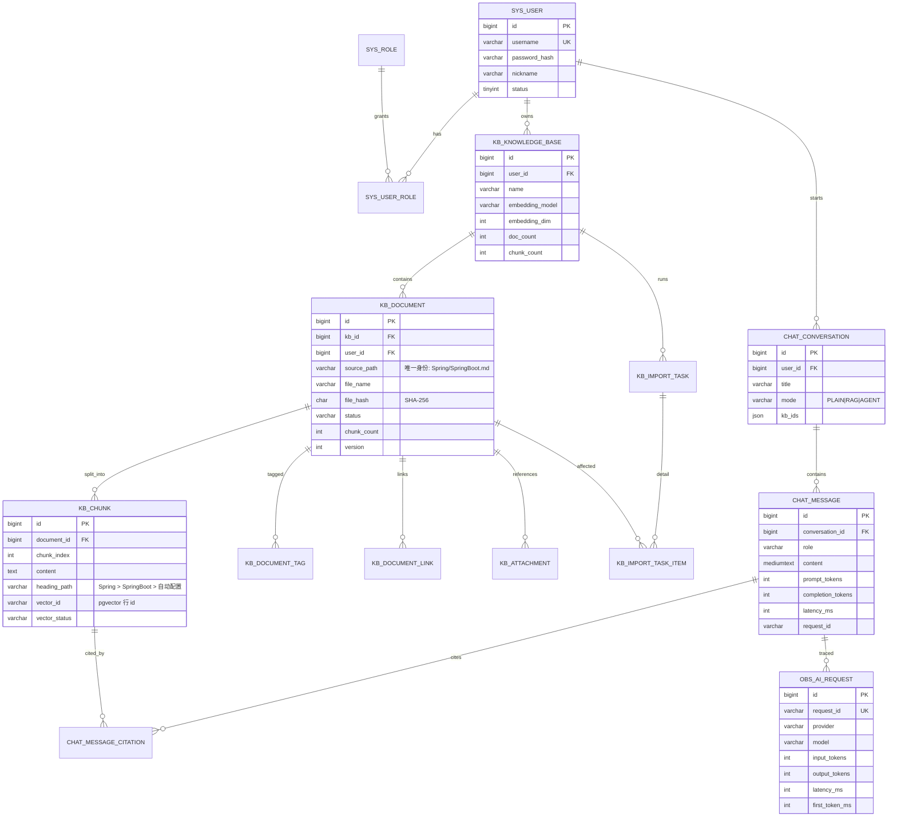

# 数据库设计（Prisdvl-Nexus）

> STEP 1 设计稿。核心表（Phase 0–3）为定稿设计；Phase 5–10 的表为**预留结构**，实现到对应阶段时再细化字段并出 Flyway 脚本。

## 0. 存储分工（为什么不是一个库）

| 存储 | 职责 | 不放在这里的原因 |
| --- | --- | --- |
| **MySQL 8.4.11** | 用户、知识库、文档元数据、Chunk 正文、会话与消息、Agent/工具/工作流/评测/观测 | — |
| **PostgreSQL 18 + pgvector 0.8.6** | Chunk 的向量与相似度检索（HNSW） | MySQL 无原生向量索引 |
| **Elasticsearch 9.4.5 + IK 9.4.5** | Chunk 全文检索与 BM25（中文分词） | MySQL 全文检索对中文/打分的可控性不足 |
| **Redis 8.10.2** | 缓存、限流、分布式锁、短时票据、进度广播 | 非持久化真源，只做加速与协调 |
| **RabbitMQ** | 导入 / 嵌入 / 评测 / 报告等异步任务 | 数据库不该承担任务队列语义 |

**一致性策略**：MySQL 是 **Chunk 的真源（source of truth）**。向量库与 ES 都是**派生索引**；任何删除/重建都以 MySQL 的 `kb_chunk` 为基准做补偿，并提供"重建索引"接口（Phase 3）。

---

## 1. ER 图（核心，Phase 0–3）



---

## 2. 命名与通用约定

| 项 | 约定 |
| --- | --- |
| 引擎 / 字符集 | MySQL 8、`InnoDB`、`utf8mb4` / `utf8mb4_0900_ai_ci` |
| 表名前缀 | `sys_`（账号权限）、`kb_`（知识库）、`chat_`（会话）、`ai_`（模型/提示词/Agent/工具）、`wf_`（工作流）、`eval_`（评测）、`obs_`（观测） |
| 主键 | `id BIGINT`，MyBatis-Plus `IdType.ASSIGN_ID`（雪花），避免自增 ID 暴露业务规模 |
| 审计列 | `created_at DATETIME(3)`、`updated_at DATETIME(3)`、`deleted TINYINT DEFAULT 0`（仅需要软删的表） |
| 逻辑删除 | 只用于 `sys_user` / `kb_knowledge_base` / `kb_document` / `chat_conversation`；`kb_chunk`、`obs_*` 物理删除 |
| 大文本 | Chunk 正文用 `TEXT`；消息正文用 `MEDIUMTEXT`；不使用 `BLOB` 存原文件（原文件落磁盘/对象存储，库里只存路径 + hash） |
| 时间 | 统一 UTC 存储，接口返回 ISO-8601；源文件的创建/修改时间单独存 `doc_created_at` / `doc_updated_at` |
| JSON | 用于"结构可能演进"的字段（`frontmatter`、`metadata`、`config_snapshot`）；**不放需要被检索/关联的字段** |
| 迁移 | Flyway，`V{version}__{desc}.sql`，禁止修改已执行的迁移文件 |
| 索引 | 外键列必建索引；列表查询一律走 `(user_id, created_at)` 组合索引；软删表索引包含 `deleted` |

---

## 3. 账号与权限（Phase 0）

```sql
CREATE TABLE sys_user (
  id            BIGINT       NOT NULL PRIMARY KEY,
  username      VARCHAR(64)  NOT NULL,
  email         VARCHAR(128)          DEFAULT NULL,
  password_hash VARCHAR(100) NOT NULL,          -- BCrypt
  nickname      VARCHAR(64)           DEFAULT NULL,
  avatar_url    VARCHAR(512)          DEFAULT NULL,
  status        TINYINT      NOT NULL DEFAULT 1, -- 1 正常 0 禁用
  last_login_at DATETIME(3)           DEFAULT NULL,
  created_at    DATETIME(3)  NOT NULL DEFAULT CURRENT_TIMESTAMP(3),
  updated_at    DATETIME(3)  NOT NULL DEFAULT CURRENT_TIMESTAMP(3) ON UPDATE CURRENT_TIMESTAMP(3),
  deleted       TINYINT      NOT NULL DEFAULT 0,
  UNIQUE KEY uk_user_username (username, deleted),
  UNIQUE KEY uk_user_email (email, deleted)
) ENGINE=InnoDB DEFAULT CHARSET=utf8mb4;
```

| 表 | 关键列 | 说明 |
| --- | --- | --- |
| `sys_role` | `code`(`USER`/`ADMIN`)、`name` | RBAC 角色字典 |
| `sys_user_role` | `user_id`、`role_id` | 唯一键 `(user_id, role_id)` |
| `sys_refresh_token` | `user_id`、`token_hash`(SHA-256)、`expires_at`、`revoked`、`device_info` | Refresh Token 轮换与吊销；**存 hash 不存明文** |

### 3.1 `workspace`（平台化 Phase 2，迁移 V9）

归属链：`User → Workspace → 资源(知识库/Agent/工作流/工具/应用)`。
第一阶段只实现**个人工作区**：注册时自动创建，与用户 1:1，`name` = "个人工作区"。

```sql
CREATE TABLE workspace (
  id          BIGINT       NOT NULL PRIMARY KEY,
  user_id     BIGINT       NOT NULL,                 -- 所有者
  name        VARCHAR(128) NOT NULL,
  description VARCHAR(512)          DEFAULT NULL,
  type        VARCHAR(16)  NOT NULL DEFAULT 'PERSONAL',  -- PERSONAL / TEAM（预留）
  created_at  DATETIME(3)  NOT NULL DEFAULT CURRENT_TIMESTAMP(3),
  updated_at  DATETIME(3)  NOT NULL DEFAULT CURRENT_TIMESTAMP(3) ON UPDATE CURRENT_TIMESTAMP(3),
  deleted     TINYINT      NOT NULL DEFAULT 0,
  UNIQUE KEY uk_ws_user_type (user_id, type, deleted),   -- 每人每种类型只允许一个未删除工作区
  KEY idx_ws_user (user_id, deleted)
) ENGINE=InnoDB DEFAULT CHARSET=utf8mb4;
```

| 说明 | 内容 |
| --- | --- |
| 幂等创建 | `WorkspaceService.requirePersonalWorkspace(userId)`：查到就返回，没有才建（注册、登录、以及任何需要工作区的入口都走它） |
| 为什么先不动查询条件 | §三十六 要求"查询必须带 `workspace_id` + `owner_id`"。当前阶段所有查询仍是 `user_id`（个人工作区与用户 1:1，两者等价），**权限维度切到 workspace 是 Phase 8 的事**——迁移里 `workspace_id` 允许为 NULL 正是为此 |
| 成员角色 | OWNER/ADMIN/EDITOR/VIEWER 已在设计里占位，表与管理接口 Phase 8 才建 |

---

## 4. 知识库与文档（Phase 2 核心）

### 4.1 `kb_knowledge_base`

| 列 | 类型 | 说明 |
| --- | --- | --- |
| `id` | BIGINT PK | |
| `user_id` | BIGINT | 所有者，**所有查询必须带此条件**（租户隔离） |
| `workspace_id` | BIGINT NULL | 所属工作区（V9 加入；历史数据为空，归属查询仍走 `user_id`） |
| `name` / `description` | VARCHAR | |
| `icon` | VARCHAR(512) NULL | 图标（URL 或 emoji，V10 加入） |
| `status` | VARCHAR(16) | `ENABLED`（默认）/ `DISABLED`；禁用后不参与检索（V10 加入） |
| `retrieval_top_k` | INT | 该库的检索 TopK，默认 5（V10 加入；**Phase 3.2 起真正生效**于 Retriever） |
| `similarity_threshold` | DOUBLE | 相似度阈值，默认 0.25（V10 加入。列默认原为 0.7，与检索实际默认的 0.25 长期不一致，Phase 3.2 统一，见 decisions.md B.32） |
| `source_type` | VARCHAR(16) | `MANUAL` / `OBSIDIAN` / `MIXED` |
| `embedding_provider` / `embedding_model` / `embedding_dim` | VARCHAR / INT | **建库时冻结**；改 embedding 模型必须重建库（见 docs/decisions.md ADR-008） |
| `chunk_strategy` | VARCHAR(32) | `MARKDOWN_HEADING` / `RECURSIVE`（默认前者） |
| `chunk_size` / `chunk_overlap` | INT | 目标 token 与重叠（Markdown 结构化切分的上限/兜底） |
| `doc_count` / `chunk_count` / `total_tokens` | INT | 冗余统计，导入完成后更新 |
| `created_at` / `updated_at` / `deleted` | | |

> V10 的四条 `ADD COLUMN` 是**分开写的**：测试与 standalone 用 H2（MySQL 模式）执行同一批迁移，
> 而 H2 不接受 `ADD COLUMN a ..., ADD COLUMN b ...` 的逗号连写形式。
> 索引 `idx_kb_workspace (workspace_id, deleted)` 同期创建。

索引：`idx_kb_user (user_id, deleted, created_at)`

### 4.2 `kb_document`

```sql
CREATE TABLE kb_document (
  id             BIGINT       NOT NULL PRIMARY KEY,
  kb_id          BIGINT       NOT NULL,
  user_id        BIGINT       NOT NULL,
  file_name      VARCHAR(512) NOT NULL,           -- SpringBoot.md
  file_ext       VARCHAR(16)  NOT NULL,           -- md / pdf / docx / txt
  source_type    VARCHAR(16)  NOT NULL,           -- UPLOAD | OBSIDIAN | ZIP
  source_path    VARCHAR(1024) NOT NULL,          -- Spring/SpringBoot.md（相对 vault 根）
  folder         VARCHAR(512)          DEFAULT NULL, -- Spring（便于按目录过滤）
  title          VARCHAR(512)          DEFAULT NULL, -- frontmatter.title 或首个 H1
  file_size      BIGINT       NOT NULL DEFAULT 0,
  file_hash      CHAR(64)     NOT NULL,           -- SHA-256(原始字节)，增量同步依据
  content_hash   CHAR(64)              DEFAULT NULL, -- SHA-256(规范化正文)，用于判断"只改了时间戳"
  frontmatter    JSON                  DEFAULT NULL, -- 完整 YAML frontmatter
  tags           JSON                  DEFAULT NULL, -- ["Java","SpringBoot"]（冗余自 kb_document_tag，供快速展示）
  heading_tree   JSON                  DEFAULT NULL, -- 标题目录树，供前端文档大纲
  doc_created_at DATETIME(3)           DEFAULT NULL, -- 源文件创建时间
  doc_updated_at DATETIME(3)           DEFAULT NULL, -- 源文件修改时间
  status         VARCHAR(16)  NOT NULL,           -- PENDING|PARSING|CHUNKING|EMBEDDING|INDEXING|READY|FAILED|SKIPPED
  error_msg      VARCHAR(2000)         DEFAULT NULL,
  chunk_count    INT          NOT NULL DEFAULT 0,
  token_count    INT          NOT NULL DEFAULT 0,
  version        INT          NOT NULL DEFAULT 1, -- 每次内容变更 +1
  indexed_at     DATETIME(3)           DEFAULT NULL,
  created_at     DATETIME(3)  NOT NULL DEFAULT CURRENT_TIMESTAMP(3),
  updated_at     DATETIME(3)  NOT NULL DEFAULT CURRENT_TIMESTAMP(3) ON UPDATE CURRENT_TIMESTAMP(3),
  deleted        TINYINT      NOT NULL DEFAULT 0,
  UNIQUE KEY uk_doc_kb_path (kb_id, source_path, deleted),   -- 增量同步的身份键
  KEY idx_doc_kb_status (kb_id, status, deleted),
  KEY idx_doc_kb_folder (kb_id, folder, deleted),
  KEY idx_doc_kb_hash (kb_id, file_hash)
) ENGINE=InnoDB DEFAULT CHARSET=utf8mb4;
```

**关键设计：文档身份 = `(kb_id, source_path)`，不是文件名也不是 id。**
理由：同一个 Vault 反复导入时，路径是唯一稳定标识；改名 = 删除 + 新建（由同步器识别），同名不同目录的笔记（Obsidian 允许）不会互相覆盖。

### 4.3 `kb_chunk`

```sql
CREATE TABLE kb_chunk (
  id            BIGINT      NOT NULL PRIMARY KEY,
  kb_id         BIGINT      NOT NULL,
  document_id   BIGINT      NOT NULL,
  user_id       BIGINT      NOT NULL,
  chunk_index   INT         NOT NULL,           -- 文档内序号，从 0 开始
  chunk_type    VARCHAR(16) NOT NULL,           -- HEADING|PARAGRAPH|CODE|TABLE|LIST
  content       TEXT        NOT NULL,           -- 送入 Embedding/BM25 的最终文本
  raw_content   TEXT                 DEFAULT NULL,-- 原文片段（保留代码块围栏等，用于展示）
  content_hash  CHAR(64)    NOT NULL,           -- SHA-256(content)，Embedding 缓存键
  heading       VARCHAR(512)         DEFAULT NULL,-- 所属最近标题文本
  heading_path  VARCHAR(1024)        DEFAULT NULL,-- Spring > SpringBoot > 自动配置
  heading_level TINYINT              DEFAULT NULL,
  start_offset  INT         NOT NULL DEFAULT 0, -- 在规范化正文中的字符区间，供前端定位
  end_offset    INT         NOT NULL DEFAULT 0,
  token_count   INT         NOT NULL DEFAULT 0,
  char_count    INT         NOT NULL DEFAULT 0,
  vector_id     VARCHAR(64)          DEFAULT NULL,-- pgvector 行 id（UUID）
  vector_status VARCHAR(16) NOT NULL DEFAULT 'PENDING', -- PENDING|DONE|FAILED|STALE
  es_status     VARCHAR(16) NOT NULL DEFAULT 'PENDING',
  created_at    DATETIME(3) NOT NULL DEFAULT CURRENT_TIMESTAMP(3),
  updated_at    DATETIME(3) NOT NULL DEFAULT CURRENT_TIMESTAMP(3) ON UPDATE CURRENT_TIMESTAMP(3),
  UNIQUE KEY uk_chunk_doc_index (document_id, chunk_index),
  KEY idx_chunk_kb_doc (kb_id, document_id),
  KEY idx_chunk_vector (vector_id),
  KEY idx_chunk_hash (content_hash)
) ENGINE=InnoDB DEFAULT CHARSET=utf8mb4;
```

> **为什么 `content_hash` 单独一列**：Embedding 是按内容计费的。相同内容（重复笔记片段、模板段落）在全局缓存里命中即可复用向量，见 Redis `nexus:embed:v1:{sha256}`。

### 4.4 标签与关联

| 表 | 关键列 | 说明 |
| --- | --- | --- |
| `kb_document_tag` | `id`、`kb_id`、`document_id`、`tag`(VARCHAR 128)、`tag_source`(`FRONTMATTER`/`INLINE`/`FOLDER`) | 唯一键 `(document_id, tag)`；索引 `(kb_id, tag)` 支撑"按标签过滤/检索" |
| `kb_document_link` | `id`、`kb_id`、`source_document_id`、`target_document_id`(可空)、`target_title`、`link_type`(`WIKILINK`/`MD_LINK`/`EMBED`)、`raw_target`、`resolved` | WikiLink/Markdown Link 抽取结果；`resolved=false` 表示目标文档未导入（=知识缺口线索，Phase 4 用） |
| `kb_attachment` | `id`、`kb_id`、`document_id`、`source_path`、`mime`、`size`、`stored_path`、`hash` | 图片等附件；第一版只登记与展示，不做多模态 Embedding |

### 4.5 导入任务（异步 + 增量同步的可观测载体）

| 表 | 关键列 | 说明 |
| --- | --- | --- |
| `kb_import_task` | `id`、`kb_id`、`user_id`、`task_type`(`UPLOAD`/`VAULT_ZIP`/`RESYNC`)、`status`(`QUEUED`/`RUNNING`/`PARTIAL`/`DONE`/`FAILED`/`CANCELLED`)、`total_files`、`created_count`、`updated_count`、`skipped_count`、`deleted_count`、`failed_count`、`total_chunks`、`total_tokens`、`progress`(0-100)、`started_at`、`finished_at`、`error_msg` | HTTP 立刻返回 `taskId`，前端轮询/SSE 看进度 |
| `kb_import_task_item` | `id`、`task_id`、`kb_id`、`source_path`、`action`(`CREATED`/`UPDATED`/`SKIPPED`/`DELETED`/`FAILED`)、`document_id`、`old_hash`、`new_hash`、`chunk_count`、`duration_ms`、`message` | 每个文件的处理明细，失败可单文件重试 |

索引：`idx_task_kb (kb_id, created_at)`、`idx_item_task (task_id, action)`

---

## 5. 会话与消息（Phase 1）

| 表 | 关键列 | 说明 |
| --- | --- | --- |
| `chat_conversation` | `id`、`user_id`、`title`、`title_auto`、`mode`(`PLAIN`/`RAG`/`AGENT`)、`kb_ids`(JSON)、`agent_id`（Phase 4.1，仅 AGENT 模式；NULL = 用内置默认 Agent）、`model_role`、`prompt_template_id`、`message_count`、`last_message_at`、`pinned`、`deleted`、时间列 | 索引 `(user_id, deleted, last_message_at)` |
| `chat_message` | `id`、`conversation_id`、`user_id`、`role`(`USER`/`ASSISTANT`/`SYSTEM`/`TOOL`)、`content`(MEDIUMTEXT)、`reasoning_content`、`model`、`provider`、`prompt_tokens`、`completion_tokens`、`total_tokens`、`latency_ms`、`first_token_ms`、`finish_reason`、`request_id`、`prompt_version_id`、`parent_message_id`、`status`(`STREAMING`/`DONE`/`STOPPED`/`FAILED`)、`error_msg`、`metadata`(JSON)、时间列 | 索引 `(conversation_id, created_at)`、`(request_id)` |
| `chat_message_citation` | `id`、`message_id`、`citation_index`(正文中的 `[n]`)、`chunk_id`、`document_id`、`kb_id`、`score`、`rank`、`snippet` | 唯一键 `(message_id, citation_index)`；支撑"点击引用 → 打开文档定位标题" |
| `chat_feedback` | `id`、`message_id`、`user_id`、`rating`(1/-1)、`comment` | 后续可回流评测集 |

**Chat Memory ≠ Chat History（必须讲清楚的区别）**

| | Chat Memory | Chat History |
| --- | --- | --- |
| 目的 | 给 LLM 的有界上下文 | 完整历史，供用户查阅/评测 |
| 存储 | Spring AI `ChatMemory` + `ChatMemoryRepository`（JDBC，表 `SPRING_AI_CHAT_MEMORY`，默认窗口 20 条） | 本项目 `chat_message` |
| 生命周期 | 可丢弃、可压缩 | 永久保留 |
| 结论 | 两者**并存**：Memory 负责"发什么给模型"，History 负责"用户看到什么"（Spring AI 官方文档明确二者分离） |

> 注意：Spring AI 2.0.1 的 `JdbcChatMemoryRepository` **不保存 tool-call 消息**（`AssistantMessage` 的工具调用与 `ToolResponseMessage` 会被静默过滤）。Agent 的完整推理链因此落在本项目 `ai_agent_run_step` 中，而不是依赖 ChatMemory。

---

## 6. 模型 / 提示词 / Agent / 工具（Phase 5–6 预留）

### 6.0 已实现：`agent` / `agent_knowledge_base`（平台化 Phase 4.1，迁移 V12）

| 表 | 关键列 | 说明 |
| --- | --- | --- |
| `agent` | `id`、`workspace_id`、`owner_id`、`code`、`name`、`description`、`system_prompt`(TEXT)、`model_role`、`status`(`DRAFT`/`PUBLISHED`/`DISABLED`)、`builtin`、时间列、`deleted` | 索引 `(owner_id, deleted, created_at)`、`(workspace_id, deleted, status)` |
| `agent_knowledge_base` | `id`、`agent_id`、`kb_id`、`created_at` | 唯一键 `(agent_id, kb_id)`；物理表（改绑 = 删旧行 + 插新行，无逻辑删除） |

三点与设计稿的**有意偏差**（详见 `docs/decisions.md` B.35）：

1. **表名不带 `ai_` 前缀**：`agent` 而不是 `ai_agent`。它与 `chat_*` / `kb_*` 一样属于本项目的业务表
   （由本项目的服务层管理生命周期），`ai_` 语义留给"AI 基础设施"（提示词版本、工具注册表）；
2. **`code` 的唯一性在服务层按 `deleted = 0` 校验，不建唯一键**：软删表上的唯一键会让
   "删掉 `helper` 再建一个 `helper`"直接冲突（`deleted=1` 那行还在），这是本项目一贯做法（与 `kb_knowledge_base` 同）；
3. **刻意没建** `max_iterations` / `timeout_ms` / `memory_config`：今天没有任何机制会读它们
   （轮数上限在 Spring AI 的 `ToolCallingManager`，超时在 HTTP 层，记忆策略由模式决定）。
   存下来但没人读的配置比没有这个配置更糟——用户会以为配了就生效。
   `agent_tool` 同理：现在只有一个内置工具，等 Tool 体系（P0 下一项）落地再建。

### 6.1 设计稿（未实现的部分）

| 表 | 关键列 | 说明 |
| --- | --- | --- |
| `ai_prompt_template` | `id`、`code`(如 `rag.answer`)、`name`、`description`、`scene` | 逻辑提示词 |
| `ai_prompt_version` | `id`、`template_id`、`version`、`content`、`variables`(JSON)、`temperature`、`max_tokens`、`top_p`、`status`(`DRAFT`/`PUBLISHED`/`ARCHIVED`)、`published_at`、`created_by` | 唯一键 `(template_id, version)`；**每次 AI 调用都记录 `prompt_version_id`**，评测才能对比版本 |
| `ai_tool_registry` | `id`、`code`、`name`、`description`、`source`(`BUILTIN`/`MCP`)、`mcp_server_id`、`permission`(`READ`/`WRITE`/`DANGEROUS`)、`input_schema`(JSON)、`requires_approval`、`enabled` | 工具元数据（不仅是代码里的 `@Tool`） |
| `ai_agent_tool` | `id`、`agent_id`、`tool_id`、`enabled`、`requires_approval` | **Agent 权限矩阵**：默认只挂 `READ` |
| `ai_tool_invocation` | `id`、`agent_run_id`、`message_id`、`tool_code`、`arguments`(JSON)、`result_digest`、`success`、`duration_ms`、`permission`、`approval_status`(`NOT_REQUIRED`/`PENDING`/`APPROVED`/`REJECTED`)、`approved_by`、`error_msg` | **审计表**，任何工具执行可追溯 |
| `ai_agent_run` | `id`、`user_id`、`conversation_id`、`agent_id`、`goal`、`status`(`RUNNING`/`WAITING_APPROVAL`/`DONE`/`FAILED`/`MAX_ITERATIONS`/`CANCELLED`)、`step_count`、`total_tokens`、`started_at`、`finished_at`、`error_msg` | 一次 Agent 任务 |
| `ai_agent_run_step` | `id`、`run_id`、`step_index`、`type`(`THINK`/`TOOL_CALL`/`OBSERVATION`/`ANSWER`)、`content`、`tool_code`、`model`、`tokens`、`duration_ms`、`created_at` | 完整思维链轨迹（前端可回放，也是评测素材） |

---

## 7. 工作流（Phase 8 预留）

| 表 | 关键列 |
| --- | --- |
| `wf_definition` | `id`、`user_id`、`code`、`name`、`version`、`status`(`DRAFT`/`PUBLISHED`)、`input_schema`(JSON) |
| `wf_node` | `id`、`definition_id`、`node_key`、`node_type`(`START`/`AI`/`TOOL`/`CONDITION`/`PARALLEL`/`HUMAN_APPROVAL`/`END`)、`config`(JSON：prompt/model/tool/条件表达式)、`position_x`、`position_y` |
| `wf_edge` | `id`、`definition_id`、`from_node_key`、`to_node_key`、`condition`(可空) |
| `wf_run` | `id`、`definition_id`、`definition_version`、`user_id`、`status`、`input`(JSON)、`output`(JSON)、`current_node_key`、`started_at`、`finished_at`、`error_msg` |
| `wf_node_run` | `id`、`run_id`、`node_key`、`node_type`、`status`(`PENDING`/`RUNNING`/`WAITING_APPROVAL`/`DONE`/`FAILED`/`SKIPPED`)、`attempt`、`input`、`output`、`duration_ms`、`error_msg` |

> 设计原则：**每个节点执行都落库**，工作流可中断、可恢复、可回放。人工确认节点 = `status=WAITING_APPROVAL`，由 API 恢复。

---

## 8. 评测（Phase 9 预留）

| 表 | 关键列 |
| --- | --- |
| `eval_dataset` | `id`、`user_id`、`kb_id`、`name`、`description` |
| `eval_case` | `id`、`dataset_id`、`question`、`expected_answer`、`expected_document_id`、`expected_source_path`、`expected_tags`(JSON)、`difficulty`、`enabled` |
| `eval_run` | `id`、`dataset_id`、`user_id`、`name`、`config_snapshot`(JSON：chunk 参数/topK/混合权重/是否 rerank/prompt_version/模型)、`status`、`total_cases`、`passed_cases`、`metrics_avg`(JSON)、`started_at`、`finished_at` |
| `eval_case_result` | `id`、`run_id`、`case_id`、`retrieved`(JSON)、`answer`、`citations`(JSON)、`metrics`(JSON：`retrieval_hit`/`mrr`/`recall_at_k`/`context_precision`/`context_recall`/`answer_relevance`/`faithfulness`/`citation_accuracy`)、`judged_by_model`、`judge_reason`(JSON)、`latency_ms`、`tokens`、`error_msg` |

> **不允许虚构指标**：每条指标必须能追溯到该 case 的真实检索结果、真实回答与裁判理由；裁判模型不可用时该指标写 `null` 并在 `judge_reason` 说明，而不是编一个分数。

---

## 9. 观测（Phase 10 预留）

| 表 | 关键列 |
| --- | --- |
| `obs_ai_request` | `id`、`request_id`(唯一)、`trace_id`、`user_id`、`conversation_id`、`message_id`、`agent_run_id`、`scene`(`CHAT`/`RAG`/`AGENT`/`EMBEDDING`/`EVALUATION`/`WORKFLOW`)、`provider`、`model`、`prompt_version_id`、`input_tokens`、`output_tokens`、`total_tokens`、`latency_ms`、`first_token_ms`、`retrieval_count`、`retrieved_document_ids`(JSON)、`tool_call_count`、`tool_codes`(JSON)、`success`、`error_code`、`error_msg`、`estimated_cost DECIMAL(12,6)`、`created_at` |
| `obs_daily_stat` | `id`、`stat_date`、`user_id`、`scene`、`model`、`request_count`、`token_in`、`token_out`、`avg_latency_ms`、`avg_first_token_ms`、`error_count`、`cost` |

索引：`idx_obs_user_time (user_id, created_at)`、`idx_obs_scene_time (scene, created_at)`、`uk_obs_request (request_id)`
数据量大时的演进：按月分区或归档到 ClickHouse（第一版不做，写在 ADR 里说明）。

---

## 10. PostgreSQL + pgvector

```sql
CREATE EXTENSION IF NOT EXISTS vector;
CREATE EXTENSION IF NOT EXISTS hstore;
CREATE EXTENSION IF NOT EXISTS "uuid-ossp";

-- Spring AI PgVectorStore 管理的表（initialize-schema=false 时由 Flyway 建）
CREATE TABLE IF NOT EXISTS vector_store (
  id        UUID PRIMARY KEY DEFAULT uuid_generate_v4(),
  content   TEXT,
  metadata  JSON,
  embedding vector(1024)          -- 与 kb_knowledge_base.embedding_dim 必须一致
);
CREATE INDEX IF NOT EXISTS idx_vector_store_hnsw
  ON vector_store USING HNSW (embedding vector_cosine_ops);
CREATE INDEX IF NOT EXISTS idx_vector_store_meta
  ON vector_store USING GIN (metadata jsonb_path_ops);
```

**metadata 键（Agents 检索过滤的依据，必须与写入代码一致）**

```json
{
  "user_id": 1001, "kb_id": 1, "document_id": 100, "chunk_id": 20001,
  "file_name": "SpringBoot.md", "source_path": "Spring/SpringBoot.md",
  "folder": "Spring", "title": "Spring Boot", "heading": "自动配置",
  "heading_path": "Spring > SpringBoot > 自动配置", "tags": ["Java", "SpringBoot"],
  "chunk_index": 5, "chunk_type": "PARAGRAPH"
}
```

**要点**
- 维度在**建库时冻结**；pgvector 的 HNSW 索引最大支持 2000 维（1024 维安全）。改 embedding 模型 = 新建知识库并全量重建。
- 每次向量检索**必须**带 `user_id`（+ 可选 `kb_id`）过滤，这是多用户隔离的最后一道防线（第一道在 MySQL 查询条件）。
- `vector_store` 只当索引：Chunk 正文以 MySQL 为准；`kb_chunk.vector_id` 保存 `vector_store.id`，删除文档时按 `document_id` 过滤删除。

---

## 11. Elasticsearch

**索引（带版本号 + 别名，方便重建不中断）**：`nexus_chunk_v1` → 别名 `nexus_chunk`

```json
{
  "settings": {
    "number_of_shards": 1,
    "number_of_replicas": 0,
    "analysis": {
      "analyzer": {
        "nexus_ik": { "type": "custom", "tokenizer": "ik_max_word", "filter": ["lowercase"] },
        "nexus_ik_search": { "type": "custom", "tokenizer": "ik_smart", "filter": ["lowercase"] }
      }
    }
  },
  "mappings": {
    "properties": {
      "chunk_id":     { "type": "long" },
      "document_id":  { "type": "long" },
      "kb_id":        { "type": "long" },
      "user_id":      { "type": "long" },
      "chunk_index":  { "type": "integer" },
      "content":      { "type": "text", "analyzer": "nexus_ik", "search_analyzer": "nexus_ik_search" },
      "title":        { "type": "text", "analyzer": "nexus_ik", "fields": { "raw": { "type": "keyword" } } },
      "heading_path": { "type": "text", "analyzer": "nexus_ik" },
      "tags":         { "type": "keyword" },
      "folder":       { "type": "keyword" },
      "source_path":  { "type": "keyword" },
      "file_name":    { "type": "keyword" },
      "chunk_type":   { "type": "keyword" },
      "created_at":   { "type": "date" }
    }
  }
}
```

- 中文分词用 **IK**（`ik_max_word` 索引 + `ik_smart` 查询是经典搭配）；IK 版本必须与 ES 版本严格一致，因此用自定义 Dockerfile 装插件（见 docs/decisions.md ADR-006）。
- 所有 BM25 查询都带 `filter: user_id (+ kb_id)` —— **过滤用 filter 不算分**，比 must 更快也更符合语义。
- 字段语义与 `vector_store.metadata` 保持一致，混合检索才能按同一套条件过滤。

---

## 12. Redis Key 设计

| Key | 类型 | TTL | 用途 |
| --- | --- | --- | --- |
| `nexus:auth:refresh:{jti}` | String | 7d | Refresh Token 白名单/吊销 |
| `nexus:auth:blacklist:{jti}` | String | 与 token 同寿命 | 主动登出 |
| `nexus:sse:ticket:{ticket}` | String | 60s | SSE 一次性鉴权票据（EventSource/fetch 无法带 Header 的替代方案） |
| `nexus:ratelimit:{scope}:{userId}` | String(计数) | 1m | 令牌桶/滑动窗口限流 |
| `nexus:import:lock:{kbId}` | String | 30m | 同一知识库导入互斥（分布式锁） |
| `nexus:import:progress:{taskId}` | Hash | 1d | 导入进度（与 DB 双写，前端读缓存更快） |
| `nexus:embed:v1:{sha256(content)}` | String(JSON float[]) | 30d | **Embedding 缓存**：同内容不重复调用、不重复付费 |
| `nexus:search:v1:{sha256(query+filters)}` | String(JSON) | 5m | 检索结果缓存（仅用于评测/幂等重放） |
| `nexus:chat:window:{conversationId}` | List | 2h | 会话窗口热缓存（Memory 的加速层，非真源） |
| `nexus:stream:cancel:{requestId}` | String | 10m | "停止生成"信号，流式循环每 chunk 检查 |
| `nexus:agent:approval:{runId}` | Hash | 1h | 待人工确认的工具调用快照 |

---

## 13. 从"表设计"到"实现"的顺序

1. Phase 0：`sys_*` + Flyway 基线 + PG 扩展与 `vector_store` 表。
2. Phase 1：`chat_conversation` / `chat_message` / `chat_message_citation` + Spring AI JDBC ChatMemory 表。
3. Phase 2：`kb_knowledge_base` / `kb_document` / `kb_document_tag` / `kb_document_link` / `kb_attachment` / `kb_import_task(_item)`。
4. Phase 2（平台化）：`workspace`（V9）+ `kb_knowledge_base` 的 `workspace_id` / `icon` / `status` / `retrieval_top_k` / `similarity_threshold`（V9 / V10，全部只增不改）。
5. Phase 3：`kb_chunk` + ES 索引 + 向量写入。
6. Phase 5–10：按对应 ADR 补 `ai_*` / `wf_*` / `eval_*` / `obs_*`。
