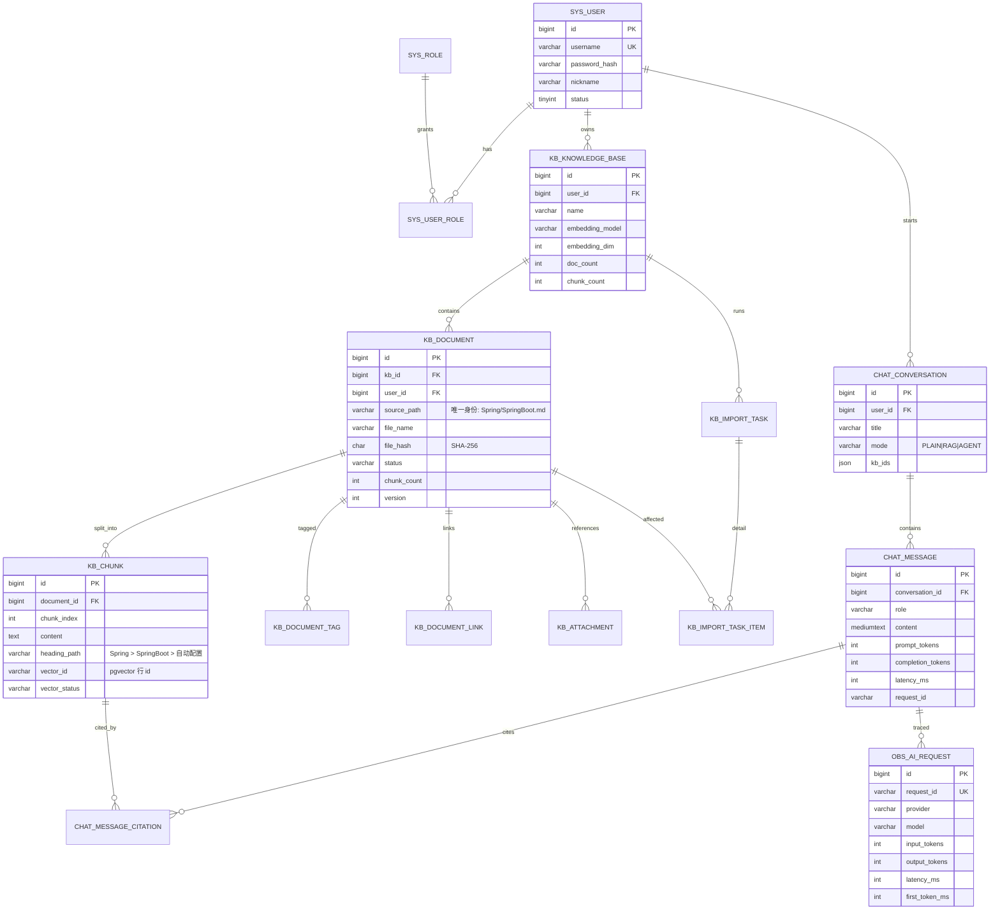

# 数据库设计（Prisdvl-Nexus）

> STEP 1 设计稿。核心表（Phase 0–3）为定稿设计；Phase 5–10 的表为**预留结构**，实现到对应阶段时再细化字段并出 Flyway 脚本。

## 0. 存储分工（为什么不是一个库）

| 存储 | 职责 | 不放在这里的原因 |
| --- | --- | --- |
| **MySQL 8.4.11** | 用户、知识库、文档元数据、Chunk 正文、会话与消息、Agent/工具/工作流/评测/观测 | — |
| **PostgreSQL 18 + pgvector 0.8.6** | Chunk 的向量与相似度检索（HNSW） | MySQL 无原生向量索引 |
| **Elasticsearch 9.4.5 + IK 9.4.5** | Chunk 全文检索与 BM25（中文分词） | MySQL 全文检索对中文/打分的可控性不足 |
| **Redis 8.10.2** | 缓存、限流、分布式锁、短时票据、进度广播 | 非持久化真源，只做加速与协调 |
| **RabbitMQ** | 导入 / 嵌入 / 评测 / 报告等异步任务 | 数据库不该承担任务队列语义 |

**一致性策略**：MySQL 是 **Chunk 的真源（source of truth）**。向量库与 ES 都是**派生索引**；任何删除/重建都以 MySQL 的 `kb_chunk` 为基准做补偿，并提供"重建索引"接口（Phase 3）。

---

## 1. ER 图（核心，Phase 0–3）



---

## 2. 命名与通用约定

| 项 | 约定 |
| --- | --- |
| 引擎 / 字符集 | MySQL 8、`InnoDB`、`utf8mb4` / `utf8mb4_0900_ai_ci` |
| 表名前缀 | `sys_`（账号权限）、`kb_`（知识库）、`chat_`（会话）、`ai_`（模型/提示词/Agent/工具）、`wf_`（工作流）、`eval_`（评测）、`obs_`（观测） |
| 主键 | `id BIGINT`，MyBatis-Plus `IdType.ASSIGN_ID`（雪花），避免自增 ID 暴露业务规模 |
| 审计列 | `created_at DATETIME(3)`、`updated_at DATETIME(3)`、`deleted TINYINT DEFAULT 0`（仅需要软删的表） |
| 逻辑删除 | 只用于 `sys_user` / `kb_knowledge_base` / `kb_document` / `chat_conversation`；`kb_chunk`、`obs_*` 物理删除 |
| 大文本 | Chunk 正文用 `TEXT`；消息正文用 `MEDIUMTEXT`；不使用 `BLOB` 存原文件（原文件落磁盘/对象存储，库里只存路径 + hash） |
| 时间 | 统一 UTC 存储，接口返回 ISO-8601；源文件的创建/修改时间单独存 `doc_created_at` / `doc_updated_at` |
| JSON | 用于"结构可能演进"的字段（`frontmatter`、`metadata`、`config_snapshot`）；**不放需要被检索/关联的字段** |
| 迁移 | Flyway，`V{version}__{desc}.sql`，禁止修改已执行的迁移文件 |
| 索引 | 外键列必建索引；列表查询一律走 `(user_id, created_at)` 组合索引；软删表索引包含 `deleted` |

> **已知遗留（2026-10-09）**：`V15`–`V18` 的注释仍指向已归档的 `docs/productization-gap-analysis.md`
> （正确位置是 `docs/archive/reports/productization-gap-analysis.md`）。**刻意不改**：这几个迁移
> 可能已在真实库（本地 MySQL）执行过，改动文件（哪怕只是注释）有触发 Flyway `Migration checksum
> mismatch` 的风险。要修这类注释，需单独评估并在真库上先跑 `flyway validate`。

### 2.1 MyBatis-Plus 写入约定：JSON 列与 `null` 字段

两类"看起来成功、实际没落库"的坑都已在真实缺陷里踩过，写实体 / Service 时必须遵守。

**(1) JSON 列必须挂 TypeHandler，且 `@TableName` 要开 `autoResultMap`**

H2 的 `json` 列会把写入的 JSON 文本存成"字符串节点"（写 `["1"]` 读回 `"[\"1\"]"`），
而 `updateById` 走"整行读出 → 改字段 → 全列写回"，未改动的 JSON 列也会被把已转义形态再写回，
**每 update 一次多套一层**（实测 `["1"]` → `"[\"1\"]"` → 逐层嵌套），
表现为"改一下标题，绑定的知识库就没了"。

处理：JSON 字段加 `@TableField(typeHandler = JsonTextTypeHandler.class)`，
类上加 `@TableName(value = "...", autoResultMap = true)` —— **没有 `autoResultMap` 时
MyBatis-Plus 不会为该字段启用 resultMap，处理器等于没挂**。

- 现有挂载点：`ChatConversationPO.kbIds`、`ChatMessagePO.metadata`、`DocumentPO.frontmatter` / `tags` / `headingTree`。
- `JsonTextTypeHandler` 有两份（`nexus-app` 与 `nexus-knowledge` 各一），是模块依赖方向（`app → knowledge`，反向引用不了）所致，非重复代码。
- 回归保护：`JsonColumnNoNestingTest`（断言**原始库值长度不增长**）、`JsonColumnRoundTripTest`、
  `MySqlJsonRoundTripTest`（默认跳过，需 `AI_MYSQL_LIVE=true` 才跑真 MySQL）。

**(2) `updateById` 默认跳过 `null` 字段 —— 清空必须用显式信号**

MyBatis-Plus 默认更新策略是 `FieldStrategy.NOT_NULL`：实体字段为 `null` 时**不生成 SET 子句**。
把"清空某列"写成 `entity.setXxx(null)` + `updateById`，会得到
**接口返回 200、响应体已是 null、但库里还是旧值**的假成功（`resetAgent` 就这样漏过一次）。

两种正确写法（项目里都在用）：

| 场景 | 写法 | 证据 |
| --- | --- | --- |
| 列本身允许 `null`，且"用默认"是合法语义 | 字段加 `@TableField(updateStrategy = FieldStrategy.ALWAYS)` | `ChatConversationPO.agentId`（`:89-90`） |
| 有天然的非 null 哨兵值 | 用哨兵替代 `null`（如 `kb_ids` 用 JSON `"[]"`） | `ConversationServiceImpl`（`:213-214`、`:350-352`） |

⚠️ `FieldStrategy.ALWAYS` 会让**每次** `updateById` 都写该列，因此该实体的其余更新点必须是
"先整行读出、再改字段、再写回"（`ConversationServiceImpl.update` 即如此），否则会把未读到的字段误清空。

局部更新的 null 语义在 DTO 层用独立信号表达：`kbIds` 传空列表 = 解绑、
`agentId` 用 `resetAgent: true` 表示清空（`agentId: null` 只能表示"不改"，见 `UpdateConversationRequest`）。

> 本节由已删除的 `docs/backend-findings-agent-constraints.md` 的持久化约束整理而来（2026-10-10），
> 结论已按当前实体注解与 Service 实现重新核实。

---

## 3. 账号与权限（Phase 0）

```sql
CREATE TABLE sys_user (
  id            BIGINT       NOT NULL PRIMARY KEY,
  username      VARCHAR(64)  NOT NULL,
  email         VARCHAR(128)          DEFAULT NULL,
  password_hash VARCHAR(100) NOT NULL,          -- BCrypt
  nickname      VARCHAR(64)           DEFAULT NULL,
  avatar_url    VARCHAR(512)          DEFAULT NULL,
  status        TINYINT      NOT NULL DEFAULT 1, -- 1 正常 0 禁用
  last_login_at DATETIME(3)           DEFAULT NULL,
  created_at    DATETIME(3)  NOT NULL DEFAULT CURRENT_TIMESTAMP(3),
  updated_at    DATETIME(3)  NOT NULL DEFAULT CURRENT_TIMESTAMP(3) ON UPDATE CURRENT_TIMESTAMP(3),
  deleted       TINYINT      NOT NULL DEFAULT 0,
  UNIQUE KEY uk_user_username (username, deleted),
  UNIQUE KEY uk_user_email (email, deleted)
) ENGINE=InnoDB DEFAULT CHARSET=utf8mb4;
```

| 表 | 关键列 | 说明 |
| --- | --- | --- |
| `sys_role` | `code`(`USER`/`ADMIN`)、`name` | RBAC 角色字典 |
| `sys_user_role` | `user_id`、`role_id` | 唯一键 `(user_id, role_id)` |
| `sys_user_session` | 见下节 V21 | Refresh Token 会话（Phase 4）；**不叫** `sys_refresh_token`（早期设计名已废弃） |

#### V21：`sys_user_session`（认证 Phase 4 · Refresh + 设备会话）

```sql
CREATE TABLE sys_user_session (
    id            BIGINT       NOT NULL,
    user_id       BIGINT       NOT NULL,
    token_hash    VARCHAR(64)  NOT NULL,  -- refresh 的 SHA-256 十六进制；绝不存明文
    device_name   VARCHAR(128)          DEFAULT NULL,
    user_agent    VARCHAR(512)          DEFAULT NULL,
    ip_address    VARCHAR(64)           DEFAULT NULL,
    created_at    DATETIME(3)  NOT NULL DEFAULT CURRENT_TIMESTAMP(3),
    last_used_at  DATETIME(3)  NOT NULL DEFAULT CURRENT_TIMESTAMP(3),
    expires_at    DATETIME(3)  NOT NULL,
    revoked       TINYINT      NOT NULL DEFAULT 0,
    revoked_at    DATETIME(3)           DEFAULT NULL,
    PRIMARY KEY (id),
    UNIQUE KEY idx_session_token_hash (token_hash),
    KEY idx_session_user_id (user_id)
) ENGINE=InnoDB DEFAULT CHARSET=utf8mb4;
```

- **opaque refresh**：`SecureRandom` 32 字节 → Base64URL；服务端只存 hash，客户端持有明文一次。
- **rotation**：刷新时 `UPDATE ... SET revoked=1 WHERE id=? AND revoked=0`（并发最多一成功），再 insert 新行。
- **改密 / 忘记密码确认**：`token_version+1` 之外，再 `revokeAllActiveForUser`。
- **不做** Redis 白名单 / jti 黑名单；状态以本表为准。

#### V18：`sys_user.token_version`（平台化 Phase 5.6）

```sql
ALTER TABLE sys_user
    ADD COLUMN token_version BIGINT NOT NULL DEFAULT 0
        COMMENT '令牌版本：改密码时 +1，使已签发的旧 token 立即失效';
```

- **只增不改、带默认值**：存量行自动为 0，于是本次改动之前签发的令牌（`ver` 声明缺失时按 0 处理）
  全部继续有效，**不会集体下线**。
- 令牌里带 `ver` claim，`TokenVersionValidator` 比对它与 `UserAuthCache.expectedTokenVersion(userId)`；
  缓存未命中或 Redis 故障时**回落查 `sys_user`**（DB 是事实来源，缓存只是加速）。
- **为什么是"版本号"而不是 `jti` 黑名单**：黑名单要存到每支令牌的过期时刻，键数随登录次数线性增长；
  而"改密码"这个唯一场景要的是"全部作废"，版本号每用户一个键，且天然表达"所有设备一起下线"。
  完整理由与代价见 `docs/decisions.md` ADR-020。
- `sys_user` 上的**唯一键 `uk_user_email(email, deleted)` 一直存在**，但注册入口此前没有预检邮箱：
  用重复邮箱注册会撞唯一键 → `DataIntegrityViolationException` → `500/9999`（用户看到"系统内部错误"，
  不知道该换邮箱）。5.6 补上预检并新增 `EMAIL_ALREADY_EXISTS(2007)` → `409`，与 `2005` 用户名重复对称。
  **这是"表上已有的约束"与"代码里的校验"不一致造成的静默故障，不是新增约束。**

### 3.1 `workspace`（平台化 Phase 2，迁移 V9）

归属链：`User → Workspace → 资源(知识库/Agent/工作流/工具/应用)`。
第一阶段只实现**个人工作区**：注册时自动创建，与用户 1:1，`name` = "个人工作区"。

```sql
CREATE TABLE workspace (
  id          BIGINT       NOT NULL PRIMARY KEY,
  user_id     BIGINT       NOT NULL,                 -- 所有者
  name        VARCHAR(128) NOT NULL,
  description VARCHAR(512)          DEFAULT NULL,
  type        VARCHAR(16)  NOT NULL DEFAULT 'PERSONAL',  -- PERSONAL / TEAM（预留）
  created_at  DATETIME(3)  NOT NULL DEFAULT CURRENT_TIMESTAMP(3),
  updated_at  DATETIME(3)  NOT NULL DEFAULT CURRENT_TIMESTAMP(3) ON UPDATE CURRENT_TIMESTAMP(3),
  deleted     TINYINT      NOT NULL DEFAULT 0,
  UNIQUE KEY uk_ws_user_type (user_id, type, deleted),   -- 每人每种类型只允许一个未删除工作区
  KEY idx_ws_user (user_id, deleted)
) ENGINE=InnoDB DEFAULT CHARSET=utf8mb4;
```

| 说明 | 内容 |
| --- | --- |
| 幂等创建 | `WorkspaceService.requirePersonalWorkspace(userId)`：查到就返回，没有才建（注册、登录、以及任何需要工作区的入口都走它） |
| 为什么先不动查询条件 | §三十六 要求"查询必须带 `workspace_id` + `owner_id`"。当前阶段所有查询仍是 `user_id`（个人工作区与用户 1:1，两者等价），**权限维度切到 workspace 是 Phase 8 的事**——迁移里 `workspace_id` 允许为 NULL 正是为此 |
| 成员角色 | OWNER/ADMIN/EDITOR/VIEWER 已在设计里占位，表与管理接口 Phase 8 才建 |

---

## 4. 知识库与文档（Phase 2 核心）

### 4.1 `kb_knowledge_base`

| 列 | 类型 | 说明 |
| --- | --- | --- |
| `id` | BIGINT PK | |
| `user_id` | BIGINT | 所有者，**所有查询必须带此条件**（租户隔离） |
| `workspace_id` | BIGINT NULL | 所属工作区（V9 加入；历史数据为空，归属查询仍走 `user_id`） |
| `name` / `description` | VARCHAR | |
| `icon` | VARCHAR(512) NULL | 图标（URL 或 emoji，V10 加入） |
| `status` | VARCHAR(16) | `ENABLED`（默认）/ `DISABLED`；禁用后不参与检索（V10 加入） |
| `retrieval_top_k` | INT | 该库的检索 TopK，默认 5（V10 加入；**Phase 3.2 起真正生效**于 Retriever） |
| `similarity_threshold` | DOUBLE | 相似度阈值，默认 0.25（V10 加入。列默认原为 0.7，与检索实际默认的 0.25 长期不一致，Phase 3.2 统一，见 decisions.md B.32） |
| `source_type` | VARCHAR(16) | `MANUAL` / `OBSIDIAN` / `MIXED` |
| `embedding_provider` / `embedding_model` / `embedding_dim` | VARCHAR / INT | **建库时冻结**；改 embedding 模型必须重建库（见 docs/decisions.md ADR-008） |
| `chunk_strategy` | VARCHAR(32) | `MARKDOWN_HEADING` / `RECURSIVE`（默认前者） |
| `chunk_size` / `chunk_overlap` | INT | 目标 token 与重叠（Markdown 结构化切分的上限/兜底） |
| `doc_count` / `chunk_count` / `total_tokens` | INT | 冗余统计，导入完成后更新 |
| `created_at` / `updated_at` / `deleted` | | |

> V10 的四条 `ADD COLUMN` 是**分开写的**：测试与 standalone 用 H2（MySQL 模式）执行同一批迁移，
> 而 H2 不接受 `ADD COLUMN a ..., ADD COLUMN b ...` 的逗号连写形式。
> 索引 `idx_kb_workspace (workspace_id, deleted)` 同期创建。

索引：`idx_kb_user (user_id, deleted, created_at)`

### 4.2 `kb_document`

```sql
CREATE TABLE kb_document (
  id             BIGINT       NOT NULL PRIMARY KEY,
  kb_id          BIGINT       NOT NULL,
  user_id        BIGINT       NOT NULL,
  file_name      VARCHAR(512) NOT NULL,           -- SpringBoot.md
  file_ext       VARCHAR(16)  NOT NULL,           -- md / pdf / docx / txt
  source_type    VARCHAR(16)  NOT NULL,           -- UPLOAD | OBSIDIAN | ZIP
  source_path    VARCHAR(1024) NOT NULL,          -- Spring/SpringBoot.md（相对 vault 根）
  folder         VARCHAR(512)          DEFAULT NULL, -- Spring（便于按目录过滤）
  title          VARCHAR(512)          DEFAULT NULL, -- frontmatter.title 或首个 H1
  file_size      BIGINT       NOT NULL DEFAULT 0,
  file_hash      CHAR(64)     NOT NULL,           -- SHA-256(原始字节)，增量同步依据
  content_hash   CHAR(64)              DEFAULT NULL, -- SHA-256(规范化正文)，用于判断"只改了时间戳"
  frontmatter    JSON                  DEFAULT NULL, -- 完整 YAML frontmatter
  tags           JSON                  DEFAULT NULL, -- ["Java","SpringBoot"]（冗余自 kb_document_tag，供快速展示）
  heading_tree   JSON                  DEFAULT NULL, -- 标题目录树，供前端文档大纲
  doc_created_at DATETIME(3)           DEFAULT NULL, -- 源文件创建时间
  doc_updated_at DATETIME(3)           DEFAULT NULL, -- 源文件修改时间
  status         VARCHAR(16)  NOT NULL,           -- PENDING|PARSING|CHUNKING|EMBEDDING|INDEXING|READY|FAILED|SKIPPED
  error_msg      VARCHAR(2000)         DEFAULT NULL,
  chunk_count    INT          NOT NULL DEFAULT 0,
  token_count    INT          NOT NULL DEFAULT 0,
  version        INT          NOT NULL DEFAULT 1, -- 每次内容变更 +1
  indexed_at     DATETIME(3)           DEFAULT NULL,
  created_at     DATETIME(3)  NOT NULL DEFAULT CURRENT_TIMESTAMP(3),
  updated_at     DATETIME(3)  NOT NULL DEFAULT CURRENT_TIMESTAMP(3) ON UPDATE CURRENT_TIMESTAMP(3),
  deleted        TINYINT      NOT NULL DEFAULT 0,
  UNIQUE KEY uk_doc_kb_path (kb_id, source_path, deleted),   -- 增量同步的身份键
  KEY idx_doc_kb_status (kb_id, status, deleted),
  KEY idx_doc_kb_folder (kb_id, folder, deleted),
  KEY idx_doc_kb_hash (kb_id, file_hash)
) ENGINE=InnoDB DEFAULT CHARSET=utf8mb4;
```

**关键设计：文档身份 = `(kb_id, source_path)`，不是文件名也不是 id。**
理由：同一个 Vault 反复导入时，路径是唯一稳定标识；改名 = 删除 + 新建（由同步器识别），同名不同目录的笔记（Obsidian 允许）不会互相覆盖。

### 4.3 `kb_chunk`

```sql
CREATE TABLE kb_chunk (
  id            BIGINT      NOT NULL PRIMARY KEY,
  kb_id         BIGINT      NOT NULL,
  document_id   BIGINT      NOT NULL,
  user_id       BIGINT      NOT NULL,
  chunk_index   INT         NOT NULL,           -- 文档内序号，从 0 开始
  chunk_type    VARCHAR(16) NOT NULL,           -- HEADING|PARAGRAPH|CODE|TABLE|LIST
  content       TEXT        NOT NULL,           -- 送入 Embedding/BM25 的最终文本
  raw_content   TEXT                 DEFAULT NULL,-- 原文片段（保留代码块围栏等，用于展示）
  content_hash  CHAR(64)    NOT NULL,           -- SHA-256(content)，Embedding 缓存键
  heading       VARCHAR(512)         DEFAULT NULL,-- 所属最近标题文本
  heading_path  VARCHAR(1024)        DEFAULT NULL,-- Spring > SpringBoot > 自动配置
  heading_level TINYINT              DEFAULT NULL,
  start_offset  INT         NOT NULL DEFAULT 0, -- 在规范化正文中的字符区间，供前端定位
  end_offset    INT         NOT NULL DEFAULT 0,
  token_count   INT         NOT NULL DEFAULT 0,
  char_count    INT         NOT NULL DEFAULT 0,
  vector_id     VARCHAR(64)          DEFAULT NULL,-- pgvector 行 id（UUID）
  vector_status VARCHAR(16) NOT NULL DEFAULT 'PENDING', -- PENDING|DONE|FAILED|STALE
  es_status     VARCHAR(16) NOT NULL DEFAULT 'PENDING',
  created_at    DATETIME(3) NOT NULL DEFAULT CURRENT_TIMESTAMP(3),
  updated_at    DATETIME(3) NOT NULL DEFAULT CURRENT_TIMESTAMP(3) ON UPDATE CURRENT_TIMESTAMP(3),
  UNIQUE KEY uk_chunk_doc_index (document_id, chunk_index),
  KEY idx_chunk_kb_doc (kb_id, document_id),
  KEY idx_chunk_vector (vector_id),
  KEY idx_chunk_hash (content_hash)
) ENGINE=InnoDB DEFAULT CHARSET=utf8mb4;
```

> **为什么 `content_hash` 单独一列**：Embedding 是按内容计费的。相同内容（重复笔记片段、模板段落）在全局缓存里命中即可复用向量，见 Redis `nexus:embed:v1:{sha256}`。

### 4.4 标签与关联

| 表 | 关键列 | 说明 |
| --- | --- | --- |
| `kb_document_tag` | `id`、`kb_id`、`document_id`、`tag`(VARCHAR 128)、`tag_source`(`FRONTMATTER`/`INLINE`/`FOLDER`) | 唯一键 `(document_id, tag)`；索引 `(kb_id, tag)` 支撑"按标签过滤/检索" |
| `kb_document_link` | `id`、`kb_id`、`from_document_id`、`link_type`(`WIKILINK`/`MARKDOWN_LINK`/`EMBED`)、`target`(VARCHAR 512)、`display`(可空)、`start_offset`、`is_external` | WikiLink/Markdown Link 抽取结果。**目标只存文本、不存外键**：`target` 是笔记名 / 相对路径 / URL，读取时才去解析成文档（`is_external=1` 的 http(s) 外链不参与关联图）。因此"目标文档未导入"退化成"解析不到"，不需要一个 `resolved` 列——第 5 章的关联面板据此拆成"出链 / 反向链接 / 待创建"三组 |
| `kb_attachment` | `id`、`kb_id`、`document_id`、`source_path`、`mime`、`size`、`stored_path`、`hash` | 图片等附件；第一版只登记与展示，不做多模态 Embedding |

### 4.5 导入任务（异步 + 增量同步的可观测载体）

| 表 | 关键列 | 说明 |
| --- | --- | --- |
| `kb_import_task` | `id`、`kb_id`、`user_id`、`task_type`(`UPLOAD`/`VAULT_ZIP`/`RESYNC`)、`source_name`（V15，见下）、`status`(`QUEUED`/`RUNNING`/`PARTIAL`/`DONE`/`FAILED`/`CANCELLED`)、`total_files`、`created_count`、`updated_count`、`skipped_count`、`deleted_count`、`failed_count`、`total_chunks`、`total_tokens`、`progress`(0-100)、`started_at`、`finished_at`、`error_msg` | HTTP 立刻返回 `taskId`，前端轮询看进度 |
| `kb_import_task_item` | `id`、`task_id`、`kb_id`、`source_path`、`action`(`CREATED`/`UPDATED`/`SKIPPED`/`DELETED`/`FAILED`)、`document_id`、`old_hash`、`new_hash`、`chunk_count`、`duration_ms`、`message` | 每个文件的处理明细，失败可单文件重试 |

索引：`idx_task_kb (kb_id, created_at)`、`idx_item_task (task_id, action)`

#### V15：`kb_import_task.source_name`（平台化 Phase 5.3）

`VARCHAR(512) NULL`，与 `kb_document.source_path` / `kb_import_task_item.source_path` 同宽。

单文件上传（P1-1）复用了整条导入链路，于是任务行需要知道"这次要导入的是哪个文件"——
ZIP 导入的答案是"暂存包"，单文件上传的答案只能是文件名本身。
把它单独存一列而不是复用 `error_msg` 之类的字段，是因为它描述的是任务的**输入**，
而 `error_msg` 是**输出**；混用会让"这次导入了什么"和"为什么失败"互相覆盖。

叫 `source_name` 而不是 `file_name`：它最终会成为 `kb_document.source_path`
（执行器把它当文件名用，也当库内路径用），与那一列保持同名是为了让"任务输入 → 文档身份"这条链一眼可读。

该列**不随 `ImportTaskResponse` 返回**：它是执行器的输入，用户要看的是结果
（进了哪些文件、哪些失败了）——那由 `kb_import_task_item` 回答。

#### 删除会动哪些表（Phase 5.3 · P1-2）

删除是整个知识库链路里唯一"一处少删就静默留残留"的动作，因此把它单独列清楚。
两类删除的清理对象**不一样**，这不是疏漏，是刻意取舍：

| 表 / 存储 | 删单篇文档 | 删整个知识库 | 为什么 |
| --- | --- | --- | --- |
| pgvector `kb_vector` | 按 `document_id` 删 | 按 `kb_id` 删 | 不删 → 检索命中却取不出正文，且没有任何入口能修 |
| Elasticsearch 文档 | 按 `document_id` 删 | 按 `kb_id` 删 | 同上（BM25 那一路） |
| `kb_chunk` | 物理删 | 物理删 | 量大、无审计价值，留着会让"这个库还有多少数据"失去意义 |
| `kb_document_tag` | 物理删 | 物理删 | 同上（是从文档派生的投影） |
| `kb_document_link` | **只删出链**（`from_document_id = 本文档`） | 按 `kb_id` 全删 | 删一篇笔记时，别人指向它的边要留下——它会退化成"待创建的引用"，这正是 Obsidian 语义 |
| `kb_document` | 逻辑删（`deleted=1`） | 逻辑删 | 保留审计；查询侧靠 `@TableLogic` 过滤 |
| 磁盘原始文件 | 删 | 删（**最后一步**） | 见下 |
| `kb_knowledge_base` 统计列 | 重算 | 整行删除 | 不重算，列表页会一直显示删除前的数字 |

两条顺序上的讲究：

1. **外部存储（向量 / ES）先清，且清不掉就整个失败**（fail-closed）。
   它们不在 MySQL 事务里、无法回滚，所以顺序只能是"先外部、后 MySQL"：
   外部失败 → 事务回滚，文档原封不动、用户可重试；反过来则留下查不到正文的孤儿。
2. **磁盘文件在删库时放最后**。文件孤儿只是浪费磁盘，而"文件已删但事务回滚"是真的数据丢失——
   两种失败的代价不对称，顺序就该不对称。（删单篇时磁盘文件在外部清理之后、事务之内，无害。）

**同名路径的墓碑陷阱**：`uk_doc_kb_path (kb_id, source_path, deleted)` 把 `deleted` 也放进了唯一键
（为了允许"删了再传同名文件"）。但 `deleted` 是 `@TableLogic Integer`，**第二次**逻辑删除同一路径
会写出第二行 `deleted=1` 而撞唯一键——传 → 删 → 再传 → 再删即可复现。
因此逻辑删除前先用原生 SQL 清掉同路径的旧墓碑
（`DocumentMapper.purgePathTombstones` / `purgeKnowledgeBaseTombstones`，原生 `@Delete` 绕过 `@TableLogic`）。
这条路径在加删除按钮之前靠"重复导入 + 删文件"才碰得到，加了按钮就是一键复现。

> 同样形状的陷阱还埋在 `uk_user_username (username, deleted)` 上（见 `docs/archive/reports/productization-gap-analysis.md` P2-15）：
> 目前**没有**删号接口所以不可达，补删号功能前必须先修。

---

## 5. 会话与消息（Phase 1）

| 表 | 关键列 | 说明 |
| --- | --- | --- |
| `chat_conversation` | `id`、`user_id`、`title`、`title_auto`、`mode`(`PLAIN`/`RAG`/`AGENT`)、`kb_ids`(JSON，**可含多个 id**：Phase 5.5 起 RAG 会话一次检索多个库；上限 10，无迁移)、`agent_id`（Phase 4.1，仅 AGENT 模式；NULL = 用内置默认 Agent）、`model_role`、`prompt_template_id`、`message_count`、`last_message_at`、`pinned`、`deleted`、时间列 | 索引 `(user_id, deleted, last_message_at)` |
| `chat_message` | `id`、`conversation_id`、`user_id`、`role`(`USER`/`ASSISTANT`/`SYSTEM`/`TOOL`)、`agent_id`（V17，见下；仅助手消息）、`content`(MEDIUMTEXT)、`reasoning_content`、`model`、`provider`、`prompt_tokens`、`completion_tokens`、`total_tokens`、`latency_ms`、`first_token_ms`、`finish_reason`、`request_id`、`prompt_version_id`、`parent_message_id`、`status`(`STREAMING`/`DONE`/`STOPPED`/`FAILED`)、`error_msg`、`metadata`(JSON)、时间列 | 索引 `(conversation_id, created_at)`、`(request_id)`、`(user_id, agent_id, id)`（V17） |
| `chat_message_citation` | `id`、`message_id`、`citation_index`(正文中的 `[n]`)、`chunk_id`、`document_id`、`kb_id`、`score`、`rank`、`snippet` | 唯一键 `(message_id, citation_index)`；支撑"点击引用 → 打开文档定位标题" |
| `chat_feedback` | `id`、`message_id`、`user_id`、`rating`(1/-1)、`comment` | 后续可回流评测集 |

**Chat Memory ≠ Chat History（必须讲清楚的区别）**

| | Chat Memory | Chat History |
| --- | --- | --- |
| 目的 | 给 LLM 的有界上下文 | 完整历史，供用户查阅/评测 |
| 存储 | Spring AI `ChatMemory` + `ChatMemoryRepository`（JDBC，表 `SPRING_AI_CHAT_MEMORY`，默认窗口 20 条） | 本项目 `chat_message` |
| 生命周期 | 可丢弃、可压缩 | 永久保留 |
| 结论 | 两者**并存**：Memory 负责"发什么给模型"，History 负责"用户看到什么"（Spring AI 官方文档明确二者分离） |

> 注意：Spring AI 2.0.1 的 `JdbcChatMemoryRepository` **不保存 tool-call 消息**（`AssistantMessage` 的工具调用与 `ToolResponseMessage` 会被静默过滤）。Agent 的完整推理链因此落在本项目 `ai_agent_run_step` 中，而不是依赖 ChatMemory。

#### V17：`chat_message.agent_id`（平台化 Phase 5.4 · P1-14）

`BIGINT NULL` + 索引 `idx_msg_user_agent (user_id, agent_id, id)`。

它回答的问题：**"这条回答是哪个 Agent 跑的？"** 加这一列之前答不出来——
`chat_conversation.agent_id` 只在会话上记了**当前选择**，而它是活的（随时可改、可为 NULL），
历史消息无法据此回溯。

| 列 | 语义 |
| --- | --- |
| `chat_conversation.agent_id` | **活指针**：这个会话现在用哪个 Agent；NULL = 跟随内置默认 |
| `chat_message.agent_id` | **历史事实**：这条回答当时实际跑的是哪一行；插入即定，不随会话换绑而变 |

三点刻意的设计（详见 `docs/decisions.md` B.45）：

1. **两列同名不同义，不是重复存储**。会话不选 Agent 时，消息上落的仍是**解析后**的内置默认那一行的真实 id——
   照抄会话上的 NULL 的话，用户问"这是谁答的"就永远没有答案，而接口一切正常，没人会报 bug；
2. **只记助手消息，用户消息恒为 NULL**：用户消息不是任何 Agent 产出的；给它也写 id 会让
   "按 agent_id 聚合"把每轮对话重复计两次；
3. **索引带 `user_id` 前缀而不是裸 `agent_id`**：这是多租户表，全仓查询一律带 `user_id`
   （同表 `idx_msg_conv` 也是 `(conversation_id, user_id, id)` 这种带归属列的形状）。
   裸 `agent_id` 索引只会被跨租户查询用上——它的存在本身就会诱导后来者写出漏 `user_id` 的查询。
   `user_id` 打头正是为了让 P1-14 的聚合查询（`GROUP BY agent_id WHERE user_id = ?`）被索引接住。

存量消息为 NULL = 未知出处（5.4 之前的消息确实无法回溯），如实表达，不回填。

---

## 6. 模型 / 提示词 / Agent / 工具（Phase 5–6 预留）

### 6.0 已实现：`agent` / `agent_knowledge_base`（平台化 Phase 4.1，迁移 V12）

| 表 | 关键列 | 说明 |
| --- | --- | --- |
| `agent` | `id`、`workspace_id`、`owner_id`、`code`、`name`、`description`、`system_prompt`(TEXT)、`model_role`、`status`(`DRAFT`/`PUBLISHED`/`DISABLED`)、`builtin`、时间列、`deleted` | 索引 `(owner_id, deleted, created_at)`、`(workspace_id, deleted, status)` |
| `agent_knowledge_base` | `id`、`agent_id`、`kb_id`、`created_at` | 唯一键 `(agent_id, kb_id)`；物理表（改绑 = 删旧行 + 插新行，无逻辑删除） |

三点与设计稿的**有意偏差**（详见 `docs/decisions.md` B.35）：

1. **表名不带 `ai_` 前缀**：`agent` 而不是 `ai_agent`。它与 `chat_*` / `kb_*` 一样属于本项目的业务表
   （由本项目的服务层管理生命周期），`ai_` 语义留给"AI 基础设施"（提示词版本、工具注册表）；
2. **`code` 的唯一性在服务层按 `deleted = 0` 校验，不建唯一键**：软删表上的唯一键会让
   "删掉 `helper` 再建一个 `helper`"直接冲突（`deleted=1` 那行还在），这是本项目一贯做法（与 `kb_knowledge_base` 同）；
3. **刻意没建** `max_iterations` / `timeout_ms` / `memory_config`：今天没有任何机制会读它们
   （轮数上限在 Spring AI 的 `ToolCallingManager`，超时在 HTTP 层，记忆策略由模式决定）。
   存下来但没人读的配置比没有这个配置更糟——用户会以为配了就生效。

> **多知识库（Phase 5.5 / 5.5.1）没有产生任何迁移，也不需要 V19。** 需求里问的
> "要不要建 `agent_knowledge_base_relation`"——**这张表 V12 就有了**（就是上面这张，
> 带唯一键 `uk_agent_kb`）。会话侧的多库绑定走 `chat_conversation.kb_ids`（V2 起就是 JSON 列）。
> 5.5.1 只改了**怎么并发地读这些绑定**（扇出 + 逐库失败隔离），读的还是同一批行。
> 顺带记一个反例：把绑定改成 `agent` 表上的 JSON 列会**丢掉**唯一约束，
> 以及"这个库被哪些 Agent 用了"的反查能力（`idx_agent_kb_kb` 就是为此建的）——
> 所以"复用已有表"在这里不只是省事，是唯一正确的选择。

### 6.0.1 已实现：`tool` / `agent_tool`（平台化 Phase 4.3，迁移 V13）

| 表 | 关键列 | 说明 |
| --- | --- | --- |
| `tool` | `id`、`workspace_id`、`owner_id`、`code`、`enabled`、时间列、`deleted` | 索引 `(owner_id, deleted)`；**覆盖行**：无行 = 用代码侧默认（启用） |
| `agent_tool` | `id`、`agent_id`、`tool_code`、`created_at` | 唯一键 `(agent_id, tool_code)`；**无行 = 不限制**；物理表（改绑 = 删旧行 + 插新行） |

三点与设计稿的**有意偏差**（详见 `docs/decisions.md` B.38）：

1. **描述性列一概不建**（`name` / `description` / `category` / `json_schema` / `source`）：
   它们唯一的真实来源是代码里的 `@Tool` 方法（名字、描述、schema 都由框架反射出来，
   模型看到的描述必须与实现同步），而读路径也只能用代码侧那一份 →
   库里那份就是**永远不被读的死数据**，只会在评审时误导人。与第 3 条同一理由。
   外部工具（MCP server / 自定义 HTTP）落地时，"只有数据库才知道"的配置才第一次真的存在，
   那时加列与接上读路径同一次做；
2. **引用键是 `tool_code` 而不是 `tool_id`**：内置工具的实现活在代码里，它的"身份"本来就是 code；
   而 `tool` 表的行是可以不存在的覆盖行，用 id 引用会立刻悬空。code 稳定，行被删/重建都不影响绑定；
3. **`agent_tool.enabled` 没建**（设计稿有）：白名单的"在不在里面"已经表达了用不用这个工具；
   一个恒为 1、没有任何写入点的标志位只会让后来的人以为它能关。
   当时同样不建的 `permission` 已在 **6.0.4（P0，V22）** 以独立的 `ai_tool_registry` 落地——
   它的值是工具固有的属性、与用户无关，混进按用户的 `tool` 表会产生"同一工具 A 说 WRITE、B 没有行"的歧义；
   `timeout_ms` / `rate_limit` 仍不建（今天没有任何一处会读它们）。

### 6.0.2 已实现：`agent.answer_policy`（平台化 Phase 4.4，迁移 V14）

`agent` 表**新增一列**（6.0 的那张表是 V12 时的状态，此处是它的增量）：

| 列 | 类型 | 说明 |
| --- | --- | --- |
| `answer_policy` | `VARCHAR(16) NOT NULL DEFAULT 'KB_PREFERRED'` | 没有可引用资料时怎么答：`KB_PREFERRED`（可用自身知识，但必须注明不是来自笔记）/ `KB_ONLY`（只依据笔记，没有就说没找到） |

两点说明（详见 `docs/decisions.md` B.41）：

1. **默认 `KB_PREFERRED`**：`KB_ONLY` 是 4.4 之前的**唯一**行为，而它的代价落在"刚注册、
   还没导入笔记"的新用户身上——第一次提问就吃一句拒绝。默认值取哪个，就是决定这批人看到什么；
2. **只有一列，没有 DML**：整个 migration 目录没有 DML 先例（全是 DDL），存量行的**提示词**
   改写交给 Java 侧按"历史指纹"就地升级（`AgentService.resolveDefault`）。写进 SQL 的话，
   那句中文长字面量会成为提示词的**第三个**真源（另两处是 `AgentPrompts` 常量与库里的行）。

### 6.0.3 已实现：`agent.temperature`（平台化 Phase 5.4 · P1-8，迁移 V16）

`agent` 表**新增一列**：

| 列 | 类型 | 说明 |
| --- | --- | --- |
| `temperature` | `DECIMAL(3,2) NULL` | 采样温度 0.00–2.00；**NULL = 跟随全局 `ai.defaults.temperature`**（0 是"显式要求确定性"，与 NULL 不同义） |

三点说明（详见 `docs/decisions.md` B.45）：

1. **NULL 与 0 是两件事，不要合并**。NULL = 没配过、跟随运维的全局值；0 = 贪心解码、显式要求最高确定性。
   用 0 当"未配置"的哨兵，等于让"我想要 0"这件事永远表达不出来；
2. **范围校验在服务层（越界报 1001），不靠列的宽度**。`DECIMAL(3,2)` 结构上容不下 0–2 之外的大数，
   那是第二道防线；服务层那条才是给出可读错误的那条。**上限取 2 而不是 1**：OpenAI 允许 0–2，
   Anthropic 允许 0–1，取并集才不会把 OpenAI 上合法的 1.5 挡在门外；
3. **生效点是 `AgentRuntime.configure`**（两条执行链路唯一的公共装配点），以请求级 `ChatOptions`
   覆盖模型默认值，**不重建 ChatModel**——`ChatClient` 的合并语义是"从模型默认选项 `mutate()`
   出发、逐字段被请求级非空值覆盖"，所以只写 temperature，`model` / `baseUrl` / `apiKey` 一个都不会丢。
   因此它只作用于**由 Agent 驱动的调用**：PLAIN / RAG 会话与 `/api/knowledge/**/ask` 不走 configure，
   仍用全局默认——这是生效范围的诚实边界，不是遗漏。

> 这一列与 6.0 里"刻意没建 `max_iterations` / `timeout_ms`"是同一条规则的对照：
> 那两个被拒是因为**没有任何机制会读它们**；temperature 落地时就带着读它的那一行，
> 所以它不是假旋钮。加配置时必须连同"谁读它"一起落地。

### 6.0.4 已实现：工具授权与 Agent 审批（P0，迁移 V22）

六张新表，全部是**只增不改**（不动 V1–V21 的任何表/列）：

| 表 | 关键列 | 说明 |
| --- | --- | --- |
| `ai_tool_registry` | `id`、`code`(唯一)、`name`、`description`、`source`、`category`、`permission`、`enabled`、时间列 | **工具注册元数据**：每个工具一行，`permission`(`READ`/`WRITE`/`DANGEROUS`) 是**运行时权威** |
| `ai_agent_run` | `id`、`user_id`、`conversation_id`、`agent_id`、`question`、`status`、`max_iterations`、`iteration_count`、`model_role`、`answer`、`error_code`、`error_msg`、`created_at`/`started_at`/`finished_at`/`updated_at` | 一次 Agent 运行（状态机，可挂起等审批） |
| `ai_agent_run_step` | `id`、`run_id`、`seq`、`step_type`(`THINK`/`TOOL_CALL`/`OBSERVATION`/`ANSWER`)、`tool_code`、`input_digest`、`output_digest`、`status`(`OK`/`FAILED`/`DENIED`/`CANCELLED`)、`created_at` | 运行轨迹；唯一键 `(run_id, seq)` 保证顺序 |
| `ai_tool_approval` | `id`、`run_id`、`user_id`、`invocation_id`、`tool_code`、`arguments_digest`、`reason`、`status`(`PENDING`/`APPROVED`/`DENIED`/`CANCELLED`/`EXPIRED`)、`decision_scope`(`once`/`always`/`deny`)、`decision_reason`、`created_at`/`decided_at` | 人工审批记录 |
| `ai_tool_invocation` | `id`、`run_id`、`step_id`、`user_id`、`tool_code`、`permission`、`arguments_digest`、`approval_id`、`status`(`PENDING_APPROVAL`/`SUCCEEDED`/`FAILED`/`DENIED`/`CANCELLED`)、`result_digest`、`error_code`、`started_at`/`finished_at` | 工具调用审计（**被拒/被取消/等待超时同样落一行**） |
| `ai_tool_grant` | `id`、`user_id`、`tool_code`、`scope`(恒 `ALWAYS`)、`created_at`/`updated_at` | 用户级长期授权；唯一键 `(user_id, tool_code)` |

四个与设计稿不同的决定，都写在这里免得以后被"补回设计稿"：

1. **权限单独一张注册表，不进 `tool` 表**。`tool` 是按用户的覆盖行（"这个用户关了哪些工具"），
   `permission` 是工具固有的风险等级、与用户无关。混在一起会立刻产生歧义：同一个工具，
   A 的覆盖行说 `WRITE`、B 没有行时听谁的？所以另建 `ai_tool_registry`，每个 code 恰好一行。
2. **同步只在首次创建时写默认权限**。启动时（`ApplicationReadyEvent`）从代码声明幂等同步
   `name`/`description`/`source`/`category`，但**不覆盖已存在的 `permission` 与 `enabled`**——
   否则管理员把某个工具降级为 `DANGEROUS` 的动作会在下一次重启时被悄悄改回 `READ`，
   而且没有任何日志。行不存在时才用代码声明的默认值插入。
3. **不建 `input_schema` / `requires_approval` 列**。入参 schema 的唯一真源仍是代码里的 `@Tool` 方法
   （反射生成，MCP 的 `tools/list` 直接读它）；"要不要审批"不需要独立开关，
   `permission != READ && 无 always 授权` 就是全部判定——多一个可以从两处推出的字段，
   迟早会出现两处不一致。
4. **不做逻辑删除**。这几张是**只追加的执行轨迹**，没有"逻辑删除"这个业务动作；
   建 `deleted` 只会让"这条记录为什么查不到"多一种解释。撤销授权是物理删（幂等）。

运行状态与审批决策都用**条件更新**落定：
`ai_agent_run` 用 `UPDATE … WHERE id=? AND status=?`（只有一次合法转换能成功）、
`ai_tool_approval` 用 `UPDATE … WHERE id=? AND status='PENDING'`（重复/并发提交只有一个能生效）。

> **已知边界**：等待审批的 future 注册表在**内存里**（`ToolApprovalService.pendingById`）。
> 进程重启后 `WAITING_APPROVAL` 的行仍然存在（刷新页面能看到待审批，这是持久化的价值），
> 但那条运行上下文已经没了——此时提交审批会落定审批记录、同时把运行标成 `FAILED`
> （"运行上下文已丢失"），**不会**假装恢复执行。

### 6.1 设计稿（未实现的部分）

| 表 | 关键列 | 说明 |
| --- | --- | --- |
| `ai_prompt_template` | `id`、`code`(如 `rag.answer`)、`name`、`description`、`scene` | 逻辑提示词 |
| `ai_prompt_version` | `id`、`template_id`、`version`、`content`、`variables`(JSON)、`temperature`、`max_tokens`、`top_p`、`status`(`DRAFT`/`PUBLISHED`/`ARCHIVED`)、`published_at`、`created_by` | 唯一键 `(template_id, version)`；**每次 AI 调用都记录 `prompt_version_id`**，评测才能对比版本 |
| `ai_tool_registry` | 见 6.0.4 | **已实现**（V22）。与设计稿的差异：不建 `mcp_server_id` / `input_schema` / `requires_approval`（理由见 6.0.4） |
| `ai_agent_tool` | `id`、`agent_id`、`tool_id`、`enabled`、`requires_approval` | **Agent 权限矩阵**：已按 6.0.1 实现为 `agent_tool`（无 `enabled`、按 code 引用）；`requires_approval` **不再打算建**——审批与否由 `ai_tool_registry.permission` + `ai_tool_grant` 推出 |
| `ai_tool_invocation` | 见 6.0.4 | **已实现**（V22）。与设计稿的差异：不存 `message_id` / `duration_ms` / `approved_by`（审批人就是 run 的 owner；时间差由 `started_at`/`finished_at` 得出），入参与结果存**脱敏摘要**而不是原始 JSON |
| `ai_agent_run` | 见 6.0.4 | **已实现**（V22）。与设计稿的差异：用 `question`/`answer` 而不是 `goal`/`step_count`/`total_tokens`（token 记账仍归 `chat_message` 与配额） |
| `ai_agent_run_step` | 见 6.0.4 | **已实现**（V22）。**刻意不存模型完整思维链**：`THINK` 只是阶段标记，这一点与设计稿"完整思维链轨迹"的表述相反，以本节为准 |

---

## 7. 工作流（Phase 8 预留）

| 表 | 关键列 |
| --- | --- |
| `wf_definition` | `id`、`user_id`、`code`、`name`、`version`、`status`(`DRAFT`/`PUBLISHED`)、`input_schema`(JSON) |
| `wf_node` | `id`、`definition_id`、`node_key`、`node_type`(`START`/`AI`/`TOOL`/`CONDITION`/`PARALLEL`/`HUMAN_APPROVAL`/`END`)、`config`(JSON：prompt/model/tool/条件表达式)、`position_x`、`position_y` |
| `wf_edge` | `id`、`definition_id`、`from_node_key`、`to_node_key`、`condition`(可空) |
| `wf_run` | `id`、`definition_id`、`definition_version`、`user_id`、`status`、`input`(JSON)、`output`(JSON)、`current_node_key`、`started_at`、`finished_at`、`error_msg` |
| `wf_node_run` | `id`、`run_id`、`node_key`、`node_type`、`status`(`PENDING`/`RUNNING`/`WAITING_APPROVAL`/`DONE`/`FAILED`/`SKIPPED`)、`attempt`、`input`、`output`、`duration_ms`、`error_msg` |

> 设计原则：**每个节点执行都落库**，工作流可中断、可恢复、可回放。人工确认节点 = `status=WAITING_APPROVAL`，由 API 恢复。

---

## 8. 评测（Phase 9 预留）

| 表 | 关键列 |
| --- | --- |
| `eval_dataset` | `id`、`user_id`、`kb_id`、`name`、`description` |
| `eval_case` | `id`、`dataset_id`、`question`、`expected_answer`、`expected_document_id`、`expected_source_path`、`expected_tags`(JSON)、`difficulty`、`enabled` |
| `eval_run` | `id`、`dataset_id`、`user_id`、`name`、`config_snapshot`(JSON：chunk 参数/topK/混合权重/是否 rerank/prompt_version/模型)、`status`、`total_cases`、`passed_cases`、`metrics_avg`(JSON)、`started_at`、`finished_at` |
| `eval_case_result` | `id`、`run_id`、`case_id`、`retrieved`(JSON)、`answer`、`citations`(JSON)、`metrics`(JSON：`retrieval_hit`/`mrr`/`recall_at_k`/`context_precision`/`context_recall`/`answer_relevance`/`faithfulness`/`citation_accuracy`)、`judged_by_model`、`judge_reason`(JSON)、`latency_ms`、`tokens`、`error_msg` |

> **不允许虚构指标**：每条指标必须能追溯到该 case 的真实检索结果、真实回答与裁判理由；裁判模型不可用时该指标写 `null` 并在 `judge_reason` 说明，而不是编一个分数。

---

## 9. 观测（Phase 10 预留）

| 表 | 关键列 |
| --- | --- |
| `obs_ai_request` | `id`、`request_id`(唯一)、`trace_id`、`user_id`、`conversation_id`、`message_id`、`agent_run_id`、`scene`(`CHAT`/`RAG`/`AGENT`/`EMBEDDING`/`EVALUATION`/`WORKFLOW`)、`provider`、`model`、`prompt_version_id`、`input_tokens`、`output_tokens`、`total_tokens`、`latency_ms`、`first_token_ms`、`retrieval_count`、`retrieved_document_ids`(JSON)、`tool_call_count`、`tool_codes`(JSON)、`success`、`error_code`、`error_msg`、`estimated_cost DECIMAL(12,6)`、`created_at` |
| `obs_daily_stat` | `id`、`stat_date`、`user_id`、`scene`、`model`、`request_count`、`token_in`、`token_out`、`avg_latency_ms`、`avg_first_token_ms`、`error_count`、`cost` |

索引：`idx_obs_user_time (user_id, created_at)`、`idx_obs_scene_time (scene, created_at)`、`uk_obs_request (request_id)`
数据量大时的演进：按月分区或归档到 ClickHouse（第一版不做，写在 ADR 里说明）。

---

## 10. PostgreSQL + pgvector

```sql
CREATE EXTENSION IF NOT EXISTS vector;
CREATE EXTENSION IF NOT EXISTS hstore;
CREATE EXTENSION IF NOT EXISTS "uuid-ossp";

-- Spring AI PgVectorStore 管理的表（initialize-schema=false 时由 Flyway 建）
CREATE TABLE IF NOT EXISTS vector_store (
  id        UUID PRIMARY KEY DEFAULT uuid_generate_v4(),
  content   TEXT,
  metadata  JSON,
  embedding vector(1024)          -- 与 kb_knowledge_base.embedding_dim 必须一致
);
CREATE INDEX IF NOT EXISTS idx_vector_store_hnsw
  ON vector_store USING HNSW (embedding vector_cosine_ops);
CREATE INDEX IF NOT EXISTS idx_vector_store_meta
  ON vector_store USING GIN (metadata jsonb_path_ops);
```

**metadata 键（Agents 检索过滤的依据，必须与写入代码一致）**

```json
{
  "user_id": 1001, "kb_id": 1, "document_id": 100, "chunk_id": 20001,
  "file_name": "SpringBoot.md", "source_path": "Spring/SpringBoot.md",
  "folder": "Spring", "title": "Spring Boot", "heading": "自动配置",
  "heading_path": "Spring > SpringBoot > 自动配置", "tags": ["Java", "SpringBoot"],
  "chunk_index": 5, "chunk_type": "PARAGRAPH"
}
```

**要点**
- 维度在**建库时冻结**；pgvector 的 HNSW 索引最大支持 2000 维（1024 维安全）。改 embedding 模型 = 新建知识库并全量重建。
- 每次向量检索**必须**带 `user_id`（+ 可选 `kb_id`）过滤，这是多用户隔离的最后一道防线（第一道在 MySQL 查询条件）。
- `vector_store` 只当索引：Chunk 正文以 MySQL 为准；`kb_chunk.vector_id` 保存 `vector_store.id`，删除文档时按 `document_id` 过滤删除。

---

## 11. Elasticsearch

**索引（带版本号 + 别名，方便重建不中断）**：`nexus_chunk_v1` → 别名 `nexus_chunk`

```json
{
  "settings": {
    "number_of_shards": 1,
    "number_of_replicas": 0,
    "analysis": {
      "analyzer": {
        "nexus_ik": { "type": "custom", "tokenizer": "ik_max_word", "filter": ["lowercase"] },
        "nexus_ik_search": { "type": "custom", "tokenizer": "ik_smart", "filter": ["lowercase"] }
      }
    }
  },
  "mappings": {
    "properties": {
      "chunk_id":     { "type": "long" },
      "document_id":  { "type": "long" },
      "kb_id":        { "type": "long" },
      "user_id":      { "type": "long" },
      "chunk_index":  { "type": "integer" },
      "content":      { "type": "text", "analyzer": "nexus_ik", "search_analyzer": "nexus_ik_search" },
      "title":        { "type": "text", "analyzer": "nexus_ik", "fields": { "raw": { "type": "keyword" } } },
      "heading_path": { "type": "text", "analyzer": "nexus_ik" },
      "tags":         { "type": "keyword" },
      "folder":       { "type": "keyword" },
      "source_path":  { "type": "keyword" },
      "file_name":    { "type": "keyword" },
      "chunk_type":   { "type": "keyword" },
      "created_at":   { "type": "date" }
    }
  }
}
```

- 中文分词用 **IK**（`ik_max_word` 索引 + `ik_smart` 查询是经典搭配）；IK 版本必须与 ES 版本严格一致，因此用自定义 Dockerfile 装插件（见 docs/decisions.md ADR-006）。
- 所有 BM25 查询都带 `filter: user_id (+ kb_id)` —— **过滤用 filter 不算分**，比 must 更快也更符合语义。
- 字段语义与 `vector_store.metadata` 保持一致，混合检索才能按同一套条件过滤。

---

## 12. Redis Key 设计

### 12.1 已实现（平台化 Phase 5.6）

| Key | 类型 | TTL | 用途 |
| --- | --- | --- | --- |
| `nexus:auth:tv:{userId}` | String | 5m（`nexus.jwt.token-version-cache-ttl`） | 令牌版本缓存；**DB 是事实来源**，未命中/故障时回落查库 |
| `nexus:auth:lf:{username}` | String(计数) | 15m（窗口） | 登录失败次数 |
| `nexus:auth:ll:{username}` | String | 15m（冻结时长） | 登录冻结标记 |
| `nexus:rl:u:{userId}:{yyyyMMddHHmm}` | String(计数) | 1m（+余量） | 用户级分钟限流 |
| `nexus:rl:ip:{ip}:{yyyyMMddHH}` | String(计数) | 1h（+余量） | 注册限流（IP 维度） |
| `nexus:q:req:{userId}:{yyyyMMdd}` | String(计数) | 当日结束 | 每日请求次数 |
| `nexus:q:tok:{userId}:{yyyyMMdd}` | String(计数) | 当日结束 | 每日 token 用量 |

**时间片是键名的一部分，这就是窗口机制**：固定窗口不靠"到点清零"，而是"下一分钟换一个键"，
旧键交给 TTL 回收。TTL 比窗口长一档，是为了避开时钟边界上"新键刚建就被删"的窄缝。
`{ip}` 在真机上是 `0:0:0:0:0:0:0:1` 这种 IPv6 写法（`getRemoteAddr()` 的返回值），按字符串入键，
不做归一化。上表是**实测 `redis-cli KEYS 'nexus:*'` 后校正过的**（初稿漏了三个时间片后缀）。

**这些键只在 `nexus.security.redis-enabled=true` 时存在**；默认走进程内存实现
（`standalone` / `test` 不依赖任何外部基础设施，键名相同但不在 Redis 里）。
实测键名与 TTL 记录在 `docs/decisions.md` B.47 末节。

### 12.2 设计稿（尚未实现）

| Key | 类型 | TTL | 用途 |
| --- | --- | --- | --- |
| ~~`nexus:auth:refresh:{jti}`~~ | — | — | **已废弃**：Phase 4 refresh 状态在 MySQL `sys_user_session`，不走 Redis |
| `nexus:auth:blacklist:{jti}` | String | 与 token 同寿命 | 主动让单支 access 立刻失效（当前 logout 不吊销 access，靠 exp / token_version） |
| `nexus:sse:ticket:{ticket}` | String | 60s | SSE 一次性鉴权票据（EventSource/fetch 无法带 Header 的替代方案） |
| `nexus:import:lock:{kbId}` | String | 30m | 同一知识库导入互斥（分布式锁） |
| `nexus:import:progress:{taskId}` | Hash | 1d | 导入进度（与 DB 双写，前端读缓存更快） |
| `nexus:embed:v1:{sha256(content)}` | String(JSON float[]) | 30d | **Embedding 缓存**：同内容不重复调用、不重复付费 |
| `nexus:search:v1:{sha256(query+filters)}` | String(JSON) | 5m | 检索结果缓存（仅用于评测/幂等重放） |
| `nexus:chat:window:{conversationId}` | List | 2h | 会话窗口热缓存（Memory 的加速层，非真源） |
| `nexus:stream:cancel:{requestId}` | String | 10m | "停止生成"信号，流式循环每 chunk 检查 |
| `nexus:agent:approval:{runId}` | Hash | 1h | 待人工确认的工具调用快照 |

> 本节表格此前把两栏混在一起，读起来像"这些都实现了"。5.6 拆成 12.1 / 12.2：
> 只有 12.1 在代码里，其余仍是设计稿（§12.1 里也没有黑名单——吊销走的是版本号，不是黑名单，见 ADR-020）。

---

## 13. 从"表设计"到"实现"的顺序

1. Phase 0：`sys_*` + Flyway 基线 + PG 扩展与 `vector_store` 表。
2. Phase 1：`chat_conversation` / `chat_message` / `chat_message_citation` + Spring AI JDBC ChatMemory 表。
3. Phase 2：`kb_knowledge_base` / `kb_document` / `kb_document_tag` / `kb_document_link` / `kb_attachment` / `kb_import_task(_item)`。
4. Phase 2（平台化）：`workspace`（V9）+ `kb_knowledge_base` 的 `workspace_id` / `icon` / `status` / `retrieval_top_k` / `similarity_threshold`（V9 / V10，全部只增不改）。
5. Phase 3：`kb_chunk` + ES 索引 + 向量写入。
6. Phase 5–10：按对应 ADR 补 `ai_*` / `wf_*` / `eval_*` / `obs_*`。
7. 平台化 5.6：`sys_user.token_version`（V18）——只增一列 + 一条预检，没有新表。
8. 平台化 5.5 / 5.5.1（多知识库 RAG）：**零迁移**。绑定表复用 V12 的 `agent_knowledge_base`，
   会话侧复用 V2 的 `chat_conversation.kb_ids`；并行化与失败隔离都是纯读路径的改动。
9. P0（工具授权与人工审批，V22）：`ai_tool_registry` / `ai_agent_run` / `ai_agent_run_step` /
   `ai_tool_approval` / `ai_tool_invocation` / `ai_tool_grant` ——六张新表，见 6.0.4。
   权限与审批状态都靠**条件更新**落定，不引入乐观锁列。
