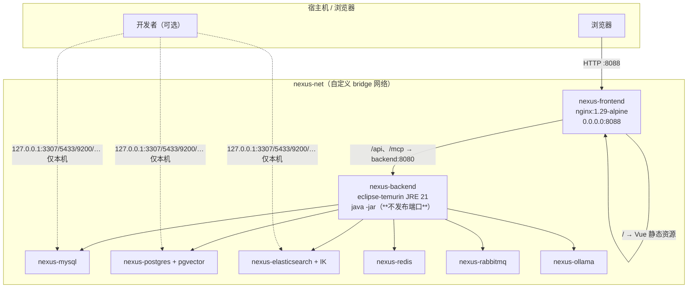

# 部署与使用说明（Phase 5.7 容器化 / Phase 11 生产化）

本文档写给两类人：**要把它跑起来的人**，和**要把它讲出来的人**（面试）。
架构细节见 [architecture.md](architecture.md)，接口见 [api.md](api.md)，踩坑记录见 [decisions.md](decisions.md)。

> **五类验证，不要混为一谈。** 本文里每个结论都标了它来自哪一层：
> **UNIT**（`mvn test` 的单元测试）／**INTEGRATION**（MockMvc / 起 Spring 上下文的集成测试）／
> **E2E**（真浏览器 + 真后端的 `verify-*.mjs`）／**LIVE**（依赖真实 ES / pgvector / 模型的测试）／
> **REAL ENVIRONMENT**（`docker compose` 起整栈后真实执行的操作）。
> 一层绿不等于另一层绿。**任何没真实跑过的，本文一律写 NOT VERIFIED。**

---

## 1. 三种跑法

> **想直接看到成品：跳 方式 C**（`docker compose up -d`，一条命令得到完整系统）。
> 方式 A/B 仍然保留——它们是**开发**形态（热更、调试端口），不是部署形态。

### 方式 A：standalone —— 零依赖，5 分钟看到全貌

不需要 Docker，不需要 MySQL/ES/pgvector。后端用 H2 内存库，检索自动降级为 SQL 关键词匹配。

```bash
# 1. 后端：Java 21 + Maven
export JAVA_HOME=/path/to/jdk-21
export AI_CHAT_API_KEY=<OpenCode Zen 的 oc_ 开头 key>   # 只有问答/Agent/评测需要模型
mvn clean package -DskipTests
java -Xmx512m -jar nexus-app/target/nexus-app-0.0.1-SNAPSHOT.jar --spring.profiles.active=standalone

# 2. 前端：Node 18+
cd web
npm install
npm run dev            # http://localhost:5173
```

- 注册任意账号即可用；演示数据见第 4 节。
- **H2 是内存库：后端每次重启，数据都会清空**，需要重新导入笔记。
- standalone 下「检索 / 问答」两个页签与 Agent 的检索会**如实降级**（关键词匹配），
  而不是报错——这是刻意设计（见 decisions.md B.29）。

### 方式 B：完整栈（开发形态）—— compose 起基础设施 + 本机 `java -jar`

```bash
cd deploy
cp .env.example .env          # 填上模型 key
docker compose up -d mysql postgres elasticsearch redis rabbitmq ollama
cd .. && mvn clean package -DskipTests
java -jar nexus-app/target/nexus-app-0.0.1-SNAPSHOT.jar --spring.profiles.active=local
```

后端在**宿主机**上跑，容器只提供基础设施；前端用 `npm run dev`（Vite，5173）。
适合改代码后热重启——但**这不是部署形态**：没有 nginx、没有镜像、宿主机要装 JDK。
启动后首次导入的笔记需要两步显式操作（默认 profile 关闭了自动嵌入/建索引，刻意让失败原因独立可查）：
知识库详情页 → 「向量化」→ 「建索引」。

### 方式 C：整栈容器化（Phase 5.7）—— 一条命令得到完整系统

```bash
cd deploy
cp .env.example .env                    # 只需填两个值：JWT_SECRET、AI_CHAT_API_KEY
JAVA_HOME=/d/develop/jdk-21 mvn -B package -DskipTests   # 在仓库根目录，先产出 jar
docker compose build                    # 构建 backend / frontend（首次含 ES+IK 镜像）
docker compose up -d
docker compose ps                       # 等到 8 个服务全部 (healthy)
# 浏览器打开 http://localhost:8088
```

**容器内不需要 JDK / Maven / Node**——镜像里只有 JRE 与静态资源（见 §2.4）。
下面 §2 逐项说明这套编排：架构、拓扑、变量、启停、持久化、健康检查、Nginx、SSE、常见问题、
以及本期真机验收的结果。

## 2. 容器化部署（Phase 5.7）

> 本节所有"实测/观察"结论都来自 **REAL ENVIRONMENT** 层：2026-10-02 在本机 Docker Desktop
> （29.5.2 / Compose v5.1.3，WSL2，容器可用内存 7.569 GiB）上真实执行。

### 2.1 Docker 架构：为什么是"三个自建镜像 + 五个官方镜像"



三点设计取舍：

1. **应用镜像自己构建，基础设施用官方镜像**。只有两个应用镜像（backend / frontend）需要写
   Dockerfile；ES 因为要装 IK 中文分词插件、且插件版本必须与 ES 完全一致，也用了一个很薄的
   Dockerfile（`deploy/elasticsearch/`）。其余五个用官方镜像 + 环境变量配置，
   **不自己维护基础镜像**。
2. **业务代码没有为 Docker 改**。打包仍然是 `mvn package` 产出的那个 fat jar，
   容器里就是 `java -jar`（§2.4）。容器化没有换掉任何构建方式。
   （本期唯一一处业务代码改动**不是**为了容器化：是容器化后延迟变化暴露出的一个前端竞态，
   见 §2.12 缺陷③。）
3. **只有前端发布端口**。基础设施全部绑 `127.0.0.1`（只给宿主机开发用），
   backend **完全不发布端口**——只有 nginx 需要访问它。这既是攻击面收敛，
   也让"部署形态"和"某台机器上有没有 JDK"解耦。

### 2.2 服务拓扑

| 服务 | 镜像 | 宿主机映射 | 容器内地址 | 健康检查 | 依赖 |
| --- | --- | --- | --- | --- | --- |
| `nexus-frontend` | 自建（nginx + dist） | `0.0.0.0:8088 → 80` | `frontend:80` | `wget /healthz` | 无 |
| `nexus-backend` | 自建（JRE 21 + jar） | **不发布** | `backend:8080` | `curl /actuator/health` | 下面 6 个全部 `service_healthy` |
| `nexus-mysql` | `mysql:8.4.11` | `127.0.0.1:3307 → 3306` | `mysql:3306` | `mysqladmin ping` | — |
| `nexus-postgres` | `pgvector/pgvector:0.8.6-pg18-trixie` | `127.0.0.1:5433 → 5432` | `postgres:5432` | `pg_isready` | — |
| `nexus-elasticsearch` | 自建（`elasticsearch:9.4.5` + IK） | `127.0.0.1:9200 → 9200` | `elasticsearch:9200` | `curl /_cluster/health` | — |
| `nexus-redis` | `redis:8.10.2` | `127.0.0.1:6379 → 6379` | `redis:6379` | `redis-cli ping` | — |
| `nexus-rabbitmq` | `rabbitmq:4.3.6-management` | `127.0.0.1:5672 / 15672` | `rabbitmq:5672` | `rabbitmq-diagnostics ping` | — |
| `nexus-ollama` | `ollama/ollama:latest` | `127.0.0.1:11434 → 11434` | `ollama:11434` | `ollama list` | — |

**`depends_on` 用的是 `condition: service_healthy`，不是默认的 `service_started`。**
默认那个只保证容器**进程**起了——MySQL 进程在跑但还没接受连接是常态，那样后端会在
Flyway 迁移阶段失败并退出（本项目是 fail-fast，由 `restart: unless-stopped` 拉起）。
等到健康检查真的通过再启动，才是"依赖真的可用"。

**`stop_grace_period: 30s`** 配合 `server.shutdown=graceful`：给在途 SSE 请求收尾的时间。

### 2.3 环境变量：谁能有默认值，谁必须自己填

```bash
cp deploy/.env.example deploy/.env
```

| 类别 | 变量 | 缺失时的行为 |
| --- | --- | --- |
| **必须自己填** | `JWT_SECRET`、`AI_CHAT_API_KEY` | **`docker compose config` 直接报错退出**，连容器都不会创建 |
| 端口 | `NEXUS_FRONTEND_PORT` 等 | 有开发默认值 |
| 开发口令 | `NEXUS_MYSQL_PASSWORD`、`NEXUS_PG_PASSWORD`、`NEXUS_RABBITMQ_PASSWORD`、`NEXUS_MYSQL_ROOT_PASSWORD` | 有默认值（与 `application-local.yml` 一致，**仅限本机**） |
| 模型网关 | `AI_CHAT_BASE_URL`、`AI_CHAT_MODEL`、`AI_JUDGE_MODEL` | 有默认值 |

`JWT_SECRET` 用的是 compose 的 `${JWT_SECRET:?...}` 语法。这一条是把后端
`nexus.jwt.secret` 的 **fail-closed** 语义**前移到了编排层**：如果只依赖应用侧校验，
`application-local.yml` 里那个开发默认密钥会把它兜住，于是"忘了配密钥"的表现是
**启动成功、而密钥是仓库里人尽皆知的那一个**。现在它变成"compose 拒绝启动"。

**REAL ENVIRONMENT 实测**：

```bash
$ JWT_SECRET= AI_CHAT_API_KEY= docker compose config
error while interpolating services.backend.environment.JWT_SECRET:
  required variable JWT_SECRET is missing a value: JWT_SECRET 未配置：请复制 deploy/.env.example ...
$ echo $?
1
```

- **`.env` 在 `.gitignore` 里**（`deploy/.env` 同理）——真实 secret 不进版本库。
  Dockerfile / docker-compose.yml / README 里**没有任何真实密钥**，只有占位与说明。
- 生产环境需要替换的完整清单（本机开发口令、ES 安全模块、TLS 等）见 §6。

### 2.4 Dockerfile 设计

**`deploy/backend/Dockerfile`**（单阶段运行镜像，`eclipse-temurin:21-jre-jammy`）：

关键点——**它不是多阶段构建，这是刻意的**：

- **镜像里没有开发环境**：只有 JRE + fat jar。没有 JDK、没有源码、没有 Maven、没有 local repo。
  多阶段（在 `maven:…` 里跑 `mvn package`）看着更"自包含"，但在这个仓库是错的：
  镜像里要重下整棵依赖树（本机 `~/.m2` 已 1GB+）、构建 5~10 分钟，
  而且本项目的构建约定本来就是"宿主机构建、容器只运行"（Windows 上 jar 被 java 进程锁住，
  打包前必须先杀 java）。
- **jar 在镜像外构建**：`mvn -B package` 在宿主机用便携 JDK 21 跑。
  代价是**必须先用 JDK 21 打包**（用 17 会得到 `class file version` 的误导性错误，见 §2.11）。
- **非 root**：`useradd --system --uid 1001 nexus` + `USER nexus`。
- `ENTRYPOINT` 带 `-XX:MaxRAMPercentage=60`（**不写死 `-Xmx`**：容器内存上限由 compose 决定，
  写死会在调小上限时让 JVM 顶着宿主机内存算堆而被 OOMKill）与 `-XX:+ExitOnOutOfMemoryError`
  （OOM 立刻退出交给 `restart` 策略，而不是留一个堆已坏、还在对外 500 的进程）。
- 镜像里装 `curl` **只为健康检查**（`-f` 语义比 wget 直接：非 2xx/3xx 即非零退出）。

**`web/Dockerfile`**（多阶段）：`node:22-alpine` 里 `npm ci && npm run build`（这一步会跑
`vue-tsc --noEmit` 类型检查，**类型错误会让镜像构建失败**）→ 产物拷进 `nginx:1.29-alpine`。
与后端相反，**前端的构建放在镜像里**：`npm ci` 严格按 lock 文件装、在 Linux 里产出与运行平台一致的
构建产物（宿主机是 Windows，本地构建出的 esbuild 二进制与 Linux 镜像不兼容），
且先只拷 `package.json` / `package-lock.json` 让依赖层走缓存。
**运行形态不是 Vite dev server**——dev server 带 HMR、按需编译、不做生产压缩，是开发工具。

**`deploy/elasticsearch/Dockerfile`**：`FROM elasticsearch:9.4.5` +
`elasticsearch-plugin install analysis-ik`，IK 版本由 build arg 与 ES 版本绑定。

### 2.5 启动步骤（REAL ENVIRONMENT，逐步实测）

```bash
cd deploy
cp .env.example .env                  # ① 填 JWT_SECRET / AI_CHAT_API_KEY
docker compose config                 # ② 校验配置与变量替换（缺 secret 即失败）
docker compose build                  # ③ 三个镜像
docker compose up -d                  # ④ 起 8 个服务
docker compose ps                     # ⑤ 等到全部 (healthy)，不是仅 Up
docker compose logs -f backend        # ⑥ 看启动日志 / 排查
```

首次导入的笔记同样需要两步显式操作：知识库详情页 → 「向量化」→ 「建索引」。
Ollama 的 `bge-m3` 若不在卷里，`docker compose exec ollama ollama pull bge-m3`。

**实测（2026-10-02，冷启动）**：`docker compose up -d` 返回耗时 **21s**，
自 `up` 开始到 **8 个服务全部 healthy 共 33s**（backend 因为等 6 个依赖健康检查通过，
比其余服务晚 20s 左右启动）。
> **观察值，不作为性能指标**——机器状态、镜像是否已在本地、内存压力都会影响它。

### 2.6 停止步骤

```bash
docker compose stop            # 只停容器，保留容器与卷
docker compose restart         # 重启（实测：3s 返回，29s 后 8 个服务全部 healthy）
docker compose down            # 停止并**删除容器/网络**，保留数据卷 ← 推荐
docker compose down -v         # 连数据卷一起删（清库，慎用）
```

**`down` 与 `down -v` 的区别就是数据丢不丢**（§2.7）。日常停服务用 `down`。

### 2.7 数据持久化（REAL ENVIRONMENT：`down` 之后 `up -d` 逐项核对）

七个具名卷：

| 卷 | 挂载点 | 装什么 |
| --- | --- | --- |
| `nexus_mysql-data` | `/var/lib/mysql` | 业务真源（用户/知识库/文档/切片/会话/消息/评测） |
| `nexus_postgres-data` | `/var/lib/postgresql` | 向量（pgvector `kb_vector`） |
| `nexus_es-data` | `/usr/share/elasticsearch/data` | 倒排索引（`nexus_chunk_*`） |
| `nexus_redis-data` | `/data` | 令牌版本 / 登录失败计数 / 限流 / 当日配额 |
| `nexus_rabbitmq-data` | `/var/lib/rabbitmq` | 队列与持久消息定义 |
| `nexus_ollama-data` | `/root/.ollama` | 嵌入模型（`bge-m3`，约 1.1 GB） |
| `nexus_backend-data` | `/app/data` | **上传的原始文件**（增量同步要重新解析原文） |

> `backend-data` 不挂卷的话，`down` 会把上传的原文一起带走，而 MySQL 里还留着指向它们的记录
> ——表现是"文档存在但打不开"。

**实测（`down` → `up -d` 全周期）**，前后逐项一致：

| 项目 | `down` 前 | `up -d` 后 |
| --- | --- | --- |
| MySQL | `sys_user=44 kb_knowledge_base=75 kb_document=65 kb_chunk=27 chat_conversation=167 chat_message=132 agent=64` | **完全相同** |
| pgvector `kb_vector` | 13 | 13 |
| ES `nexus_chunk/_count` | 13 | 13 |
| RabbitMQ 队列 | `nexus.import.vault.queue`(durable=true)、`…dlq`(durable=true) | 两条都在，仍 `durable=true` |
| Ollama 模型 | `bge-m3:latest` | `bge-m3:latest` |
| `backend-data` | `kb/ staging/`，696K | 完全相同 |
| 卷列表（`down` 之后） | — | 7 个 `nexus_*` 卷全部还在 |

`down` 之后 `docker compose ps -a` 为空、7 个卷仍在；`up -d` 后数据逐项对得上，
且 `verify-multi-kb.mjs` 复跑仍退出码 0（**服务真的可用**，不只是数据文件还在）。

### 2.8 健康检查与就绪语义

| 服务 | 探针 | 它到底证明了什么 |
| --- | --- | --- |
| `mysql` | `mysqladmin ping` | mysqld 接受连接 |
| `postgres` | `pg_isready` | 能建立会话 |
| `es` | `GET /_cluster/health` | 集群可服务 |
| `rabbitmq` | `rabbitmq-diagnostics ping` | Erlang 节点在跑 |
| `ollama` | `ollama list` | daemon 真的在（比 curl `/api/tags` 更能说明，且不需要镜像里有 curl） |
| `backend` | `curl -fs /actuator/health` | 进程活着 **且 MySQL 连得上**（默认含 DataSource 探针） |
| `frontend` | `wget /healthz` | nginx 在服务 |

两处刻意的选择：

- **后端探针打 `/actuator/health` 而不是 `/`**：后者会被 SPA fallback 接管，
  哪怕静态资源丢了也返回 `index.html`。
- **frontend 的探针打 nginx 自己加的静态探针 `/healthz`**，同理。
- **actuator 没有经 nginx 对外暴露**：`curl http://localhost:8088/api/actuator/health` 返回
  **HTTP 401**（该路径不在 `permitAll` 名单里），只有容器内
  `docker compose exec backend curl -s localhost:8080/actuator/health`
  拿得到 `{"groups":["liveness","readiness"],"status":"UP"}`。这是有意的。

### 2.9 Nginx 配置（`web/nginx.conf`）

| 位置 | 作用 |
| --- | --- |
| `resolver 127.0.0.11` + 变量 `$backend_upstream` | 用 Docker 内置 DNS，**每次请求重新解析** backend 地址 |
| `location /` | Vue 静态资源 + `try_files $uri $uri/ /index.html`（SPA 回退） |
| `location /api/` | `proxy_pass $backend_upstream$request_uri` → `backend:8080` |
| `location /api/chat/stream`（SSE） | `proxy_buffering off`、`gzip off`、`proxy_read_timeout 3600s` |
| `location /mcp` | MCP JSON-RPC，同样反代到后端 |
| `location /healthz` | 静态探针 |

- **不缓存、不缓冲 SSE**：`proxy_buffering off` 是 RAG/Agent 流式逐字输出的前提；
  少了它，nginx 会把 SSE 攒在缓冲里、一次性吐出来——"流式"就只剩名字。
- **`resolver` + 变量写法**（而不是写死 `upstream backend`）：后端重建/换 IP 后自愈。
  也正因为这个，**frontend 刻意没有 `depends_on: backend`**——nginx 启动不需要后端在，
  加了只会让"后端暂时不健康"拖住整个前端（先是 502，后端起来后立刻正常）。
- **唯一的入口**：`/` 与 `/api` 同源，所以**浏览器侧不涉及 CORS**，
  JWT 也不会因为跨域而需要放宽 cookie/header 策略。

### 2.10 SSE：容器化之后最容易坏掉的一条

链路：浏览器 → nginx(:8088) → backend(:8080) → 模型网关。三处可能"吞掉流"的地方都处理了：

1. **nginx**：`proxy_buffering off` + `gzip off` + 长 `proxy_read_timeout`（§2.9）；
2. **后端**：`proxy_request_buffering off` 让请求体直通（避免把 POST 体先攒下来）；
3. **应用**：`spring.mvc.async.request-timeout` 与 `stop_grace_period: 30s` 保证长流不被打断。

**REAL ENVIRONMENT 验证**：整栈（经 nginx）跑 `verify-stream.mjs`（逐字增长 + 引用 +
生成期间的"检索到 N 个片段"）与 `verify-agent-chat.mjs`（Agent 工具卡片 + RAG），
**退出码均为 0**。如果 nginx 缓冲了 SSE，这两个脚本会立刻红。
**没有单独为 WebSocket 做配置**——本项目不使用 WebSocket（流式走 SSE），
这一条如实记在这里，避免"配了但没验"混进来。

### 2.11 常见问题（部署期实际踩到的）

| 现象 | 原因 | 处理 |
| --- | --- | --- |
| `docker compose up` 后 backend 反复重启 | 依赖服务虽 `Up` 但未就绪 | 确认用了 `condition: service_healthy`；`docker compose logs backend` 看 Flyway 报错 |
| `error while interpolating … required variable JWT_SECRET is missing` | `.env` 没填 | `cp .env.example .env` 并填两个必填项（这是**设计行为**，不是 bug） |
| `class file version 65.0`（或反过来 61.0） | 打包用了错误的 JDK | 用 JDK **21** 打包：`JAVA_HOME=/d/develop/jdk-21 mvn -B package -DskipTests` |
| 前端 502 | backend 尚未启动/正在重启 | 等 healthy；nginx 会自愈（§2.9），无需重启 nginx |
| 前端一直白屏、`/api` 全 404 | 用了 dev 端口 5173 或后端直连 8080 | 换 **`http://localhost:8088`**；backend 不发布端口 |
| 改了 `.env` 不生效 | compose 在容器创建时注入变量 | `docker compose up -d`（会重建受影响的容器） |
| 检索返回空 / 4005 | 笔记导入后没做「向量化」「建索引」 | 知识库详情页两步操作；或见 §2.12 的失败库排查 |
| ES 里 `_count` 为 0 但向量能召回 | BM25 那条腿没数据（例如重建索引中途失败） | `POST /{kbId}/index/recreate` 再 `POST /{kbId}/index`，两次之间**间隔 ≥ 1 秒**（见 §2.12 已知缺陷） |
| `resource_already_exists_exception` | 同一秒内两次重建索引，物理索引名撞车 | 同上：两次之间 `sleep 1`；记录为 **Known Gap**（§2.12） |

### 2.12 多库 RAG 的真机验收（phase 5.7 §九 / §十 / §十一）

**脚本**：`web/scripts/verify-multi-kb-failure.mjs`（新增）。它把 §九、§十要求的东西逐条钉住：

1. **建三个真实知识库**：KB-A（Java 笔记）/ KB-B（Spring AI 笔记）/ KB-C（Agent 笔记），
   各导入一份**只属于自己的内部代号**（`JVM-ALPHA-31` / `SPRING-BETA-77` / `AGENT-GAMMA-19`）
   ——模型不可能"本来就知道"，只能来自检索；
2. **单库 / 双库 / 三库**：断言检索事件覆盖的库数逐级扩大，且 `hitKbIds` 里 A、B、C 都真的贡献了命中
   （不是"绑了三个只用了一个"）；
3. **部分命中**：把 B/C 的相似度下限临时调到 1.0（**知识库自己的真实配置**，不是打桩），
   只问 A 独有的词 → `hits` 只来自 A，但 `knowledgeBaseIds` 仍是 3、`failedKnowledgeBases` 为空——
   即"三个库都搜了，只是两个没命中"，与"没检索到"是两回事；
4. **一个库真的失败（真失败，不是 mock）**：往**真实 Elasticsearch** 里写一条
   `_id` 非数字、但 `knowledge_base_id` 指向 KB-B 的文档。真实检索代码在
   `Long.valueOf(hit.id())` 处抛 `NumberFormatException`——**这个异常只发生在 KB-B 的扇出任务里**。
   期望结果 `KB-A ✅ / KB-B ❌ / KB-C ✅`。

**实测结果**（`verify-multi-kb-failure.mjs`，退出码 0）：

| 断言 | 实测 |
| --- | --- |
| 检索事件仍覆盖 3 个库（含失败的 B） | ✅ |
| 恰好 1 个库失败，且失败的是 B | ✅ `验收B-SpringAI 1790942722433：For input string: "acceptance-corrupt-1790942722433"` |
| 失败项带库名 + 原因 | ✅ |
| A ✅ 与 C ✅ 仍返回命中 | ✅ |
| B 一条命中都没贡献（失败没被当成"没命中"混进来） | ✅ |
| 整次检索照常成功，`count > 0` 且 `empty=false` | ✅ |
| 回答含 A 与 C 的独有事实、**不含** B 的 | ✅ |
| `retrieval.kb.failed` 计数 **+1** | ✅ `4 → 5` |
| 界面文案「其中 1 个知识库检索失败」 | ✅ |
| 悬浮提示点名是哪个库 + 原因 | ✅（库名，不是"知识库 1003"） |
| 界面上多选真正绑了三个库 | ✅ 请求体带 A/B/C 三个 id |

截图：`docs/screenshots/multi-kb-partial-failure.png`。

**并发语义（§十一）**：多库检索走 `MultiKnowledgeRetriever` 的虚拟线程扇出，
**不是串行**。本期实测的耗时观察值（单库 vs 三库，各 4 轮）显示三库的检索段
约等于**一个扇出窗口**而不是三次串行相加——详见 §2.13。
`fanout-timeout` 默认 10s：实测三库检索段落在 **978 ~ 3781 ms**，仍在同一量级内、
留有约 2.6× 以上余量；**没有修改这个值**（§十五要求"不要为了追求更快而盲目修改"）。

**本期新发现的两个真实缺陷**（**已记录，未在本期顺手修**，见 §2.13 与 Known Gaps）：

1. `LiveChunkIndexTest.recreateIndexSwitchesAlias`（一个 **LIVE** 测试）会**清空共享的
   ES 索引**——对着开发栈跑一次，BM25 那条腿就静默失效（向量那条腿仍工作，所以症状很隐蔽：
   检索仍有结果，只是少了关键词召回）。**本期实际撞了两次**（第一次在 5.5.1 收尾时，
   第二次就是上面 1b 那次 live 复跑）：跑完 `nexus_chunk/_count` 从 13 变成 **0**，
   而 `/search?mode=hybrid` 仍有结果——因为向量那一路还在。
   恢复办法（已实测）：`POST /{kbId}/index/recreate` 把切片状态重置，再
   `POST /{kbId}/index` 重建；两个库要**先全部 recreate、再全部 index**，
   否则后一个库的 recreate 会把前一个刚建好的索引一起换掉（重建是**全局**的）。
3. **一个前端竞态，容器化之后从偶发变成必现**（**本期唯一一处业务代码改动**）：
   自动选中会话时发出的 `listMessages` 响应晚于用户点「新对话」回来，无条件写 `items`
   ——界面上写着"新对话"、内容却是上一条会话的消息。Vite 本地跑窗口太窄撞不上，
   经过 nginx + 容器内 MySQL 每跳多几十毫秒就稳定命中。
   修法：`AgentView.vue` 加 `messageLoadSeq`（每次加载编号，只有最后一次允许写 `items`；
   「新对话」让在飞的那次作废）。见 `docs/decisions.md` B.49 §4.5。
2. `ElasticsearchChunkIndex.recreateIndex()` 的物理索引名是**秒级**的
   （`yyyyMMddHHmmss`），同一秒内调用两次会撞名 →
   `resource_already_exists_exception` → 接口 500，且此时切片已被标成 `INDEXED`
   而索引其实是空的（表现为 `/index` 报 `total: 0`）。

### 2.13 数据持久化 / 资源 / 启动耗时的**观察值**

> **以下全部是观察值，不作为性能指标。**

单次 `up -d` 稳定后的容器内存（`docker stats`）：

| 容器 | 内存 | 占容器可用量 |
| --- | --- | --- |
| `nexus-ollama` | 1.263 GiB | 16.7% |
| `nexus-elasticsearch` | 1003 MiB | 12.9% |
| `nexus-backend` | 630.7 MiB | 8.1% |
| `nexus-mysql` | 453.9 MiB | 5.9% |
| `nexus-rabbitmq` | 141.1 MiB | 1.8% |
| `nexus-postgres` | 34.95 MiB | 0.5% |
| `nexus-frontend` | 18.22 MiB | 0.2% |
| `nexus-redis` | 6.562 MiB | 0.1% |
| **合计** | **≈ 3.5 GiB** | 约 47% 的 7.569 GiB |

启动耗时（观察值）：`restart` 命令 3s 返回、29s 后 8 个服务全部 healthy；
`down` 3s；冷 `up -d` 21s 返回、33s 后全部 healthy。

三库 vs 单库 RAG 端到端（各 4 轮，含模型生成）：

| | total（ms） | 其中 retrieval（ms） |
| --- | --- | --- |
| 单库 | 2115 / 8800 / 1762 / 2414 | 812 ~ 1149 |
| 三库 | 2710 / 20797 / 4831 / 1899 | 978 ~ 3781 |

结论：**端到端耗时由模型网关主导**，检索段的占比很小；三库并没有付出"三次串行"的代价。

## 3. 核心能力一览（对照界面）

| 页面 | 能力 | 依赖 |
| --- | --- | --- |
| 知识库列表 | 新建 / 导入 Vault zip（同步或异步） | 无 |
| 正文页 | Markdown 渲染 + 大纲跳转 + **关联面板**（出链/反向链接/待创建）+ **相关推荐** + **工作流** | 无 |
| 切片 | 切分结果 + 向量/索引状态（排查"为什么搜不到"） | 无 |
| 检索 | BM25 / 向量 / 混合（RRF 融合），命中项标注来源与分数 | ES + pgvector |
| 问答 | RAG：混合检索 → LLM 重排 → 上下文组装 → **流式回答**，引用可点跳原文，留档可回看 | full |
| Agent | 工具循环：模型主动决定检索（`knowledge_search`），每一步工具调用**可见** | full（检索降级可用） |
| 评测 | 对"问题 + 预期要点"跑一遍 Agent，报告要点命中率 + 引用有效性 | full |
| MCP | `POST /mcp` 暴露 `knowledge_search` / `qa_ask` 两个标准 MCP 工具 | full |

## 4. 演示数据（standalone 重建脚本）

standalone 每次重启后按下面的方式重建演示数据（一次写进一条命令）：

```bash
# 先造一个包含双链与标签的笔记包
mkdir -p /tmp/vault/Vault/Redis && cat > /tmp/vault/Vault/Redis/缓存击穿.md <<'EOF'
---
tags: [Redis, 缓存]
---

# 缓存击穿

## 互斥锁方案
用 SETNX 加锁，只让一个请求去数据库加载数据。

## 逻辑过期方案
把过期时间写进 value，异步刷新。
EOF
cd /tmp/vault && zip -r ../vault.zip Vault

# 注册登录 → 建库 → 导入（都是已封装的 REST 接口）
curl -s -X POST localhost:8080/api/auth/register -H 'Content-Type: application/json' \
  -d '{"username":"demo","password":"Passw0rd!23"}'
TOKEN=$(curl -s -X POST localhost:8080/api/auth/login -H 'Content-Type: application/json' \
  -d '{"username":"demo","password":"Passw0rd!23"}' | jq -r .data.accessToken)
KB=$(curl -s -X POST localhost:8080/api/knowledge-bases -H "Authorization: Bearer $TOKEN" \
  -H 'Content-Type: application/json' -d '{"name":"我的 Java 笔记"}' | jq -r .data.id)
curl -s -X POST "localhost:8080/api/knowledge-bases/$KB/vault" -H "Authorization: Bearer $TOKEN" \
  -F "file=@/tmp/vault.zip;type=application/zip"
```

## 5. 把知识库接进外部 LLM 客户端（MCP）

项目自带最小 MCP Server：`POST http://localhost:8080/mcp`。

```bash
# 1) 先登录拿一个 JWT（身份就是它，没有别的来源）
TOKEN=$(curl -s -X POST localhost:8080/api/auth/login -H 'Content-Type: application/json' \
  -d '{"username":"demo","password":"Passw0rd!23"}' | jq -r .data.accessToken)

# 2) 任意 MCP 客户端 / curl 都要带这个令牌：
curl -s -X POST localhost:8080/mcp \
  -H "Authorization: Bearer $TOKEN" -H 'Content-Type: application/json' \
  -d '{"jsonrpc":"2.0","id":1,"method":"tools/list","params":{}}'
# tools/call: {"jsonrpc":"2.0","id":2,"method":"tools/call",
#              "params":{"name":"knowledge_search","arguments":{"query":"缓存击穿"}}}
```

**身份模型**：与全站一致——`Authorization: Bearer <JWT>`，用户身份取自令牌的 `sub`。
**没有任何请求头可以声明"我是谁"**（2026-10-01 之前有：`X-Nexus-User`，它使 `/mcp` 成为一条
免认证即可读任意用户知识库的路径，见 decisions.md B.42）。

因此：

- MCP 客户端配置里要放一个**令牌**（多数客户端支持自定义 header），令牌过期后需重新登录；
- 令牌等同于该用户的全部数据权限——**不要写进脚本仓库、不要贴进聊天**；
- 想只在本机使用，就把服务绑到 `127.0.0.1`（例如 `server.address=127.0.0.1`）：
  **隔离靠网络边界，不靠请求头**。仍然不要把 8080 暴露到公网。

## 6. 简历 / 面试讲解大纲（3 分钟讲法）

1. **一句话**：个人知识库 AI 助手——导入 Obsidian 笔记，混合检索 + 带引用的流式问答 + 会自己查资料的 Agent。
2. **架构**：Maven 多模块 modulular monolith（common → ai → knowledge → app），
   "能拆要是微服务，但不拆"的理由：数据都在一个库、一个进程内方法调用，
   逻辑边界靠模块依赖方向保证。
3. **三个技术亮点（各讲 30 秒）**：
   - **检索**：BM25（ES+IK 中文分词）+ bge-m3 向量 + **RRF 融合**，模型无关（可换供应商）；
   - **RAG**：重排（失败自动降级）+ 上下文预算 + **引用可核对**（区分"用到的资料"与"召回到的"），
     资料为空**不调用模型**——从根上防幻觉；流式输出解决长延迟体感；
   - **Agent**：用户可控三要素 = 痕迹可见 + 轮数有界 + 降级如实；再往上
     **MCP Server** 把知识库暴露成标准工具给外部客户端。
4. **工程素养（讲 30 秒）**：`mvn test` **567/0/0/18**（基线口径，104 个类；那 18 个"依赖基础设施所以跳过"
   的 live 测试**在整栈起来并打开 live 开关后全部真跑并通过**，口径为 **567/0/0/0**，见 §8 的第 1 与 1b 行）；
   容器化后 **11 个 `verify-*.mjs` 全部退出码 0**，另有 5.8 的全链路冒烟 `verify-full-product.mjs` 一次通过；
   **每轮交付都 live 验证**（5.6 那期用 `standalone` + 本机原生 Redis 避开 Docker；
   5.5.1 用桩 SSE 帧验界面层，**5.7 把那条桩腿换成了"真 ES + 一个真挂掉的库"**，见 §2.12）；
   22 条 ADR + B-node 记录踩坑；前端有自己写的动效层；**观测注册表**把"被吞掉的降级"变成可巡检的数字。
5. **一句话收尾**：它不是 demo——`git log` 里每个提交都能对应一条设计决策，都回答过"为什么"。

## 7. 模型与环境事实

- 模型网关：OpenCode Zen（`https://opencode.ai/zen/go/v1`，模型 `deepseek-v4-flash`），
  已用守卫测试验证其**支持函数调用**（AgentLoopTest）。
- 嵌入：Ollama `bge-m3`（1024 维），维度在知识库创建时冻结（ADR-008）。
- 环境坑速查：Docker Desktop 常未启动 → 依赖容器的能力都有降级路径；
  **打包前必须先杀 java**（jar 文件锁会让 repackage 失败）。
- **跑 `mvn test` 前先把整栈停掉**（`cd deploy && docker compose stop`）：Mockito 通过 ByteBuddy
  自附加时会再 fork 一个 JVM，而 surefire 本身也在 fork；整栈 8 个容器占着内存时，
  自附加会失败并报 `Could not self-attach to current VM using external process` /
  `does not supply a working agent attachment mechanism`——**这个报错指向 JDK，实际是内存不足**，
  很容易误判成 JDK 装错了（5.8 实测：可用内存 2.0/15.6 GB、339 进程时必现；停栈后全绿）。
  跑完 `docker compose start` 即可恢复。

## 8. Phase 5.7 真机验收结果（证据表）

> 口径见文首那五类标签。**这张表只写真实执行过的**；
> 没执行的条目一律列出并标 **NOT VERIFIED**，不写"全部正常"。

| # | 验证项 | 层 | 命令 | 结果 |
| --- | --- | --- | --- | --- |
| 1 | 全量测试（不带基础设施开关，基线） | UNIT + INTEGRATION | `JAVA_HOME=/d/develop/jdk-21 mvn -B clean test` | **567 tests / 0 failures / 0 errors / 18 skipped**；四模块 14 + 66 + 159 + 328 |
| 1b | 全量测试（带 live 开关，整栈在跑） | UNIT + INTEGRATION + **LIVE** | 在上面加 `AI_SEARCH_LIVE=true AI_VECTOR_LIVE=true AI_EMBEDDING_LIVE=true AI_CHAT_API_KEY=…` | **567 / 0 / 0 / _0_ skipped**，`BUILD SUCCESS`，3:38 ——那 18 个平时跳过的 live 测试**全部真跑**（见 §8.2） |
| 2 | 打包 | — | `mvn -B package -DskipTests` | SUCCESS |
| 3 | 前端构建（含 `vue-tsc --noEmit`） | — | `npm run build` | exit 0 |
| 4 | compose 配置校验 | REAL ENVIRONMENT | `docker compose config` | 通过；缺 secret 时**拒绝启动**（§2.3） |
| 5 | 三个镜像构建 | REAL ENVIRONMENT | `docker compose build` | 成功 |
| 6 | 整栈启动 | REAL ENVIRONMENT | `docker compose up -d` | 8/8 healthy（§2.5） |
| 7 | 11 个 E2E 脚本（**经 nginx**，5.7） | E2E | 见 §8.1 | **11/11 EXIT=0** |
| 7b | **全链路冒烟**（5.8 新增，见 §8.1 末） | E2E + LIVE | `node scripts/verify-full-product.mjs` | **EXIT=0**，13 步全绿 |
| 7c | **12 个 E2E 脚本整轮复跑**（5.8 收口，经 nginx） | E2E + LIVE | 见 §8.1 | **12/12 EXIT=0**，0 跳过 |
| 8 | 18 个 live 测试（真 ES / 真 pgvector / 真模型） | LIVE | §8.2 | **18/18 执行并通过**，0 skipped |
| 9 | 多库真机验收（含"一个库真失败"） | REAL ENVIRONMENT | `verify-multi-kb-failure.mjs` | EXIT=0，逐条见 §2.12 |
| 10 | 停 / 启 / 数据存活 | REAL ENVIRONMENT | `restart` → `down` → `up -d` | 7 项数据逐项一致（§2.7） |

### 8.1 E2E 复跑（`WEB_BASE=http://localhost:8088`，经 nginx 打整栈）

```
verify-login            EXIT=0   3s      verify-security          EXIT=0   7s
verify-frontend         EXIT=0   3s      verify-multi-kb          EXIT=0   7s
verify-stream           EXIT=0   9s      verify-retrieval-ui      EXIT=0  19s
verify-agent-chat       EXIT=0  12s      verify-multi-kb-failure  EXIT=0  22s
verify-agents           EXIT=0  14s
verify-agent-no-kb      EXIT=0  14s
verify-doc-lifecycle    EXIT=0   5s
```

两个脚本需要**非默认**的 `API_BASE`（它们对 base 的约定不一致，属既有遗留，**未改脚本**）：
`verify-security.mjs` 要 `http://localhost:8088`（其余脚本要 `…/api`）。
`verify-retrieval-ui.mjs` 是**桩验证**（它替换 `/api/chat/stream` 为手写 SSE 帧），
属 E2E 链路 + 桩帧混合，它不是"真机检索"的证据。

> 首次复跑时 `verify-retrieval-ui.mjs` 失败过。根因**不是**前端缺陷：
> 演示账号累计了 82 个 E2E 残留会话，而 `pageSize=50`；脚本新建的会话 `last_message_at` 为 NULL，
> MySQL 在 `DESC` 下把 NULL 排最后 ⇒ 会话落到第 2 页 ⇒ 消息列表接口没被调用 ⇒ 检索卡片没被清掉。
> 处理方式是**清理残留会话**（82 → 32），**没有改脚本**。

**5.8 收口：12 个脚本整轮复跑。** 播种（`NEXUS_BASE=http://localhost:8088 node scripts/seed-demo.mjs`，
幂等，识别出 demo 用户与两个演示库已存在）后，逐个执行：

```
verify-login 0   verify-frontend 0   verify-doc-lifecycle 0   verify-stream 0
verify-retrieval-ui 0   verify-multi-kb 0   verify-agent-chat 0   verify-agents 0
verify-multi-kb-failure 0   verify-agent-no-kb 0   verify-security 0   verify-full-product 0
```

**12/12 EXIT=0，且没有任何脚本报 `⚠ SKIPPED`**（退出码 2 会说明环境能力缺失；
本次全部为真实通过）。注意整栈运行下 `WEB_BASE=http://localhost:8088`，
`verify-agent-no-kb.mjs` 需 `API_BASE=http://localhost:8088/api`、
`verify-security.mjs` 需 `API_BASE=http://localhost:8088`（两者约定不一致，属既有遗留，未改脚本）。

**5.8 新增：全链路冒烟（`verify-full-product.mjs`）。** 上面那 11 个脚本各验一个功能面，
且都以"seed-demo 已种好数据"为前提——**没有任何一个证明"全新用户从零能走通整条链路"**。
本脚本补这一段，并覆盖了此前零 E2E 触及的 **Observability**。

一次真实运行（`API_BASE=http://localhost:8088/api`，整栈容器化，**EXIT=0**）：

```
✓ 1  注册 + 登录               新账号 smoke-* 拿到令牌
✓ 2  创建知识库                A / B 两个，id 不同
✓ 3  上传文档                  两个导入任务入队（异步）
✓ 4  异步导入(A)(B)            DONE（新增 1 篇，切片 1）—— 轮询到终态，非 sleep 猜
✓ 5  向量化+索引(A)(B)         4 步全 SUCCESS：统计文档 → 统计切片 → 向量化 → 建索引
✓ 5b 可检索(A)(B)              hybrid 各 1 条命中（轮询到真有命中，而非"工作流没报错"）
✓ 6  RAG 问答                  回答含 NX-8153，citations 1 条
✓ 7  创建 Agent                status=DRAFT，kbIds 两个都在
✓ 8  发布                      DRAFT → PUBLISHED
✓ 9  Agent Chat + Tool Calling usedTools=true，痕迹 ["knowledge_search","knowledge_search"]
✓ 9  Citation（Agent 路径）     回答含 NX-8153 —— 证明检索覆盖到 KB-B
✓ 10 流式 Agent Chat           事件链 meta→tool_call→tool_result→delta→usage→done，回答含 NX-8153
✓ 11 Observability             /summary: tool.call.succeeded=3；/agents 里能查到该 Agent 的用量
✓ 12 用户隔离                  越权读 KB-A：HTTP 404 code=3001
✓ 13 界面                      真登录表单登录成功，列表里看到两个新库
```

**这条链路的关键设计**：断言的是**只写在 KB-B 里的独有事实**（`NX-8153` / `180 毫秒`）——
模型不可能"本来就知道"，所以回答里出现它，才证明"检索真的命中了我上传的那份文档"。
脚本自建 `smoke-*` 账号、结束时删除会话 / Agent / 两个知识库；
**账号删不掉**（没有删号接口，属已知缺口），因此每跑一次留一个 `smoke-*` 账号。

### 8.2 Live 测试（真基础设施 + 真模型）

此前 18 个依赖基础设施的测试在本机是 `skipped`；本期整栈起来后**全部真实执行并通过**
（对应上面 1b 那行，`Skipped: 0`）：

| 组 | 数量 | 依赖 | 门控 | 实测类（耗时） |
| --- | --- | --- | --- | --- |
| ES | 5 | `nexus-elasticsearch` | `AI_SEARCH_LIVE=true` | `LiveChunkIndexTest`（5.07s） |
| pgvector | 4 | `nexus-postgres` | `AI_VECTOR_LIVE=true` | `LiveVectorStoreTest`（0.14s） |
| 嵌入 | 2 | `nexus-ollama`（bge-m3） | `AI_EMBEDDING_LIVE=true` | `LiveEmbeddingTest`（0.50s） |
| 模型 | 7 | 外部网关 | `AI_CHAT_API_KEY` | `AgentLoopTest`（25.2s）·`LiveModelCallTest`（4.8s）·`ChatStreamLiveTest`（32.0s）·`MultiTurnMemoryTest`（6.5s） |

> ⚠️ 跑这组之前要知道 **`LiveChunkIndexTest` 会清空共享的 ES 索引**（§2.12 缺陷①）。
> 本期的做法是：先跑测试，再 `recreate` + `index` 把两个演示知识库重建回来
> （恢复后 `ES _count = 13`，BM25 对两个库都能召回）。
> 这是**已知代价**，不是"跑完什么都没发生"。

### 8.3 未验证 / 已知风险（如实列出）

- **NOT VERIFIED · WebSocket**：本项目不用 WebSocket，未做也未验（Streaming 走 SSE）。
- **NOT VERIFIED · 生产形态**：ES 安全模块仍关闭（开发态）、无 TLS、无外置密钥管理、
  单实例无边车。这些是 **Phase 11** 的范围，本期只做"单机整栈可跑"。
- **NOT VERIFIED · 多机 / 高可用**：compose 是单机编排。
- **Known Gap · 检索事件不落库**：`retrieval` 事件目前活在一次流里，刷新即失。
  并行化之后"这次少搜了谁"更要紧，但**本期按范围要求不实现**，见
  `productization-gap-analysis.md` P2-4。
- **Known Gap · `recreateIndex()` 非同一秒幂等**（§2.12 缺陷②）。
- **Known Gap · `LiveChunkIndexTest` 会清空共享 ES 索引**（§2.12 缺陷①）——
  它是 LIVE 测试，对着开发栈跑要小心。
- **观察值不作指标**：§2.13 的耗时/内存是单机观察值。