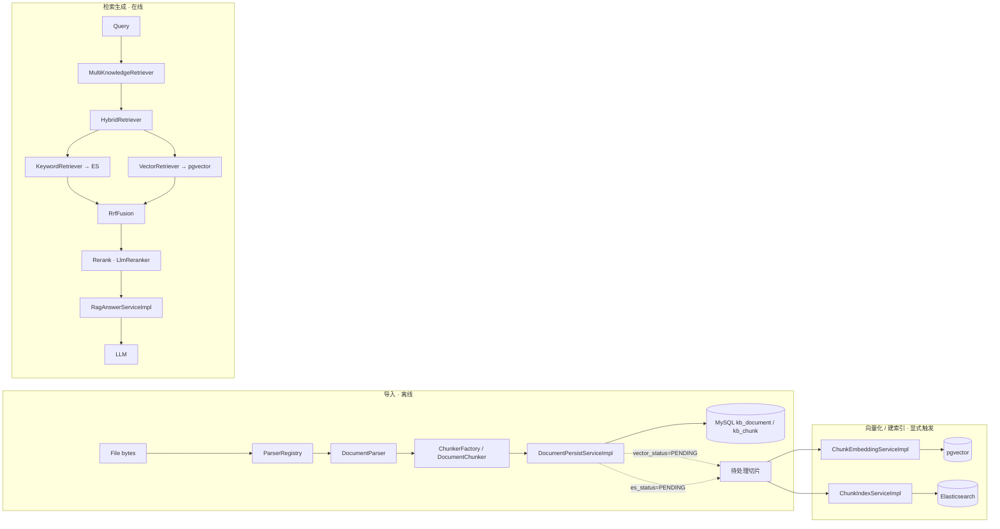

# RAG 子系统

> 本文只记录**已在代码中实现**的 RAG 行为。每一条关键结论都附带 `文件:行号` 证据；凡未在代码中确认者，标注为「未确认」或不予收录。
>
> 证据标注约定：`相对路径:行号`，路径以仓库根 `D:\develop\Prisma` 为基准。行号对应当前分支 (`platform-phase3`) 的代码状态。

---

## 0. 全景

RAG 在本仓库分为两段**互不连续**的过程：**导入（离线）** 与 **检索生成（在线）**。关键点在于：导入结束**不会**自动触发向量化与索引，见 §1.6。

---

## 1. 文档导入

### 1.1 链路与职责

| 阶段 | 类 | 路径 | 说明 |
| --- | --- | --- | --- |
| 解析分派 | `ParserRegistry` | `nexus-knowledge/.../parser/ParserRegistry.java` | 按扩展名查找解析器，未命中抛 3005 |
| 解析 | `DocumentParser` SPI | `nexus-knowledge/.../parser/DocumentParser.java` | 接口；解析失败抛 3004 |
| 分块 | `ChunkerFactory` / `DocumentChunker` | `nexus-knowledge/.../chunk/` | 按 `ChunkStrategy` 选策略 |
| 持久化 | `DocumentPersistServiceImpl` | `nexus-knowledge/.../service/impl/DocumentPersistServiceImpl.java` | 写 `kb_document` / `kb_chunk`，状态置 `READY` |
| 向量化 | `ChunkEmbeddingServiceImpl` | `nexus-knowledge/.../service/impl/ChunkEmbeddingServiceImpl.java` | 单独触发，见 §1.6 |
| 建索引 | `ChunkIndexServiceImpl` | `nexus-knowledge/.../service/impl/ChunkIndexServiceImpl.java` | 单独触发，见 §1.6 |

`DocumentParser.extensions()` 是「支持哪些扩展名」的唯一事实来源（`parser/DocumentParser.java:27`）；`ParserRegistry.supportedExtensions()` 聚合全部解析器（`parser/ParserRegistry.java:45-51`），`requireParser` 未命中抛 `3005 FILE_TYPE_UNSUPPORTED`（`parser/ParserRegistry.java:31-37`）。

### 1.2 按格式的解析类

| 格式 | 扩展名 | 解析类 | 要点 |
| --- | --- | --- | --- |
| Markdown | `md`, `markdown` | `MarkdownDocumentParser` | frontmatter、标签、wikilinks、附件；跳过代码围栏 (`:102-138`) |
| TXT | `txt`, `text`, `log` | `TxtDocumentParser` | 纯文本 |
| PDF | `pdf` | `PdfDocumentParser` | PDFBox；**不生成标题**；保留 `pageOffsets` (`:98-100`)；扫描件 PDF 解析失败 (`:85-88`) |
| DOCX | `docx` | `DocxDocumentParser` | POI；标题优先级 outlineLvl > 样式名 (`:137-166`)；表格转 Markdown |
| ZIP / Obsidian Vault | `zip` | `VaultPackageExtractor`（非 `DocumentParser`） | 见 §1.3 |

扩展名分别见：`MarkdownDocumentParser.java:43`、`TxtDocumentParser.java:19`、`PdfDocumentParser.java:46`、`DocxDocumentParser.java:50`。

### 1.3 ZIP / Obsidian Vault

ZIP **不是**一种 `DocumentParser`。它由 `imports/VaultPackageExtractor.java` 在内存中展开，逐条目分派给对应解析器。安全与限额：

- 拒绝 Zip Slip（路径穿越）。
- 跳过隐藏文件、不支持扩展名、空文件。
- 限额见 `imports/VaultScanOptions.java:18-20`：最多 5000 个条目、单文件 20MB、总量 200MB（ZIP bomb 防护）。

Obsidian Vault 即「ZIP 包中的一批 Markdown」，逐笔记由 `MarkdownDocumentParser` 解析。

### 1.4 异步导入（RabbitMQ）

| 组件 | 路径 | 行为 |
| --- | --- | --- |
| 配置 | `infra/messaging/RabbitImportConfig.java` | exchange / queue / DLX |
| 监听 | `infra/messaging/ImportTaskListener.java:32-41` | 消费任务并执行 |
| 异步发布 | `infra/messaging/RabbitImportTaskPublisher.java:30-33` | 投递任务 |
| 同步回退 | `infra/messaging/SynchronousImportTaskPublisher.java:25,37-40` | `nexus.import.mode=sync` 时同线程执行 |

### 1.5 任务状态机与失败处理

`imports/ImportTaskExecutor.java` 负责执行：CAS 抢占任务 (`:77-78,131-142`)、四阶段流水线 (`:189-288`)、**逐文件失败隔离** (`:371-391`)、最终状态收敛为 `DONE` / `PARTIAL` / `FAILED` (`:307-310`)。状态取值见 `V5__chunk_and_import_task.sql:45,68`。

- **增量同步**：以 SHA-256 `file_hash` + `content_hash` 判定文件是否变化，从而决定 save / updateMetadataOnly / relocate（`DocumentPersistServiceImpl`）。
- **失败原因暴露**：`kb_import_task_item` 记录逐条目失败原因，通过任务查询接口返回。
- **重试入口**：`KnowledgeImportServiceImpl` 仅允许对 `PARTIAL` / `FAILED` 且暂存区仍存在的任务重试 (`:159-178`)。

### 1.6 关键事实：导入不触发嵌入 / 索引

`DocumentPersistServiceImpl` 把文档状态置为 `READY`，但把每个切片的 `vector_status` / `es_status` 初始化为 `PENDING` (`:337-340,427-430`)。全仓库**没有** `@EventListener` / `afterCommit` 之类的导入后钩子（已全局检索确认）。因此：

- 向量化仅由 `POST /api/knowledge-bases/{id}/embed` 显式触发（`KnowledgeEmbeddingController.java`，`ChunkEmbeddingServiceImpl.embedPendingChunks` 挑 `vector_status=PENDING`，`:86-90`；失败保持 `PENDING`，`:100-104`）。
- 建索引仅由搜索/工作流路径触发（`ChunkIndexServiceImpl.indexPendingChunks` 挑 `es_status=PENDING`，`:70-74`）。
- 对话入口仅有三处：`KnowledgeEmbeddingController`、`KnowledgeSearchController`、`WorkflowService` (`:96,107`，经 `WorkflowController.java:28` 暴露，受配置门控可降级)。

> 换言之：**导入成功 ≠ 可检索**。必须再跑向量化与建索引。这是设计现状，不是缺陷，但常被误解。

---

## 2. Hybrid Search（混合检索）

### 2.1 通道

| 通道 | 类 | 数据源 | SOURCE 标记 |
| --- | --- | --- | --- |
| 关键词 | `KeywordRetriever` | Elasticsearch BM25 | `"bm25"` (`:34`) |
| 向量 | `VectorRetriever` | pgvector 余弦 | `"vector"` |
| 融合入口 | `HybridRetriever` | 两路召回后融合 | `RecallSupport.fuse` (`:79-85`) |

`HybridRetriever` 对每个知识库解析过滤计划，`matchNothing` 时跳过该路 (`:74-78`)。

### 2.2 Elasticsearch 侧

索引映射见 `infra/search/ElasticsearchChunkIndex.java`：

- 分词器：索引用 `ik_max_word`，查询用 `ik_smart` (`:62-63,280-302`)。
- 字段权重：`title^3` / `heading_path^2` / `content^1` (`:159-160`)。
- 元数据过滤子句在 `:200-227`（见 §4）。

### 2.3 pgvector 侧

`infra/vector/PgVectorStore.java`：余弦相似度 SQL 为 `1 - (embedding <=> CAST(? AS vector))` (`:104-127`)；SQL 中已含 `document_id IN (...)`；`minScore` 是**唯一的事后过滤**（内存中，`:83-88`）。

### 2.4 RRF 融合

`nexus-common/.../search/RrfFusion.java`：

- `DEFAULT_K = 60` (`:26`)。
- 得分 = Σ `1.0 / (k + rank)` (`:108-109`)。
- 排序：先按得分，再按 `chunkId` 保证稳定 (`:57-59`)。
- 融合后按 topK 截断。

`RecallSupport.merge` 在单列表时走快速路径，原样返回 (`:107-109`)。查询参数上限见 `nexus-ai/.../RetrievalQuery.java:43-65`：`MAX_TOP_K=100`、`DEFAULT_TOP_K=5`、`MAX_CANDIDATES=200`、`RECALL_MULTIPLIER=3`、`DEFAULT_SIMILARITY_THRESHOLD=0.25`。

### 2.5 Rerank

`nexus-ai/.../rag/LlmReranker.java`：

- **是 LLM**，不是本地模型：以 `CHAT_JUDGE` 角色调用 (`:96`)。
- 开关 `nexus.rag.rerank-enabled`，默认 `true`；超时键 `nexus.rag.rerank-timeout-ms`。
  **注意两个默认值不同，别读错**：`LlmReranker.java:61` 的 `@Value` 兜底是 `12000`，但
  `nexus-app/src/main/resources/application.yml:198` 把它覆盖成 `5000`——**实际生效的是 5 秒**。
  代码兜底只在配置完全缺席时才有意义。
- `MAX_CANDIDATES=20` (`:35`)。
- **降级语义**：失败或超时返回空列表 → 调用方退回召回顺序。

> **常见误解纠正**：`rag/retriever/RerankedRetriever.java` 是装饰器（`RERANK_CANDIDATES=8`，`:50`），但它目前**处于休眠状态**——没有任何调用方接线。真正的 rerank 由 `RagAnswerServiceImpl` 直接调用（`:142-145`，`RERANK_CANDIDATES=8`，`:60`）。即：**端口有了，但没接线**。

---

## 3. Multi-KB Retrieval（多知识库检索）

`nexus-ai/.../rag/retriever/MultiKnowledgeRetriever.java`：

| 场景 | 执行方式 | 证据 |
| --- | --- | --- |
| 单知识库 | 在**调用线程**执行，不设超时 | `:110-118` |
| 多知识库 | **虚拟线程**扇出，`invokeAll(tasks, timeout)` | `:217-219` |

- 执行器为 `Executors.newVirtualThreadPerTaskExecutor`，并做 TCCL + MDC 传播。
- 超时 `nexus.retrieval.fanout-timeout`，默认 10 秒（`nexus-ai/.../RetrievalDefaults.java:76-77`）。
- **按输入顺序装配**结果 (`:148-178`)。原因有二：(a) 结果稳定排序；(b) 检索过程**不能并发写 SSE 监听器**。
- **逐库失败隔离**：单库失败不拖垮整批，记录 `RetrievalFailure`（`rag/retriever/RetrievalFailure.java:20-25`，含 `knowledgeBaseId/knowledgeBaseName/reason` 与 `displayName`），并计数 `retrieval.kb.failed` (`:190`；常量见 `nexus-common/.../observe/ObservabilityRegistry.java:73`)。
- **全部失败**：抛出原始异常（保留首个根因），不吞错 (`:181-182,266-283`)。

### 3.1 不被隔离的失败

| 失败类型 | 行为 | 原因 |
| --- | --- | --- |
| 归属校验失败（3001） | 整批失败 | 越权属于请求级错误，不应降级掩盖 |
| 嵌入模型不一致 | 整批失败 | 向量空间不可比，部分检索结果无意义 |

其余（单库网络/超时/空结果等）按 §3 逐库隔离。

---

## 4. Metadata Filtering（元数据过滤）

**原则：过滤必须留在检索 / SQL 层，绝不事后在内存里筛。** 唯一的事后过滤是 `minScore`（§2.3）。

### 4.1 谁过滤什么

| 维度 | ES 侧 | pgvector 侧 |
| --- | --- | --- |
| `tags` | boolean `filter` → `terms` | 表无此列 |
| `folder` | `term` + `prefix` | 表无此列 |
| `documentIds` | `terms` | `AND document_id IN (...)` |
| `kbId` | 过滤子句 | 表列 `kb_id` |
| `userId`（隔离） | 写入查询条件 | 写入查询条件 |

ES 侧过滤子句见 `ElasticsearchChunkIndex.java:200-227`。

### 4.2 tags / folder 的解析

pgvector 表只有 `kb_id` / `document_id` 两列，因此 `tags` / `folder` 先在关系库中经 `nexus-ai/.../rag/retriever/RetrievalFilterResolver.java` 解析为 `document ids`（tags / folder / documentIds 取**交集**，`:63-86,128-146`），再以 `AND document_id IN (...)` 下推。

- 若解析结果为空 → `FilterPlan.nothing()` 显式短路为空，**不静默丢弃某个条件**（`:128-146`）。这一点是刻意的：丢条件会导致越权/错配。

### 4.3 用户隔离

`KnowledgeBaseServiceImpl` 的 `requireOwned` (`:260-272`) / `requireAllOwned` (`:275-311`) 把 `user_id` 写入查询，越权时抛 `404` / `3001`（文案「知识库不存在或无权访问」，`:305-306`）。控制器始终使用 `CurrentUser.requireId()`，**绝不信任前端传入的 kbId**（`KnowledgeImportController.java:66,88,94,109,115`）。

---

## 5. No-hit 行为（无命中）

无命中指召回为空（或过滤后为空）。不同路径行为**不同**：

| 路径 | 是否调用模型 | 证据 |
| --- | --- | --- |
| RAG：`/api/knowledge-bases/*/ask`、`ask/stream` | **否**，短路 | `RagAnswerServiceImpl.java:132-135,149-152,266-270`；`RagStreamServiceImpl.java:79-90` |
| 聊天 RAG 模式 | **否**，`finishWithoutModel` | `ChatStreamServiceImpl.java:194-202,380-389` |
| Agent 模式 | **是** | 检索是一个工具，零命中成为一条工具观测，循环继续 |
| PLAIN 模式 | **是** | 不做检索 |

RAG 路径短路时返回固定文案 `RagAnswerService.EMPTY_ANSWER`。

### 5.1 answerPolicy

`answerPolicy` 取值 `KB_PREFERRED`（默认）/ `KB_ONLY`，存储于 `V14__agent_answer_policy.sql:28-30`（`answer_policy VARCHAR(16) NOT NULL DEFAULT 'KB_PREFERRED'`）。

- 仅在**提示层**强制：`nexus-app/.../agent/AgentPrompts.java`，`systemPromptFor` (`:109-111`) 与 `policyBlock` (`:114-119`)。
- 只在 **Agent 路径**生效。

> 这是**提示词约束，不是代码级断言**。`KB_ONLY` 下若模型仍引用了知识库外内容，代码不会拦截。

---

## 6. 引用（Citation）

`nexus-ai/.../rag/Citations.java`：

- 用正则识别正文中的 `[n]` 标记 (`:20`)。
- `build` 生成 `RagCitation{chunkId, documentId, title, headingPath, snippet, score, referenced}`，并标记哪些编号真正被引用 (`:25-36`)。
- 持久化到 `kb_qa_record.citations`（`V7__qa_record.sql:18`，`citations MEDIUMTEXT`）。写入发生在 `RagAnswerServiceImpl` 的 `finish` (`:410`)。

### 6.1 已知缺口（诚实记录）

| 缺口 | 证据 |
| --- | --- |
| KB `ask` 路径：citations **完整持久化** | `RagAnswerServiceImpl.java:410` |
| 多知识库 chat-stream 路径：**既不持久化 citations，也不发送最终 citation 列表** | `ChatStreamServiceImpl` 的 `persist` 只写内容 (`:490-513`) |
| `ChatAnswerResponse` **没有** citations 字段 | `chat/model/dto/ChatAnswerResponse.java:9-18`（且 `:7` 的 javadoc 已过时） |
| `citation` SSE 事件**未实现** | `chat/stream/SseEventNames.java:12,36`（已声明未使用）；`docs/api.md:480,512` 亦标注「Phase 3 预留，仍未实现」 |

---

## 7. 已知边界汇总

| # | 边界 | 性质 | 证据 |
| --- | --- | --- | --- |
| 1 | 导入后**不自动**向量化 / 建索引，需显式触发 | 设计现状 | `DocumentPersistServiceImpl.java:337-340,427-430`；无 post-import 钩子 |
| 2 | `RerankedRetriever` 装饰器**休眠**，rerank 在 `RagAnswerServiceImpl` 直调 | 部分实现（端口未接线） | `RerankedRetriever.java:50`；`RagAnswerServiceImpl.java:142-145` |
| 3 | chat-stream 多知识库路径**不持久化 / 不返回** citations | 尚未实现 | `ChatStreamServiceImpl.java:490-513`；`ChatAnswerResponse.java:9-18` |
| 4 | `citation` SSE 事件**未实现** | 尚未实现 | `SseEventNames.java:12,36`；`docs/api.md:480,512` |
| 5 | `answerPolicy` 仅在提示层生效，无代码级断言 | 设计如此 | `AgentPrompts.java:109-119` |
| 6 | 归属校验失败 / 嵌入模型不一致**不隔离**，整批失败 | 设计如此 | `MultiKnowledgeRetriever.java:181-182,266-283` |
| 7 | 扫描件 PDF 无 OCR，直接解析失败 | 设计现状 | `PdfDocumentParser.java:85-88` |
| 8 | PDF 解析**不生成标题** | 设计现状 | `PdfDocumentParser.java:98-100` |

「未确认」：无明显未确认项。本文所有结论均已在当前代码中核对。

---

## 8. 关键类索引

| 类 | 职责 | 路径 |
| --- | --- | --- |
| `DocumentParser` | 解析 SPI | `nexus-knowledge/.../parser/DocumentParser.java` |
| `ParserRegistry` | 解析器注册与分派 | `nexus-knowledge/.../parser/ParserRegistry.java` |
| `MarkdownDocumentParser` | MD 解析 | `nexus-knowledge/.../parser/MarkdownDocumentParser.java` |
| `TxtDocumentParser` | TXT 解析 | `nexus-knowledge/.../parser/TxtDocumentParser.java` |
| `PdfDocumentParser` | PDF 解析 | `nexus-knowledge/.../parser/PdfDocumentParser.java` |
| `DocxDocumentParser` | DOCX 解析 | `nexus-knowledge/.../parser/DocxDocumentParser.java` |
| `VaultPackageExtractor` | ZIP / Vault 展开 | `nexus-knowledge/.../imports/VaultPackageExtractor.java` |
| `ImportTaskExecutor` | 导入任务执行 | `nexus-knowledge/.../imports/ImportTaskExecutor.java` |
| `KnowledgeImportServiceImpl` | 导入入队 / 重试 | `nexus-knowledge/.../service/impl/KnowledgeImportServiceImpl.java` |
| `DocumentPersistServiceImpl` | 文档 / 切片持久化 | `nexus-knowledge/.../service/impl/DocumentPersistServiceImpl.java` |
| `ChunkEmbeddingServiceImpl` | 向量化 | `nexus-knowledge/.../service/impl/ChunkEmbeddingServiceImpl.java` |
| `ChunkIndexServiceImpl` | ES 建索引 | `nexus-knowledge/.../service/impl/ChunkIndexServiceImpl.java` |
| `ChunkerFactory` | 分块策略选择 | `nexus-knowledge/.../chunk/ChunkerFactory.java` |
| `MultiKnowledgeRetriever` | 多库扇出 / 隔离 | `nexus-ai/.../rag/retriever/MultiKnowledgeRetriever.java` |
| `HybridRetriever` | 混合召回 + RRF | `nexus-ai/.../rag/retriever/HybridRetriever.java` |
| `KeywordRetriever` | ES BM25 召回 | `nexus-ai/.../rag/retriever/KeywordRetriever.java` |
| `VectorRetriever` | pgvector 召回 | `nexus-ai/.../rag/retriever/VectorRetriever.java` |
| `RetrievalFilterResolver` | 元数据过滤解析 | `nexus-ai/.../rag/retriever/RetrievalFilterResolver.java` |
| `RetrievalFailure` | 失败记录 | `nexus-ai/.../rag/retriever/RetrievalFailure.java` |
| `RerankedRetriever` | Rerank 装饰器（休眠） | `nexus-ai/.../rag/retriever/RerankedRetriever.java` |
| `LlmReranker` | LLM Rerank | `nexus-ai/.../rag/LlmReranker.java` |
| `RagAnswerServiceImpl` | RAG 同步作答 | `nexus-ai/.../rag/RagAnswerServiceImpl.java` |
| `RagStreamServiceImpl` | RAG 流式作答 | `nexus-ai/.../rag/RagStreamServiceImpl.java` |
| `Citations` | `[n]` 引用解析 | `nexus-ai/.../rag/Citations.java` |
| `RrfFusion` | RRF 融合 | `nexus-common/.../search/RrfFusion.java` |
| `ElasticsearchChunkIndex` | ES 映射 / 检索 | `nexus-app/.../infra/search/ElasticsearchChunkIndex.java` |
| `PgVectorStore` | pgvector 存储 / 检索 | `nexus-app/.../infra/vector/PgVectorStore.java` |
| `KnowledgeSearchTool` | Agent 检索工具 | `nexus-app/.../agent/KnowledgeSearchTool.java` |
| `AgentPrompts` | 策略提示词 | `nexus-app/.../agent/AgentPrompts.java` |
| `KnowledgeBaseServiceImpl` | 归属校验 / 隔离 | `nexus-knowledge/.../service/impl/KnowledgeBaseServiceImpl.java` |
| `ChatStreamServiceImpl` | 聊天流式（RAG 模式） | `nexus-app/.../chat/service/impl/ChatStreamServiceImpl.java` |
